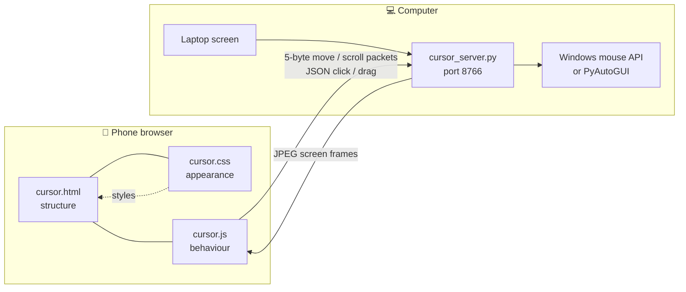
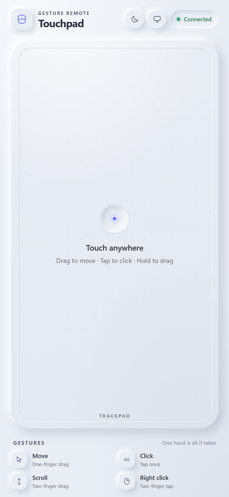
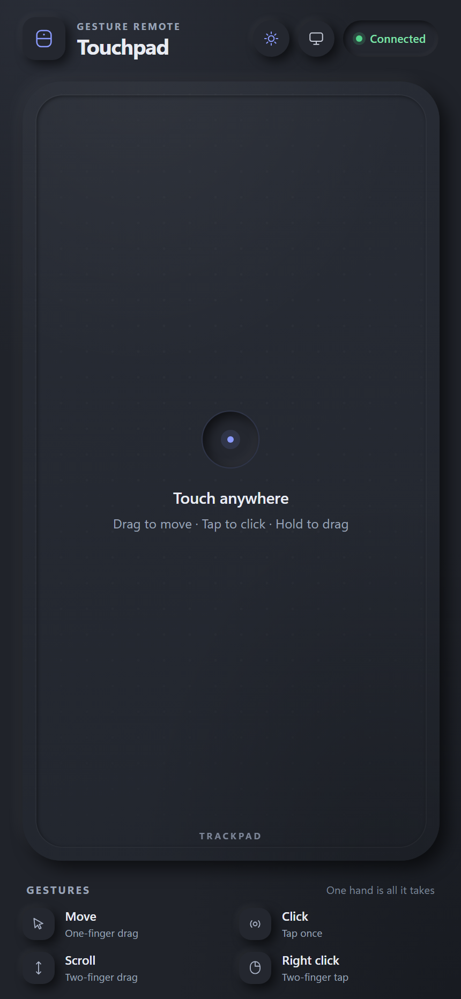
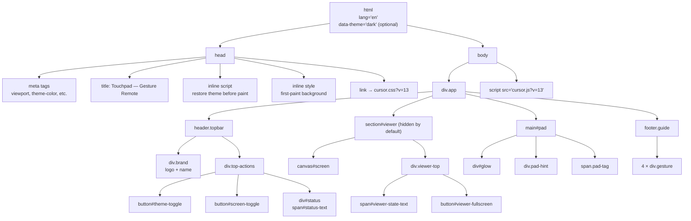
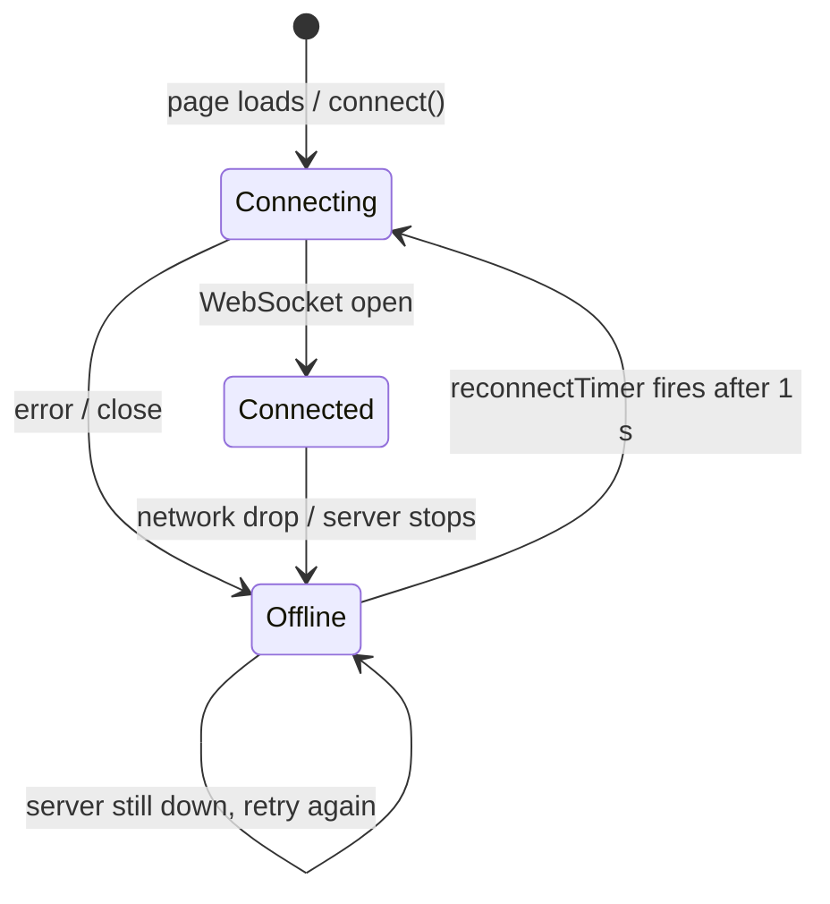
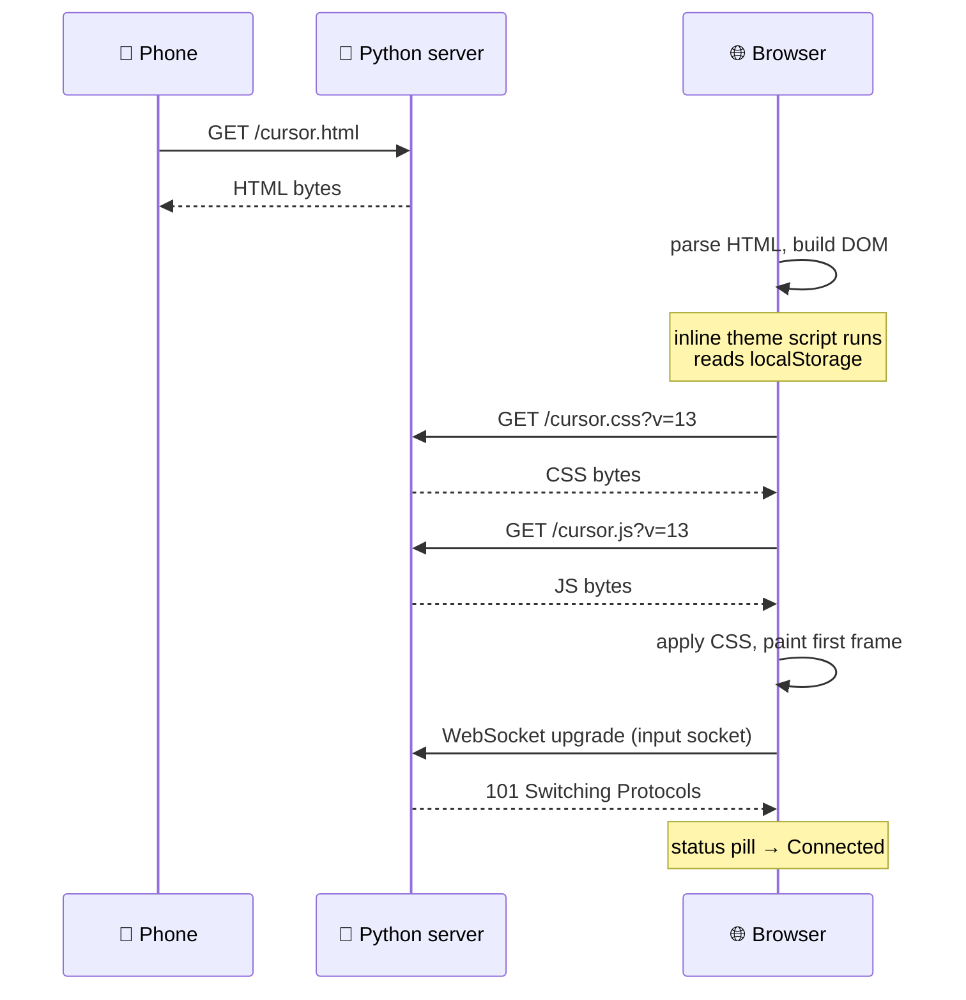

# The Phone Screen, Explained From Zero
## A line-by-line guide to `cursor.html` (and `cursor.css`)

> **Who this is for:** someone who has never built a web page. No question is too basic.
>
> **What this file covers:** every line of `cursor.html` (173 lines) and every block of
> `cursor.css` (1018 lines). The CSS is included here because HTML and CSS are two halves
> of the same thing: HTML is the skeleton, CSS is the skin.
>
> **How to read it:** keep the real file open beside this guide. The line numbers here
> match the real file exactly.

---

## 0. The three-second summary

`cursor.html` is the **phone screen** of the project.

It contains:

1. A header with the project name, a dark-mode button, a screen-preview button, and a
   connection status light.
2. An optional area that shows a live picture of the computer screen.
3. A giant touchpad area.
4. A small guide showing the four gestures.

`cursor.css` makes all of that look like a soft, rounded, physical trackpad, and gives it a
light and a dark theme.

Nothing here moves the mouse by itself. The HTML and CSS are the **remote control case**.
The JavaScript (`cursor.js`) is the **buttons and wires**, and Python
(`cursor_server.py`) is the **hand that actually moves the computer mouse**.

---

## 1. The big picture



A useful analogy:

| Part | Analogy | Job |
| --- | --- | --- |
| `cursor.html` | Skeleton | Says *what* exists on the page |
| `cursor.css` | Clothes and paint | Says *what it looks like* |
| `cursor.js` | Nervous system | Says *what happens when you touch* |
| `cursor_server.py` | Hands | Actually moves the computer mouse |

If you delete the HTML, there is no page.
If you delete the CSS, the page still works but looks like a plain document from 1995.
If you delete the JavaScript, the page loads but no button or gesture does anything.
If you delete the Python server, the page cannot even be served (unless you open the HTML
file directly), and no mouse action happens.

---

## 2. What the finished page looks like

These are **real screenshots**, captured from the running project in a mobile-sized
browser window — not drawings.

### Light theme



### Dark theme



The only difference between these two images is one attribute on the `<html>` element:
`data-theme="dark"`. The CSS swaps a palette of colour variables. The structure does not
change at all.

---

## 3. HTML in one minute

HTML is written as **elements**. Most elements look like this:

```html
<tag attribute="value">content</tag>
```

- `<tag>` is the opening tag.
- `</tag>` is the closing tag.
- `attribute="value"` gives extra information to the browser.
- Everything between the tags is the element's content.

Some elements have no closing tag, such as `<meta>` and `<link>`. They are called **void
elements**.

The browser reads the file from top to bottom and builds a tree in memory called the
**DOM** (Document Object Model). JavaScript later searches that tree by `id`.

---

## 4. The DOM tree of this page



The IDs in this tree are the contract between HTML and JavaScript. The next table is the
most important table in this document.

### 4.1 Every ID and who uses it

| ID | Element | Used by `cursor.js` for | What breaks if the ID is renamed |
| --- | --- | --- | --- |
| `theme-color` | `<meta>` | Changing the phone browser's top bar colour | The browser chrome keeps the old colour after a theme switch |
| `theme-toggle` | `<button>` | Click listener and ARIA update | The theme button stops working; `themeToggle` is `null` |
| `screen-toggle` | `<button>` | Opening/closing the viewer | The screen button stops working |
| `status` | `<div>` | `dataset.state` for the coloured dot | The pill never changes colour or text |
| `status-text` | `<span>` | Writing "Connecting" / "Connected" | You see the dot but no words |
| `viewer` | `<section>` | Showing/hiding and fullscreen | The screen preview cannot open; `viewer` is `null` |
| `screen` | `<canvas>` | Drawing JPEG frames | The server stream has nowhere to draw |
| `viewer-state-text` | `<span>` | "Connecting" / "Live" / "No signal" | The small badge over the screen goes blank |
| `viewer-fullscreen` | `<button>` | Fullscreen button | Tapping the button throws an error |
| `pad` | `<main>` | All touch listeners | The touchpad is dead; first line of JS crashes |
| `glow` | `<div>` | Moving the finger glow | `glowEl.style` throws; gesture events break |

> **Rule for beginners:** in JavaScript, `document.getElementById("pad")` returns `null` if
> the ID does not exist. The very next line that tries to use it (`pad.addEventListener`)
> throws `TypeError: Cannot read properties of null`. One wrong ID can stop the whole
> script.

---

## 5. `cursor.html` line by line

The file has 173 lines. The ranges below cover **every line**.

### 5.1 Lines 1–14: the document declaration and `<head>` metadata

```html
1:  <!DOCTYPE html>
2:  <html lang="en">
3:  <head>
4:      <meta charset="UTF-8">
5:      <meta name="viewport" content="width=device-width, initial-scale=1, maximum-scale=1, user-scalable=no, viewport-fit=cover">
6:      <meta id="theme-color" name="theme-color" content="#e9edf4">
7:      <meta name="apple-mobile-web-app-capable" content="yes">
8:      <meta name="mobile-web-app-capable" content="yes">
9:      <meta name="apple-mobile-web-app-status-bar-style" content="default">
10:     <meta name="apple-mobile-web-app-title" content="Touchpad">
11:     <meta name="description" content="Turn your phone into a precision trackpad for your computer.">
12:     <title>Touchpad — Gesture Remote</title>
13:     <link rel="icon" href="data:image/svg+xml,...">
14:
```

| Line(s) | Code | Plain-English meaning | What happens if it is missing or changed |
| --- | --- | --- | --- |
| 1 | `<!DOCTYPE html>` | Tells the browser "this is modern HTML5". | The browser may use "quirks mode", where old CSS rules apply and sizes behave strangely. Always keep it. |
| 2 | `<html lang="en">` | The root element. `lang` tells screen readers and search engines the page language. | Without `lang`, a screen reader may pronounce text with the wrong accent. The page still works. |
| 3 | `<head>` | Starts the invisible information section. | Without it, the browser auto-creates one. Still works, but messy. |
| 4 | `<meta charset="UTF-8">` | The character set. UTF-8 can store every language and emoji. | The em dash `—` in the title, the `·` in the hint, and the `≤` symbols might appear as `â€"` garbage. |
| 5 | `<meta name="viewport" ...>` | The phone should use its real width and should not let the user pinch-zoom the page. `viewport-fit=cover` lets the page extend under a notch. | The most visible beginner bug: the phone pretends to be 980 px wide, the page looks tiny and zoomed out. Removing `user-scalable=no` allows accidental pinch-zoom while using the pad. |
| 6 | `<meta id="theme-color" ... content="#e9edf4">` | Paints the phone browser's address bar / status area light grey. The `id` lets JavaScript change it. | The bar stays light while the page is dark, which looks broken. Removing the ID makes `themeColorMeta` `null`; the code guards against that, so it does not crash. |
| 7 | `apple-mobile-web-app-capable` | Old iOS hint: allow "Add to Home Screen" to open without Safari's normal toolbars. | No crash; you simply get a normal browser tab instead of an app-like window. |
| 8 | `mobile-web-app-capable` | The standard version of the same hint for other browsers. | Same as above. |
| 9 | `apple-mobile-web-app-status-bar-style` | Ask iOS to use a normal (not black) status bar. | The status bar may look inconsistent with the light theme. |
| 10 | `apple-mobile-web-app-title` | The name shown under the icon if installed to the home screen. | The phone may use the page `<title>` instead. |
| 11 | `description` | A summary for search engines and link previews. | Nothing functional; link previews are less clear. |
| 12 | `<title>Touchpad — Gesture Remote</title>` | The browser tab name. | The tab shows the URL or "Untitled"; confusing but functional. |
| 13 | `<link rel="icon" ...>` | An inline SVG favicon: a tiny rounded rectangle that looks like a trackpad. | The browser requests `/favicon.ico`, and because the server has no file for it, you get a harmless 204 or a blank icon. |
| 14 | blank | Separates the head metadata from the theme script. | Nothing. |

**A beginner trap:** line 5 makes the page unzoomable. That is intentional for a touchpad,
because a two-finger gesture must scroll the *computer*, not zoom the *phone page*. Do not
copy this line into a normal article or shop page — accessibility guidelines usually want
zoom to remain available.

### 5.2 Lines 15–28: the theme bootstrap (the anti-flash script)

```html
15:     <script>
16:         // Apply a saved dark theme before the stylesheet paints, so there is
17:         // no bright flash when the page opens in dark mode.
18:         (() => {
19:             try {
20:                 if (localStorage.getItem("touchpad-theme") === "dark") {
21:                     document.documentElement.dataset.theme = "dark";
22:                     document.getElementById("theme-color").content = "#20232a";
23:                 }
24:             } catch (error) {
25:                 // Storage can be blocked (private mode); light stays the default.
26:             }
27:         })();
28:     </script>
```

| Line(s) | Code | Plain-English meaning | What happens if it is missing or changed |
| --- | --- | --- | --- |
| 15 | `<script>` | Starts a small block of JavaScript inside the HTML. | Without the script, the page cannot restore the saved theme early. |
| 16–17 | `// ...` | Comments for humans. The browser ignores them. | Nothing. |
| 18 | `(() => {` | An **immediately invoked function expression** (IIFE): a function that runs the moment it is defined. It keeps `error` and any variables out of the global scope. | If you remove it, the code still runs, but you leak variables globally and risk name clashes. |
| 19 | `try {` | "Try the next lines; if anything throws, jump to `catch`." | Without it, a blocked `localStorage` can throw a `SecurityError` and stop this script. The page would still render, but the early theme restore fails. |
| 20 | `if (localStorage.getItem("touchpad-theme") === "dark") {` | Read the saved setting. Only "dark" triggers dark mode; anything else means light. | If the key is renamed, the saved choice is forgotten. If you compare with `=` instead of `===`, you assign instead of compare, which is a bug. |
| 21 | `document.documentElement.dataset.theme = "dark";` | `document.documentElement` is `<html>`. `dataset.theme` writes `data-theme="dark"`. CSS uses that attribute to switch palettes. | No attribute → CSS stays light. This is the line that actually prevents the white flash. |
| 22 | `document.getElementById("theme-color").content = "#20232a";` | Updates the browser bar colour to dark grey. | If the meta tag is missing, this line throws. Because it is inside `try`, the catch swallows the error. |
| 23 | `}` | Ends the `if`. | Syntax error if removed. |
| 24 | `} catch (error) {` | Handles any error from the `try` block. | Without it, private-mode storage errors become visible console errors, and dark restore stops. |
| 25 | `// Storage can be blocked...` | Explains the catch. | Nothing. |
| 26 | `}` | Ends the catch. | Syntax error if removed. |
| 27 | `})();` | Calls the arrow function immediately. | Without the final `()`, the function is defined but never run; dark mode flashes. |
| 28 | `</script>` | Ends the inline script. | The rest of the HTML would be parsed as script text. |

**Why this must be in `<head>` and not at the bottom:** the browser paints the page as soon
as it has enough HTML and CSS. If the theme were applied only after `cursor.js` loaded at
the bottom, the user would see a white page for a moment, then a dark page — the infamous
"flash of incorrect theme".

**The "each possibility" table for this script:**

| Situation | What happens |
| --- | --- |
| No saved value | `getItem` returns `null`; the page stays light. |
| Saved value is `"dark"` | The `data-theme="dark"` attribute is set before CSS paints; no flash. |
| Saved value is `"light"` | Nothing happens; light is the CSS default. |
| `localStorage` is full or blocked | The `try/catch` catches it; the page still loads, but the theme choice cannot be read. |
| JavaScript is disabled | The inline script does not run; the page is always light, but the content is still visible. |
| The browser is extremely old and lacks `dataset` | The script throws; the catch keeps the page alive. |

### 5.3 Lines 29–34: the first-paint background

```html
29:
30:     <style>
31:         /* First paint only; the stylesheet takes over immediately after. */
32:         html { background: #e9edf4; }
33:         html[data-theme="dark"] { background: #20232a; }
34:     </style>
```

| Line(s) | Code | Meaning | If missing/changed |
| --- | --- | --- | --- |
| 29 | blank | Spacing. | Nothing. |
| 30 | `<style>` | Starts a tiny inline stylesheet. | The browser may paint a white background before `cursor.css` arrives. |
| 31 | comment | Explains that this is only for the first moment. | Nothing. |
| 32 | `html { background: #e9edf4; }` | The light background colour, identical to the CSS variable `--bg`. | A white flash on slow connections. |
| 33 | `html[data-theme="dark"] { background: #20232a; }` | The dark background, applied only when the attribute exists. | Dark users see a light flash before the main stylesheet loads. |
| 34 | `</style>` | Ends the inline style. | The rest of the document could be treated as CSS text. |

The main stylesheet is linked on line 36. This tiny style is a **bridge**: it covers the
milliseconds between "HTML starts painting" and "CSS file has downloaded".

### 5.4 Lines 36–37: the stylesheet link

```html
36:     <link rel="stylesheet" href="cursor.css?v=13">
37: </head>
```

| Line | Code | Meaning | If missing/changed |
| --- | --- | --- | --- |
| 36 | `<link rel="stylesheet" href="cursor.css?v=13">` | Downloads and applies the main stylesheet. The `?v=13` is a **cache buster**: a new query string makes the phone fetch the new file instead of a stale saved copy. | Without CSS: a plain white page with default fonts, no rounded pad, no layout, and the canvas shows at its default 300×150 size. If you change CSS but do not change `v=13`, phones may keep the old design. |
| 37 | `</head>` | Ends the invisible head section. | The browser auto-closes it; still works. |

> **Cache-busting explained:** browsers save CSS and JS to make pages faster. That is good
> in production, but bad while developing: you edit `cursor.css`, reload the phone, and see
> the old design. Bumping `?v=13` to `?v=14` in both the HTML and the script tag forces a
> fresh download.

### 5.5 Lines 38–39: the body and the app container

```html
38: <body>
39:     <div class="app">
```

| Line | Code | Meaning | If missing/changed |
| --- | --- | --- | --- |
| 38 | `<body>` | Everything visible lives inside the body. | The browser creates one automatically; no crash. |
| 39 | `<div class="app">` | A flex column that holds the header, viewer, pad, and guide. CSS gives it a maximum width of 540 px and safe-area padding. | Without it, the page still shows the children, but they lose the column layout and the gap between sections. The pad would not fill the remaining height. |

The `class="app"` is not used by JavaScript. It is purely a CSS hook. If you rename it,
the page loses its layout but keeps working; this is the difference between an **ID** (a
unique JavaScript/HTML anchor) and a **class** (a reusable styling label).

### 5.6 Lines 40–54: the header and brand

```html
40:         <header class="topbar">
41:             <div class="brand">
42:                 <span class="brand-mark" aria-hidden="true">
43:                     <svg viewBox="0 0 24 24" fill="none">
44:                         <rect x="4" y="3" width="16" height="18" rx="5" stroke="currentColor" stroke-width="1.5"/>
45:                         <path d="M4.5 12h15" stroke="currentColor" stroke-width="1.5"/>
46:                         <circle cx="12" cy="7.5" r="1" fill="currentColor"/>
47:                     </svg>
48:                 </span>
49:                 <span class="brand-text">
50:                     <span class="eyebrow">Gesture Remote</span>
51:                     <h1>Touchpad</h1>
52:                 </span>
53:             </div>
54:
```

| Line(s) | Code | Meaning | If missing/changed |
| --- | --- | --- | --- |
| 40 | `<header class="topbar">` | Semantic header, styled as a flex row with space between the brand and the controls. | The content still appears, but without its position and spacing. |
| 41 | `<div class="brand">` | Groups the logo and the two text lines. | The logo and text may wrap separately. |
| 42 | `<span class="brand-mark" aria-hidden="true">` | A round soft-UI tile around the logo. `aria-hidden="true"` hides the decorative graphic from screen readers, so they do not announce meaningless shapes. | A screen reader may say "image" or "graphic" for no reason. The tile loses its shadow and size. |
| 43 | `<svg viewBox="0 0 24 24" fill="none">` | An inline SVG: a drawing made of shapes, not a bitmap. `viewBox` defines a 24×24 coordinate system that can scale to any size. | The logo does not render, leaving an empty tile. |
| 44 | `<rect x="4" y="3" width="16" height="18" rx="5" .../>` | A rounded rectangle — the body of the trackpad icon. `rx` is the corner radius. `currentColor` means "use the CSS text colour". | The icon loses its outer shape. |
| 45 | `<path d="M4.5 12h15" .../>` | A horizontal divider line in the icon: `M` = move to, `h15` = horizontal line 15 units. | The icon looks like a blank rectangle. |
| 46 | `<circle cx="12" cy="7.5" r="1" fill="currentColor"/>` | A small filled dot above the line, like a trackpad button. | The icon loses its dot. |
| 47 | `</svg>` | Ends the SVG. | The browser may treat later content as SVG. |
| 48 | `</span>` | Ends the logo tile. | Malformed DOM; browser auto-closes. |
| 49 | `<span class="brand-text">` | Groups the eyebrow and the title. | They lose their vertical stacking. |
| 50 | `<span class="eyebrow">Gesture Remote</span>` | Tiny uppercase label. CSS adds letter spacing and a muted colour. | The little label disappears. |
| 51 | `<h1>Touchpad</h1>` | The page's main heading. Important for accessibility and SEO. | Screen-reader users lose the page's main heading. The visual title disappears. |
| 52–53 | `</span></div>` | Close the text group and the brand row. | The browser auto-closes, but the nesting becomes fragile. |
| 54 | blank | Spacing. | Nothing. |

**SVG in one paragraph:** an SVG is written like HTML but draws shapes. `rect` is a
rectangle, `circle` is a circle, `path` is a freeform line. `viewBox="0 0 24 24"` means
"pretend the canvas is 24 units wide and 24 units tall". CSS then scales the whole thing
to 20×20 pixels. This is why the icon stays sharp on every screen density.

### 5.7 Lines 55–64: the theme toggle button

```html
55:             <div class="top-actions">
56:                 <button id="theme-toggle" class="icon-btn theme-toggle" type="button" aria-pressed="false" aria-label="Switch to dark mode" title="Switch to dark mode">
57:                     <svg class="icon-moon" viewBox="0 0 24 24" fill="none" aria-hidden="true">
58:                         <path d="M20.3 14.1A8.4 8.4 0 0 1 9.9 3.7 8.4 8.4 0 1 0 20.3 14.1Z" stroke="currentColor" stroke-width="1.5" stroke-linejoin="round"/>
59:                     </svg>
60:                     <svg class="icon-sun" viewBox="0 0 24 24" fill="none" aria-hidden="true">
61:                         <circle cx="12" cy="12" r="4" stroke="currentColor" stroke-width="1.5"/>
62:                         <path d="M12 2.9v2.2M12 18.9v2.2M21.1 12h-2.2M5.1 12H2.9M18.4 5.6l-1.5 1.5M7.1 16.9l-1.5 1.5M18.4 18.4l-1.5-1.5M7.1 7.1 5.6 5.6" stroke="currentColor" stroke-width="1.5" stroke-linecap="round"/>
63:                     </svg>
64:                 </button>
```

| Line(s) | Code | Meaning | If missing/changed |
| --- | --- | --- | --- |
| 55 | `<div class="top-actions">` | Groups the three controls on the right. | The controls scatter or wrap. |
| 56 | `<button id="theme-toggle" ... type="button" aria-pressed="false" aria-label="Switch to dark mode" title="...">` | A real button. `type="button"` prevents it from submitting a form (there is no form here, but it is good hygiene). `aria-pressed` tells screen readers whether the "dark mode" switch is currently on. `aria-label` is the spoken name. `title` is the hover tooltip. | **Rename the ID:** `themeToggle` is `null`, the click listener line throws, and no theme button works. **Remove `type`:** it defaults to `submit`; harmless here, dangerous in a form. **Remove `aria-label`:** a screen reader may read only "moon icon button", which is useless. |
| 57 | `<svg class="icon-moon" ... aria-hidden="true">` | The moon icon shown in light mode. CSS hides it in dark mode. | The moon may show in both themes or not at all, depending on CSS. |
| 58 | crescent `path` | An arc path that draws a crescent moon. | The moon icon becomes empty. |
| 59 | `</svg>` | Ends the moon. | Broken SVG nesting. |
| 60 | `<svg class="icon-sun" ... aria-hidden="true">` | The sun icon shown in dark mode. CSS hides it by default. | The sun may appear next to the moon. |
| 61 | `circle` | The centre of the sun. | The sun loses its core. |
| 62 | eight-line `path` | The sun's rays: four lines through the centre and four diagonal rays. | The sun looks like a plain circle. |
| 63 | `</svg>` | Ends the sun. | The browser auto-closes. |
| 64 | `</button>` | Ends the button. | The following controls may nest inside the button and become unclickable. |

**Why both icons are in the HTML:** CSS decides which one to show. In light mode the moon
means "tap for dark"; in dark mode the sun means "tap for light". The JavaScript only
changes the attribute and labels; the CSS handles the visual swap.

### 5.8 Lines 65–72: the screen-preview toggle

```html
65:
66:                 <button id="screen-toggle" class="icon-btn screen-toggle" type="button" aria-pressed="false" aria-label="Show laptop screen" title="Show screen">
67:                     <svg viewBox="0 0 24 24" fill="none" aria-hidden="true">
68:                         <rect x="3.2" y="4.2" width="17.6" height="11.6" rx="2.6" stroke="currentColor" stroke-width="1.5"/>
69:                         <path d="M8.5 20h7M12 16v4" stroke="currentColor" stroke-width="1.5" stroke-linecap="round"/>
70:                     </svg>
71:                 </button>
72:
```

| Line(s) | Code | Meaning | If missing/changed |
| --- | --- | --- | --- |
| 65 | blank | Spacing. | Nothing. |
| 66 | `<button id="screen-toggle" ... aria-pressed="false" aria-label="Show laptop screen">` | The button that opens the live screen viewer. `aria-pressed` is updated by JavaScript when the viewer opens. | Renaming the ID breaks `screenToggle.addEventListener` and the whole script stops there. Removing the label makes the icon meaningless to screen readers. |
| 67 | `<svg ...>` | A monitor icon. | The button appears empty. |
| 68 | `rect` | The monitor body: a rounded rectangle. | The monitor has no frame. |
| 69 | `path` | The stand: a horizontal base and a vertical neck. | The monitor floats. |
| 70–71 | close SVG/button | Ends the icon and button. | Broken nesting. |
| 72 | blank | Spacing. | Nothing. |

### 5.9 Lines 73–77: the connection status pill

```html
73:                 <div id="status" class="status" data-state="connecting" role="status" aria-live="polite" title="Connecting">
74:                     <span class="status-dot" aria-hidden="true"></span>
75:                     <span id="status-text">Connecting</span>
76:                 </div>
77:             </div>
```

| Line(s) | Code | Meaning | If missing/changed |
| --- | --- | --- | --- |
| 73 | `<div id="status" class="status" data-state="connecting" role="status" aria-live="polite" title="Connecting">` | The pill. `data-state` is the CSS hook for colour: connecting = amber, connected = green, offline = amber pulse. `role="status"` + `aria-live="polite"` asks screen readers to announce changes without interrupting. | Rename the ID: `statusEl.dataset.state` crashes. Remove `data-state`: the dot has no state colour. Remove `aria-live`: blind users get no connection feedback. |
| 74 | `<span class="status-dot" aria-hidden="true"></span>` | The coloured circle. It is decorative; the text carries the meaning. | The pill shows only words. |
| 75 | `<span id="status-text">Connecting</span>` | The words. JavaScript replaces `textContent` with "Connected" or "Reconnecting". | The pill stays on "Connecting" forever. |
| 76–77 | close divs | End the pill and the top-actions row. | Broken nesting. |

**The three states:**



### 5.10 Lines 78–98: the screen viewer

```html
78:         </header>
79:
80:         <section id="viewer" class="viewer" hidden aria-label="Live laptop screen">
81:             <canvas id="screen" width="960" height="540"></canvas>
82:
83:             <div class="viewer-top">
84:                 <span class="viewer-state">
85:                     <span class="viewer-dot" aria-hidden="true"></span>
86:                     <span id="viewer-state-text">Connecting</span>
87:                 </span>
88:
89:                 <button id="viewer-fullscreen" class="viewer-btn" type="button" aria-label="Enter fullscreen" title="Fullscreen">
90:                     <svg class="icon-expand" viewBox="0 0 24 24" fill="none" aria-hidden="true">
91:                         <path d="M8.5 3.5h-5v5M15.5 3.5h5v5M20.5 15.5v5h-5M3.5 15.5v5h5" stroke="currentColor" stroke-width="1.6" stroke-linecap="round" stroke-linejoin="round"/>
92:                     </svg>
93:                     <svg class="icon-collapse" viewBox="0 0 24 24" fill="none" aria-hidden="true">
94:                         <path d="M3.5 8.5h5v-5M20.5 8.5h-5v-5M20.5 15.5h-5v5M3.5 15.5h5v5" stroke="currentColor" stroke-width="1.6" stroke-linecap="round" stroke-linejoin="round"/>
95:                     </svg>
96:                 </button>
97:             </div>
98:         </section>
```

| Line(s) | Code | Meaning | If missing/changed |
| --- | --- | --- | --- |
| 78 | `</header>` | Ends the header. | The viewer may be treated as part of the header. |
| 79 | blank | Spacing. | Nothing. |
| 80 | `<section id="viewer" class="viewer" hidden aria-label="Live laptop screen">` | A whole section for the screen preview. The `hidden` attribute makes it invisible and removes it from layout at first. | **Remove `hidden`:** an empty black 16:9 rectangle is visible on every page load, wasting space. **Rename the ID:** `viewer` is `null`, and opening/closing the preview crashes. **Remove `aria-label`:** a screen reader announces an unlabeled region. |
| 81 | `<canvas id="screen" width="960" height="540"></canvas>` | The drawing surface. The attributes set the internal pixel grid to 960×540; CSS later stretches the visible box to the width of the phone. | Rename the ID: `screenCanvas.getContext` on `null` throws on the first lines of JS. Remove the canvas: the JPEG frames have nowhere to go. Change width/height without changing CSS: the image is stretched or squashed. |
| 82 | blank | Spacing. | Nothing. |
| 83 | `<div class="viewer-top">` | An overlay row on top of the canvas: state badge on the left, fullscreen button on the right. | The badge and button stack in normal flow and get hidden behind the canvas. |
| 84 | `<span class="viewer-state">` | A rounded dark badge. | The live indicator loses its pill background. |
| 85 | `<span class="viewer-dot" aria-hidden="true"></span>` | The tiny state dot. | The badge shows only text. |
| 86 | `<span id="viewer-state-text">Connecting</span>` | The text "Connecting", "Live", or "No signal". | `setViewerState` throws when it writes `textContent`. The screen preview breaks. |
| 87–88 | close span / blank | Ends the badge. | Minor nesting issue. |
| 89 | `<button id="viewer-fullscreen" ... aria-label="Enter fullscreen">` | The fullscreen button. | Renaming the ID breaks `fullscreenBtn.addEventListener`. |
| 90 | `<svg class="icon-expand" ...>` | The "enter fullscreen" icon: four corners pointing out. | The button is blank. |
| 91 | corner `path` | Draws four L-shaped corners. | No expand symbol. |
| 92 | `</svg>` | Ends the expand icon. | Broken SVG. |
| 93 | `<svg class="icon-collapse" ...>` | The "exit fullscreen" icon: four corners pointing in. CSS hides it until fullscreen. | The button shows the wrong icon in fullscreen. |
| 94 | inward corner `path` | The inward arrows. | No collapse symbol. |
| 95–96 | close SVG/button | Ends the button. | Broken nesting. |
| 97–98 | close viewer-top/section | Ends the viewer. | The touchpad may be nested inside the viewer and never show. |

**What `hidden` really does:** browsers apply `display: none` to `[hidden]` by default. CSS
also defines `.viewer[hidden] { display: none; }` as a second guarantee. JavaScript flips
`viewer.hidden = false` to show it. This is why the viewer takes no space in the light
screenshot.

**Why the canvas is 960×540:** that is a 16:9 shape. The server usually sends a 960 px wide
JPEG on LAN. Matching the canvas internal size to the incoming image avoids an extra resize
on the phone. The `ResizeObserver` in JS tells the server the *displayed* width so the drawn
cursor stays the right size.

### 5.11 Lines 99–110: the touchpad

```html
99:
100:        <main id="pad" class="pad" aria-label="Trackpad. Drag with one finger to move, tap to click, drag with two fingers to scroll.">
101:            <div id="glow" class="pad-glow" aria-hidden="true"></div>
102:
103:            <div class="pad-hint">
104:                <span class="hint-ring" aria-hidden="true"></span>
105:                <span class="hint-title">Touch anywhere</span>
106:                <span class="hint-sub">Drag to move &middot; Tap to click &middot; Hold to drag</span>
107:            </div>
108:
109:            <span class="pad-tag" aria-hidden="true">Trackpad</span>
110:        </main>
```

| Line(s) | Code | Meaning | If missing/changed |
| --- | --- | --- | --- |
| 99 | blank | Spacing. | Nothing. |
| 100 | `<main id="pad" class="pad" aria-label="...">` | The largest element: the whole touch surface. `<main>` tells assistive technology "this is the main content". `aria-label` explains the gestures in one sentence. | **Rename the ID:** the first JS line `document.getElementById("pad")` returns `null`; every touch listener throws; the app is dead. **Remove `class="pad"`:** no styling, no flex growth, the pad collapses. **Remove `aria-label`:** a screen reader only says "main". |
| 101 | `<div id="glow" class="pad-glow" aria-hidden="true"></div>` | A 300×300 circular glow that follows the finger. It is moved with `transform: translate3d(...)`. | Rename the ID: `glowEl.style` throws at touchstart; gestures stop. Remove the element: no visual touch feedback, but touch math still works. |
| 102 | blank | Spacing. | Nothing. |
| 103 | `<div class="pad-hint">` | The centred "Touch anywhere" instruction. | The first-time hint disappears. |
| 104 | `<span class="hint-ring" aria-hidden="true"></span>` | The breathing ring around the dot. CSS draws the dot with `::after`. | The ring/dot disappears. |
| 105 | `<span class="hint-title">Touch anywhere</span>` | Large hint text. | First-time users see only "Drag to move...". |
| 106 | `<span class="hint-sub">Drag to move &middot; Tap to click &middot; Hold to drag</span>` | Small hint. `&middot;` renders a middle dot `·`. | The hint loses its separators or becomes one run-on sentence. |
| 107–108 | close div / blank | Ends the hint block. | Nesting issue. |
| 109 | `<span class="pad-tag" aria-hidden="true">Trackpad</span>` | Tiny uppercase label near the bottom. Decorative, hidden from screen readers. | The label disappears; no functional effect. |
| 110 | `</main>` | Ends the pad. | The guide may be treated as pad content and receive touch styles. |

**Why `<main>` instead of `<div>`:** search engines and screen readers can jump straight
to the main content. It costs nothing and makes the page more semantic. The CSS treats it
exactly like a div.

### 5.12 Lines 111–168: the gesture guide

```html
111:
112:        <footer class="guide" aria-label="Gesture guide">
113:            <div class="guide-head">
114:                <span class="guide-title">Gestures</span>
115:                <span class="guide-note">One hand is all it takes</span>
116:            </div>
117:            <div class="guide-grid">
118:                <div class="gesture">
...
167:            </div>
168:        </footer>
```

| Line(s) | Code | Meaning | If missing/changed |
| --- | --- | --- | --- |
| 111 | blank | Spacing. | Nothing. |
| 112 | `<footer class="guide" aria-label="Gesture guide">` | A footer at the bottom of the app. It is not the page's legal footer; it is a quick reference. | The cards still render, but the grouping and styles are lost. |
| 113 | `<div class="guide-head">` | The "Gestures" title row. | The title and note lose their alignment. |
| 114 | `<span class="guide-title">Gestures</span>` | Section label. | The section has no title. |
| 115 | `<span class="guide-note">One hand is all it takes</span>` | Friendly note. Hidden on short screens by CSS. | No functional change. |
| 116 | `</div>` | Ends the head row. | Nesting issue. |
| 117 | `<div class="guide-grid">` | A 2-column CSS grid. | The four cards become one long column. |
| 118–128 | First `div.gesture` | "Move" card: icon + strong "Move" + small "One-finger drag". | The move hint disappears. |
| 130–141 | Second card | "Click / Tap once". | The click hint disappears. |
| 143–153 | Third card | "Scroll / Two-finger drag". | The scroll hint disappears. |
| 155–166 | Fourth card | "Right click / Two-finger tap". | The right-click hint disappears. |
| 167 | `</div>` | Ends the grid. | Cards may nest incorrectly. |
| 168 | `</footer>` | Ends the guide. | The closing script may be treated as footer content. |

Every card follows the same pattern:

```html
<div class="gesture">
    <span class="gesture-icon" aria-hidden="true">
        <svg viewBox="0 0 24 24" fill="none"> ... </svg>
    </span>
    <span class="gesture-copy">
        <strong>Move</strong>
        <small>One-finger drag</small>
    </span>
</div>
```

- `.gesture` is a flex row: icon on the left, text on the right.
- `aria-hidden="true"` on the icon means "this is decoration; do not read it".
- `<strong>` is bold, meaningful text (the action).
- `<small>` is secondary text (how to perform it).

**Why the guide exists:** a touchpad with no labels is guesswork. The guide is the
discoverability layer. The actual detection rules are in `cursor.js`; the guide is only
documentation on the screen.

**Small-screen behaviour:** CSS hides `.guide` entirely below 540 px height, hides
`.guide-note` below 340 px width or 700 px height, and hides the small descriptions below
340 px width. This keeps the touchpad large on tiny phones instead of squeezing everything.

### 5.13 Lines 169–173: closing the page and loading the script

```html
169:        </div>
170:
171:        <script src="cursor.js?v=13"></script>
172:    </body>
173: </html>
```

| Line | Code | Meaning | If missing/changed |
| --- | --- | --- | --- |
| 169 | `</div>` | Closes `.app`. | Body children may nest incorrectly. |
| 170 | blank | Spacing. | Nothing. |
| 171 | `<script src="cursor.js?v=13"></script>` | Loads the behaviour script at the **end** of the body, after all elements exist. The `?v=13` matches the CSS cache buster. | **Remove it:** the page looks complete but is completely dead — no connection, no gestures, no theme button, no screen viewer. **Move it into `<head>` without `defer`:** the script runs before `#pad` exists, so `getElementById` returns `null` and the script crashes. **Change `?v` only in CSS but not here:** phones may pair a new CSS with an old JS. |
| 172 | `</body>` | Ends the visible document. | Browser auto-closes. |
| 173 | `</html>` | Ends the document. | Browser auto-closes. |

**Why the script is at the bottom:** HTML is parsed top to bottom. A `<script>` without
`defer` stops parsing while it downloads and runs. At the bottom, the pad, canvas, buttons,
and status already exist, so `getElementById` finds them. The modern alternative is
`<script src="cursor.js" defer></script>` in the head. This project uses the bottom-of-body
pattern because it is simple and has no framework.

---

## 6. `cursor.css` — the look, block by block

CSS is a list of **rules**:

```css
selector {
    property: value;
}
```

- The selector chooses elements.
- The declarations inside the braces set their appearance.
- The browser combines all matching rules using the **cascade**: later rules and more
  specific selectors win.

This stylesheet has 1018 lines. The table below covers every section. For a beginner, the
goal is not to memorise every number; it is to understand what each block is for and what
would change if it disappeared.

### 6.1 Lines 1–9: the file comment

| Lines | Content | Meaning | If changed |
| --- | --- | --- | --- |
| 1–9 | A block comment describing the Soft UI theme, light/dark palettes, and the performance rule (static shadows, only transform/opacity animate). | Comments are ignored by the browser. | Nothing functional; future maintainers lose the explanation. |

### 6.2 Lines 11–25: the global reset

```css
*,
*::before,
*::after {
    box-sizing: border-box;
}

* {
    margin: 0;
    padding: 0;
    touch-action: none;
    user-select: none;
    -webkit-user-select: none;
    -webkit-tap-highlight-color: transparent;
    -webkit-touch-callout: none;
}
```

| Lines | Rule | Meaning | If missing/changed |
| --- | --- | --- | --- |
| 11–15 | `box-sizing: border-box` on every element and pseudo-element | Width includes padding and border. A 100 px box with 20 px padding stays 100 px wide instead of becoming 140 px. | Layout maths becomes surprising; the app can overflow horizontally. |
| 17–25 | Reset margin and padding on everything | Removes browser default gaps around headings, body, lists, etc. | Unwanted white edges and misaligned header. |
| 20 | `touch-action: none` | Tells the browser: "do not pan, zoom, or double-tap-zoom on this element; I will handle touches myself." | The page may scroll or zoom while the user drags the touchpad. This is one of the most important lines for a custom touch surface. |
| 21–22 | `user-select: none` and `-webkit-user-select: none` | Stops text selection when dragging. | A long press may select the hint text and show copy handles. |
| 23 | `-webkit-tap-highlight-color: transparent` | Removes the grey flash that mobile Safari/Chrome paints on tapped elements. | Taps may flash a grey box. |
| 24 | `-webkit-touch-callout: none` | Stops iOS's long-press context menu on links/images. | Long-press may pop up a menu instead of starting a drag. |

> `*` means "every element". `*::before` and `*::after` mean the decorative pseudo-elements
> that CSS can create. `box-sizing` must apply to those too, or their borders change sizes.

### 6.3 Lines 27–92: the light theme variables

`:root` selects the `<html>` element. Every custom property (`--name`) defined here is
available to the whole page. Think of these as named paint pots.

| Lines | Variables | What they control | If missing |
| --- | --- | --- | --- |
| 27–35 | `color-scheme: light`, font stack, font smoothing, text size adjust, `--control: 34px` | Base typography and the standard control size. The font stack tries the iPhone system font first, then Segoe UI, then Roboto, then a generic sans-serif. | Text falls back to Times New Roman; controls lose their size variable and `width: var(--control)` becomes invalid. |
| 39–44 | `--bg`, `--bg-sheen`, `--bg-shade`, `--surface`, `--pad-surface`, `--pad-surface-deep` | Background layers. The body uses two radial gradients plus `--bg`; the pad uses a linear gradient. | The page becomes flat or transparent; the soft 3D effect disappears. |
| 46–50 | `--ink`, `--ink-soft`, `--muted`, `--faint`, `--icon-ink` | Text colours from strongest to faintest. | Text may inherit black, losing hierarchy. |
| 52–59 | `--accent`, `--accent-soft`, `--green*`, `--amber*` | Blue accent, green connected state, amber connecting/offline state. | Status colours and focus rings disappear or become invalid. |
| 60–62 | `--idle-dot`, `--idle-ring`, `--dot-ring-size` | The neutral grey dot and its halo. | The dot loses its ring. |
| 64–74 | `--shadow-light`, `--shadow-dark`, `--raised`, `--raised-sm`, `--inset-sm`, `--inset`, `--inset-deep` | Soft-UI shadows. `--raised` makes a surface look lifted; `--inset` makes it look pressed in. Each is a pair of shadows: light from the top-left, dark from the bottom-right. | Buttons and the pad look flat; the whole design identity is lost. |
| 76–81 | `--pad-sheen`, `--pad-tint`, `--pad-edge`, `--pad-edge-shadow`, `--dot-color`, `--dot-opacity` | The pad's highlights, dotted texture, and inner border. | The pad loses its texture and inner rim. |
| 83–88 | `--glow`, `--glow-soft`, `--drag-glow`, `--drag-glow-soft`, `--ring-line`, `--dot-ring` | Blue finger glow, amber drag glow, hint ring. | The finger glow becomes transparent/invalid. |
| 90–91 | `--overlay`, `--overlay-shadow` | The dark translucent badges over the screen viewer. | The "Live" badge and fullscreen button become unreadable. |

**Why variables instead of writing colours everywhere?** The dark theme only needs to
redefine these names. Every rule that says `background: var(--surface)` automatically
updates. If colours were hard-coded in 50 places, dark mode would require editing 50 rules
and would drift out of sync.

### 6.4 Lines 94–145: the dark theme overrides

`:root[data-theme="dark"]` means "the root element, but only when it has the attribute
`data-theme="dark"`". The inline script in the HTML adds that attribute before paint.

| Lines | What changes | Effect |
| --- | --- | --- |
| 94–102 | `color-scheme: dark`; background and surface colours become dark greys | The page goes dark; native form controls also render dark. |
| 104–108 | Ink/text colours become light greys | Text stays readable on dark surfaces. |
| 110–119 | Accent, green, amber, idle colours become brighter | The blue, green, and amber need more luminance on a dark background to keep contrast. |
| 121–130 | Shadows flip: light shadow becomes barely visible white, dark shadow becomes strong black | The same "raised" shape now reads as a dark physical key instead of a light one. |
| 132–137 | Pad sheen/tint/edge/dots become subtle white/black | The dot texture is visible but not noisy. |
| 139–144 | Glow and ring colours brighten | The finger glow remains visible on dark grey. |

**What if only some variables are overridden?** The missing ones fall back to the light
values. The page becomes a confusing mix: for example, a light text colour might sit on a
light surface. Any new variable added to the light block should also be considered for the
dark block.

**What if the theme attribute is set to `"Dark"` with a capital D?** The CSS selector is
case-sensitive for attribute values: it will not match. JavaScript writes lowercase
`"dark"`, so keep it consistent.

### 6.5 Lines 147–162: the body background

```css
html, body { height: 100%; }

body {
    display: flex;
    justify-content: center;
    overflow: hidden;
    overscroll-behavior: none;
    color: var(--ink);
    background:
        radial-gradient(110% 70% at 14% -4%, var(--bg-sheen) 0%, transparent 58%),
        radial-gradient(100% 80% at 100% 104%, var(--bg-shade) 0%, transparent 62%),
        var(--bg);
}
```

| Lines | Meaning | If missing/changed |
| --- | --- | --- |
| 147–150 | `html` and `body` fill the viewport height. | The app may be shorter than the screen; the pad could collapse. |
| 152–156 | Centre the app horizontally, hide any overflow, disable rubber-band overscroll. | A horizontal scrollbar may appear; pulling down may bounce the page. `overflow: hidden` also clips the header if it is too wide — a real risk on very narrow phones. |
| 157 | Set the default text colour to `--ink`. | Text may be black even in dark mode. |
| 158–161 | Three background layers: a light sheen at the top-left, a darker shade at the bottom-right, and the base colour. | The page looks flat; the soft "lit from above" effect is gone. |

The `radial-gradient` syntax is worth decoding:

```text
radial-gradient(110% 70% at 14% -4%, var(--bg-sheen) 0%, transparent 58%)
                 │        │        │              │
                 width    height   centre         colour stop
```

It paints an ellipse of `--bg-sheen` at the top-left and fades to transparent by 58% of the
way out. The second gradient does the same at the bottom-right. Three layers together give
a soft, uneven studio-light look.

### 6.6 Lines 164–177: the app column

| Lines | Properties | Meaning | If missing/changed |
| --- | --- | --- | --- |
| 164–166 | `display: flex; flex-direction: column; gap: clamp(12px, 2.4vh, 20px);` | Stack children vertically with a gap that grows with screen height but stays between 12 and 20 px. | Sections touch each other; spacing feels cramped on tall phones. |
| 167–169 | `width: 100%; max-width: 540px;` | Fill the phone, but do not stretch across a desktop monitor. | On a desktop, the touchpad becomes a giant billboard; on a phone, it may be too narrow. |
| 170–172 | `height: 100vh; height: 100svh; height: 100dvh;` | Three fallbacks. Old browsers use `vh`; modern ones use the small or dynamic viewport height. `dvh` accounts for the mobile browser's address bar sliding in and out. | On mobile Safari, the bottom guide may be cut off behind the browser bar. The later declaration wins where supported. |
| 173–176 | Padding with `env(safe-area-inset-*)` | Keeps content away from notches, rounded corners, and home indicators. | The header slips under the notch; the bottom guide sits under the home bar. |
| 167 | `max-width: 540px` | A deliberate design width. | The layout still flexes, but the visuals are tuned for this width. |

`clamp(min, preferred, max)` is a CSS function: it returns the preferred value but never
smaller than `min` or larger than `max`. `clamp(16px, 4.8vw, 26px)` means "about 4.8% of
the viewport width, but keep it between 16 and 26 px".

### 6.7 Lines 179–243: the header

| Lines | Selector / properties | Meaning | If missing/changed |
| --- | --- | --- | --- |
| 181–188 | `.topbar`: flex, space-between, align centre, gap 12 px, padding-top 2 px | Brand on the left, actions on the right. | The controls may sit under the brand. |
| 190–195 | `.brand`: flex, centre, gap 11 px, `min-width: 0` | Keeps the logo and text together. `min-width: 0` is a flexbox trick that lets a child shrink instead of forcing overflow. | Long text can push the status pill off-screen. |
| 197–207 | `.brand-mark`: 40×40 grid, centred, rounded 12 px, accent colour, surface background, raised shadow | The rounded logo tile. | The logo sits bare on the background. |
| 209–212 | `.brand-mark svg`: 20×20 | Sizes the SVG inside the tile. | The icon may render at its default size or overflow. |
| 214–218 | `.brand-text`: flex column, `min-width: 0` | Stacks "Gesture Remote" above "Touchpad". | Text lines sit side by side. |
| 220–227 | `.eyebrow`: muted, 9 px, 650 weight, letter-spacing 0.16em, uppercase | The small spaced-out label. | It looks like ordinary body text. |
| 229–236 | `h1`: top margin 4 px, ink colour, `clamp(18px, 5vw, 20px)`, weight 650, tight letter spacing | The Touchpad title. | The title uses the browser default 32 px and may wrap. |
| 238–243 | `.top-actions`: flex, centre, gap 8 px, `flex: none` | Keeps the three controls at their natural size and prevents them from shrinking. | The status pill may squash or the buttons may shrink. |

**The `min-width: 0` trick, in beginner terms:** flex items are normally not allowed to
shrink below their content's minimum width. A long word can therefore push everything
wider. Setting `min-width: 0` says "you are allowed to shrink, even if the text has to
overflow or ellipsis". Here it protects the header on narrow phones.

### 6.8 Lines 245–311: icon buttons and theme swap

| Lines | Selector / properties | Meaning | If missing/changed |
| --- | --- | --- | --- |
| 245–263 | `.icon-btn`: 34×34 grid, round, no border, surface, raised shadow, pointer cursor, transitions | The circular theme/screen buttons. | Buttons become default grey rectangles. |
| 265–270 | `.icon-btn::after`: absolute, inset -4 px, empty content | Invisible extra touch target around the button, making it easier to hit without making the visible circle larger. | The buttons are still usable but harder to tap. |
| 272–275 | `.icon-btn svg`: 16×16 | Icon size. | Icons may overflow or look tiny. |
| 277–280 | `.icon-btn:active`: inset shadow, scale 0.97 | The "pressed in" feedback. | Taps feel lifeless. |
| 282–286 | `:focus-visible`: 2 px accent outline, 3 px offset | A visible keyboard focus ring. | Keyboard users cannot see which control is selected. |
| 288–291 | `.screen-toggle[aria-pressed="true"]`: accent colour, inset shadow | Shows that the screen viewer is open. | The button gives no indication that the viewer is active. |
| 293–299 | `.theme-toggle .icon-sun { display: none; }`, `.icon-moon { display: block; }` | In light mode, show only the moon. | Both icons overlap. |
| 301–311 | Dark overrides: theme button accent, sun visible, moon hidden | In dark mode, show only the sun. | Dark mode shows the wrong icon. |

**Why use `aria-pressed` as a CSS selector?** It keeps the visual state and the assistive
state in sync automatically. When JavaScript sets `aria-pressed="true"`, the CSS reacts.
There is no separate `.active` class to forget.

### 6.9 Lines 313–363: the status pill

| Lines | Selector / properties | Meaning | If missing/changed |
| --- | --- | --- | --- |
| 313–329 | `.status`: inline-flex, centre, gap 7, 34 px tall, pill radius, inset shadow, 10.5 px, weight 600, nowrap | The connection pill. | It becomes a plain text label. |
| 331–338 | `.status-dot`: 6×6 circle, neutral grey, ring via `box-shadow: 0 0 0 3px var(--idle-ring)` | The default dot before a state is applied. | No dot. |
| 340–344 | `[data-state="connecting"] .status-dot`: amber + pulse animation | While trying to connect. | Users cannot tell that connection is in progress. |
| 346–353 | `[data-state="connected"]`: green text, green dot | The happy state. | A green dot may appear without green text, or vice versa. |
| 355–363 | `[data-state="offline"]`: amber text and pulsing dot | The reconnecting state. | Users may think the app is dead instead of retrying. |

The pulse keyframes are at lines 988–997. The animation changes `opacity` and `scale`, both
of which are cheap for the phone's GPU. Animating `box-shadow` or `width` would force
layout/paint work every frame and could make the pad stutter.

### 6.10 Lines 365–504: the screen viewer

| Lines | Selector / properties | Meaning | If missing/changed |
| --- | --- | --- | --- |
| 367–383 | `.viewer`: flex, 16:9 aspect ratio, 9 px padding, rounded 26 px, surface, raised shadow, `overflow: hidden`, `contain: layout paint` | The frame around the live screen. `contain` tells the browser the viewer's layout/paint cannot affect outside, which helps performance. | The viewer loses its frame or its shape; the page may reflow when frames arrive. |
| 385–387 | `.viewer[hidden]`: `display: none` | A second guarantee that the viewer is invisible when hidden. | Some browsers might still reserve space. |
| 389–396 | `.viewer canvas`: block, 100% width/height, `object-fit: contain`, dark background | The JPEG is letterboxed inside the frame without distortion. | The screen image may stretch or overflow. |
| 398–408 | `.viewer-top`: absolute top/right/left 18 px, flex space-between, `pointer-events: none` | The overlay row floats above the canvas. `pointer-events: none` lets taps pass through the empty row. | The overlay may block fullscreen taps or sit in the wrong place. |
| 410–424 | `.viewer-state`: dark pill, white text, 9.5 px, nowrap | The "Live" badge. | The badge becomes unreadable over bright screen content. |
| 426–447 | `.viewer-dot` and its connecting/live/offline colours | The small status dot on the viewer. | No visual stream state. |
| 449–463 | `.viewer-btn`: 30×30 round, dark overlay, white icon, `pointer-events: auto` | The fullscreen button. It re-enables pointer events inside a row that disabled them. | The button cannot be clicked. |
| 465–472 | `.viewer-btn svg` 15×15; collapse icon hidden by default | Icon sizing and default state. | Both fullscreen icons show at once. |
| 474–486 | `.viewer:fullscreen`: full viewport, no padding/radius, black background | Fullscreen mode fills the screen and removes decorative framing. | A rounded box with padding floats in the middle of a black screen. |
| 488–500 | Fullscreen overlay spacing and icon swap | Safe-area-aware overlay; expand hidden, collapse shown. | The exit button may sit under a notch and show the wrong icon. |
| 502–504 | `body.viewing .guide { display: none; }` | Hides the gesture guide while the screen viewer is open, giving the viewer more room. | The guide takes space and the pad/viewer shrink. |

**`aspect-ratio: 16 / 9`:** the viewer keeps the shape of a widescreen monitor even before
any frame arrives. Without it, the section might have zero height until an image loads,
then jump — a layout shift.

**`object-fit: contain` vs `cover`:** `contain` shows the whole screen with black bars if
the shapes differ. `cover` fills the frame but crops the edges. For a remote desktop, never
crop; `contain` is correct.

### 6.11 Lines 506–665: the touchpad surface

| Lines | Selector / properties | Meaning | If missing/changed |
| --- | --- | --- | --- |
| 508–526 | `.pad`: relative, flex column, `flex: 1 1 auto`, min-height 0, overflow hidden, `isolation: isolate`, `contain: layout paint`, 36 px radius, layered gradients, raised shadow | The big touch area. `flex: 1 1 auto` makes it consume all leftover vertical space. `isolation: isolate` creates a stacking context so the glow and pseudo-elements stay inside. `min-height: 0` lets it shrink in a flex column instead of overflowing. | The pad may not fill the screen, may overflow, or may push the guide off the bottom. Rounded corners and shadow disappear. |
| 528–539 | `.pad::before`: absolute inset 0, radial dot pattern, mask fading at the edges, pointer-events none | The subtle dot grid. The mask fades dots near the edges. | The pad becomes a flat colour. |
| 541–550 | `.pad::after`: absolute inset 12 px, 1 px inner border, 26 px radius, inner shadow | The inner rim that makes the pad look recessed. | The pad looks like a flat card. |
| 552–571 | `.pad-glow`: absolute 300×300 circle, radial blue gradient, opacity 0, `translate3d(-400px, -400px, 0)`, transition opacity, `will-change: transform, opacity` | The finger glow. It starts off-screen and invisible. `will-change` hints that it will move; the browser can promote it to its own layer. | No glow. If `will-change` is overused on many elements, memory use rises. |
| 573–575 | `.pad.is-dragging`: deep inset shadow | The pad looks pressed while holding to drag. | No visual confirmation of drag mode. |
| 577–584 | `.pad.is-dragging .pad-glow`: amber gradient | Changes the glow from blue to amber during a drag. | The user cannot tell drag mode from normal mode. |
| 586–594 | `.pad-hint`: z-index 3, flex column, centred, transition, pointer-events none | The "Touch anywhere" hint. It must not intercept touches. | Tapping the hint would hit the hint, not the pad, and the first touch might not register. |
| 596–601 | `.pad.is-used .pad-hint`: hidden, transparent, lifted 4 px, delayed visibility transition | Once the user touches once, the hint fades away forever (until reload). | The hint stays in the middle of the pad and gets in the way visually. |
| 603–605 | `.pad.is-used .hint-ring::before`: animation none | Stops the breathing ring after first use. | The ring keeps pulsing forever, wasting attention. |
| 607–618 | `.hint-ring`: 52×52 grid, surface, inset shadow | The circular button-like hint. | The hint loses its central circle. |
| 620–627 | `.hint-ring::before`: absolute -1 px, ring line, `breathe` animation 4 s | The expanding/contracting ring. | The hint is static. |
| 629–636 | `.hint-ring::after`: 6×6 accent dot with a 6 px halo | The blue centre dot. | The ring is empty. |
| 638–643 | `.hint-title`: 15 px, weight 600, ink | "Touch anywhere". | The hint loses emphasis. |
| 645–650 | `.hint-sub`: 12 px, muted, 6 px top margin | The gesture summary line. | It crowds the title. |
| 652–665 | `.pad-tag`: absolute bottom 18 px, centred, 8.5 px, letter-spaced, uppercase, faint, pointer-events none | The tiny "TRACKPAD" label. | It may intercept touches or disappear. |

**The z-index stack inside the pad:**

```text
z-index 3  .pad-hint / .pad-tag      ← text, never blocks touches
z-index 2  .pad::after               ← inner rim, decorative
z-index 1  .pad-glow                 ← finger glow
z-index 0  .pad::before              ← dot pattern
background  .pad                     ← gradient base
```

Higher numbers paint on top. `isolation: isolate` creates a local stacking context, so
these numbers cannot accidentally rise above the header or the screen viewer.

### 6.12 Lines 667–752: the gesture guide cards

| Lines | Selector / properties | Meaning | If missing/changed |
| --- | --- | --- | --- |
| 669–671 | `.guide { flex: none; }` | The footer keeps its natural height and does not absorb leftover space. | The guide may stretch and squash the pad. |
| 673–680 | `.guide-head`: flex, baseline alignment, space-between, 4 px side padding, 10 px bottom margin | "Gestures" on the left, note on the right. | The two labels stack or collide. |
| 682–688 | `.guide-title`: muted, 10 px, 700, letter-spacing 0.14em, uppercase | The small section label. | It looks like normal text. |
| 690–694 | `.guide-note`: faint, 10 px | The friendly right-side note. | It competes visually with the title. |
| 696–701 | `.guide-grid`: 2 equal columns, 16 px column gap, 11 px row gap | A compact 2×2 guide. | Four cards become a single tall column, eating the pad's height. |
| 703–708 | `.gesture`: flex, centre, 10 px gap, min-width 0 | Icon + text row. | The icon and text may overflow. |
| 710–721 | `.gesture-icon`: 30×30 grid, rounded 11 px, surface, raised shadow | The small icon tile. | The card loses its visual anchor. |
| 723–726 | `.gesture-icon svg`: 16×16 | Icon size. | The icon may fill or overflow the tile. |
| 728–733 | `.gesture-copy`: flex column, 1 px gap, min-width 0 | Stacks action and description. | They sit side by side. |
| 735–742 | `.gesture-copy strong`: 11.5 px, weight 600, ink, nowrap | The action name. | It may wrap awkwardly. |
| 744–752 | `.gesture-copy small`: 9.5 px, muted, ellipsis, nowrap | The gesture description. | Long text may overflow the card. |

The `min-width: 0` appears again inside a grid/flex layout. It lets the text column shrink
and use `text-overflow: ellipsis` instead of widening the whole grid.

### 6.13 Lines 754–986: responsive adjustments

A **media query** applies rules only when a condition is true. This page has several,
because a phone in landscape is a completely different shape from a phone in portrait.

| Lines | Condition | Rules | Why it exists | If removed |
| --- | --- | --- | --- | --- |
| 756–764 | Width ≥ 620 px and height ≥ 720 px | Centre the body vertically; cap the app at 920 px or viewport minus 40 px. | On a tablet/desktop, a phone-shaped column looks better centred than stretched. | The app touches the top of a large screen and the pad becomes extremely tall. |
| 766–770 | Landscape and width ≥ 700 px | App max-width 760 px. | Uses the extra horizontal room instead of a narrow column. | The app stays 540 px wide in the middle of a wide screen. |
| 773–783 | Width ≤ 400 px | Control size 32 px; status gap/padding/font slightly smaller. | The three header controls must fit on narrow phones. | The status pill may be pushed off the right edge. |
| 785–836 | Width ≤ 370 px | Status collapses to a 32 px dot; its text is visually hidden but kept for screen readers; guide gaps/icons/fonts shrink. | There is not enough room for a full "Connected" pill. | Header overflow or a squashed status pill. |
| 838–872 | Width ≤ 340 px | Control 30 px; hide guide note, small descriptions; smaller brand and title. | Extreme small-phone survival mode. | Content overflows or the pad becomes too small. |
| 874–906 | Height ≤ 700 px | Smaller gaps/padding; hint ring 44 px; hide the guide note and pad tag; smaller guide spacing. | Short phones need vertical room for the pad. | The pad gets squeezed by decorations. |
| 908–959 | Height ≤ 540 px | Hide the guide entirely; smaller brand, viewer, pad radius; hint becomes a horizontal row; hide hint subtext. | In landscape, height is precious; the pad must remain usable. | The guide and pad compete; the pad may become tiny. |
| 961–986 | Orientation landscape | If `body.viewing` (screen viewer open), switch `.app` to a 2-column grid: viewer left, pad right, header spanning both. | A landscape phone can show the screen and control it side by side. | The viewer and pad stack vertically and both become too small. |

The **status text visually-hidden pattern** at lines 802–813 is a classic accessibility
technique: the text is clipped to a 1×1 px box instead of `display: none`, so screen readers
still read it, but sighted users see only the dot.

### 6.14 Lines 988–1008: the two animations

```css
@keyframes pulse {
    0%, 100% { opacity: 0.45; transform: scale(0.85); }
    50%      { opacity: 1;    transform: scale(1); }
}

@keyframes breathe {
    0%, 100% { opacity: 0.6; transform: scale(1); }
    50%      { opacity: 0;   transform: scale(1.16); }
}
```

| Lines | Animation | Used by | Meaning | If removed |
| --- | --- | --- | --- | --- |
| 988–997 | `pulse` | Connecting/offline status dots and viewer dots | The dot fades and shrinks, then brightens and grows, like a slow heartbeat. | The dots are static; users may think the app is frozen while reconnecting. |
| 999–1008 | `breathe` | The hint ring | The ring expands and fades out, drawing the eye to "Touch anywhere". | The first-use hint is less noticeable. |

Both animate only `opacity` and `transform`. These can be handled by the GPU without
recalculating layout. Animating `width`, `height`, `top`, or `box-shadow` would be much
more expensive.

### 6.15 Lines 1010–1018: reduced motion

```css
@media (prefers-reduced-motion: reduce) {
    *, *::before, *::after {
        animation-duration: 0.01ms !important;
        animation-iteration-count: 1 !important;
        transition-duration: 0.01ms !important;
    }
}
```

Some people get dizzy or nauseous from motion. Their operating system can request reduced
motion. This block shortens every animation and transition to nearly zero, while keeping
the final state. The page still works; it simply stops moving.

| If missing | Effect |
| --- | --- |
| No reduced-motion block | Users who requested less motion still see the pulsing dot, breathing ring, and fades. |
| `!important` removed | More specific rules could override the reduced durations. |
| Durations set to `0ms` instead of `0.01ms` | Some browsers skip the `transitionend` event, which can break code that waits for it. This project does not wait for it, but `0.01ms` is the safer convention. |

---

## 7. How a page load actually happens



The order matters:

1. **HTML arrives first.** It contains the structure, the inline theme script, and links.
2. **The theme script runs before CSS is applied.** It sets `data-theme` so the correct
   palette is used on the very first paint.
3. **CSS downloads.** The page becomes the soft UI.
4. **JavaScript downloads and runs.** It connects the socket and wires the gestures.
5. **The WebSocket opens.** The status changes to green "Connected".

If the CSS is slow, the inline first-paint background prevents a white flash. If the JS is
slow, the page is visible but inert for a moment. If the WebSocket fails, the page remains
usable visually but cannot control the computer.

---

## 8. The layout box model

```text
┌────────────────────────── phone viewport (100dvh) ──────────────────────────┐
│ body (flex, centred, overflow hidden)                                       │
│ ┌──────────────────────── .app (max 540px, safe-area padding) ────────────┐  │
│ │  topbar: brand + [theme] [screen] [status]                             │  │
│ │  gap                                                                    │  │
│ │  viewer (hidden by default; 16:9 when open)                             │  │
│ │  gap                                                                    │  │
│ │  pad (flex: 1; takes all remaining height)                              │  │
│ │    ├─ dots (::before)                                                  │  │
│ │    ├─ glow (follows finger)                                            │  │
│ │    ├─ inner rim (::after)                                              │  │
│ │    ├─ hint (hidden after first touch)                                  │  │
│ │    └─ "TRACKPAD" tag                                                   │  │
│ │  gap                                                                    │  │
│ │  guide: 2×2 gesture cards                                              │  │
│ └─────────────────────────────────────────────────────────────────────────┘  │
└─────────────────────────────────────────────────────────────────────────────┘
```

The pad is the only child with `flex: 1 1 auto`. That is why it grows when the viewer is
closed and shrinks when the viewer opens. The viewer is `flex: 0 0 auto`, so it keeps its
16:9 height; the pad absorbs the difference.

---

## 9. Theme flow, end to end

```mermaid
flowchart TD
    A[Page opens] --> B{localStorage<br/>touchpad-theme = dark?}
    B -- Yes --> C[html data-theme=dark<br/>before CSS paints]
    B -- No --> D[no attribute<br/>light palette]
    C --> E[CSS dark variables]
    D --> F[CSS light variables]
    E --> G[User taps sun]
    F --> H[User taps moon]
    G --> I[applyTheme('light', true)]
    H --> J[applyTheme('dark', true)]
    I --> K[remove data-theme<br/>set meta theme-color light<br/>save 'light']
    J --> L[set data-theme=dark<br/>set meta theme-color dark<br/>save 'dark']
```

| User action | `data-theme` | `localStorage` | `theme-color` meta | Icon shown |
| --- | --- | --- | --- | --- |
| First visit | absent | absent | `#e9edf4` | moon |
| Tap moon | `"dark"` | `"dark"` | `#20232a` | sun |
| Tap sun | `"light"` | `"light"` | `#e9edf4` | moon |
| Reload after dark | `"dark"` set by inline script | `"dark"` | `#20232a` | sun |
| Private mode, tap moon | `"dark"` | save fails silently | dark | sun |
| JavaScript disabled | absent | unchanged | light | moon |

The crucial detail: **CSS is the source of truth for appearance; JavaScript only toggles an
attribute.** This keeps the theme logic tiny and makes the pre-paint restore possible.

---

## 10. “What happens if…?” — the big scenario table

### 10.1 Missing files

| Scenario | What the user sees | What still works | What breaks |
| --- | --- | --- | --- |
| `cursor.html` missing | Server returns 404 "Not found" | Server runs | No page at all |
| `cursor.css` missing | Plain document, default fonts, canvas 300×150, all colours default | HTML structure and JS gestures still work | No layout, no soft UI, no responsive sizing |
| `cursor.js` missing | The styled page appears; status stays "Connecting"; buttons do nothing | CSS and page layout | No socket, no touch handling, theme button dead, viewer dead |
| `cursor_server.py` not running | Browser cannot load the page from the LAN URL | Opening the HTML as a local file shows CSS/JS, but the WebSocket fails | No page served, no mouse control, no screen stream |
| `favicon.ico` missing | Generic tab icon | Everything | Nothing important; server returns 204 |

### 10.2 Wrong HTML edits

| Edit | Consequence | How to spot it |
| --- | --- | --- |
| Change `id="pad"` to `id="touchpad"` | JS `document.getElementById("pad")` returns `null`; `pad.addEventListener` throws; no gestures at all | Console: `Cannot read properties of null (reading 'addEventListener')` |
| Remove `id="glow"` | Touchstart throws when calling `glowEl.style`; gestures may stop | Console error at first touch |
| Remove `hidden` from `#viewer` | A blank viewer frame is always visible; pad is smaller | Visual |
| Change `width`/`height` on `<canvas>` | Frame is stretched/squashed; cursor overlay position may look wrong | Visual distortion |
| Move `<script src="cursor.js">` into `<head>` | Script runs before elements exist; IDs are `null`; entire script dies | Console errors immediately |
| Remove the inline theme script | Dark-mode users see a white flash on every load | Visual flash |
| Remove viewport meta | Phone renders a 980 px-wide page scaled down; text tiny, pad huge relative to the screen | Visual zoom-out |
| Remove `aria-*` attributes | Sighted users see no difference; screen-reader users lose labels/state | Accessibility audit |
| Duplicate an ID | `getElementById` returns the first match; the second element is never updated | Hard to spot; validate IDs |

### 10.3 Wrong CSS edits

| Edit | Consequence | How to spot it |
| --- | --- | --- |
| Remove `touch-action: none` | The browser may scroll/zoom while dragging; the pad fights the page | Page moves under the finger |
| Remove `overflow: hidden` from body | Rubber-band scrolling; possible horizontal scrollbar | Page bounces; layout shifts |
| Change `flex: 1 1 auto` on `.pad` to `flex: none` | Pad collapses to content height; huge empty area below | Visual |
| Remove `min-height: 0` from `.pad` | In a flex column, the pad refuses to shrink; guide pushed off-screen | Bottom content cut off |
| Remove `pointer-events: none` from `.pad-hint` | The hint swallows the first touch; gestures start late or not at all | Tapping the centre does nothing |
| Remove `isolation: isolate` from `.pad` | The glow's z-index may escape and paint above the header/viewer | Glow over the top bar |
| Change `--accent` only in light theme | Dark theme still uses the new accent, which may have poor contrast | Hard-to-read blue on dark |
| Remove media queries | On a 360 px phone, the header overflows and the pad is cramped | Horizontal clipping |
| Remove reduced-motion block | Motion-sensitive users cannot disable animations | Accessibility issue |
| Use `backdrop-filter` heavily | Blur is expensive on phones; frame rate drops while streaming | Janky scrolling/gestures |

### 10.4 Network and runtime scenarios

| Scenario | `cursor.html` / CSS | `cursor.js` | Python server |
| --- | --- | --- | --- |
| Phone on same Wi-Fi, server running | Loads | Connects, status green | Serves files and input |
| Phone on mobile data, no tunnel | Page may load only if already cached; WebSocket fails | Retries every 1 s; status amber "Reconnecting" | Not reachable |
| Tunnel running, `https` URL | Loads | Uses `wss://` automatically | Receives through Cloudflare |
| Server stops mid-session | Existing page stays visible | Close event → amber, retry loop | No process |
| Phone screen locks | Page hidden | Stops drag, stops screen stream, glow off | Releases held button in `finally` |
| Phone rotates | CSS media queries reflow | `ResizeObserver` resends viewer width | Adjusts cursor size |
| Battery saver throttles timers | UI still works | Reconnect may be delayed; rAF slower | Unaffected |
| `localStorage` blocked | Page loads light | Theme toggle still switches for the session | Unaffected |

---

## 11. Accessibility notes for beginners

The page is unusually careful for a small project. Here is what each piece does:

| Feature | Where | Why it matters |
| --- | --- | --- |
| `lang="en"` | `<html>` | Correct pronunciation by screen readers |
| `<header>`, `<main>`, `<footer>`, `<section>` | Structure | Lets assistive tech jump between landmarks |
| `aria-label` on the pad and viewer | Pad/viewer | Explains non-obvious regions |
| `aria-hidden="true"` on decorative SVGs/dots | Throughout | Prevents meaningless "graphic" announcements |
| `role="status"` + `aria-live="polite"` | Status pill | Announces connection changes without stealing focus |
| `aria-pressed` | Theme and screen buttons | Announces toggle state ("pressed"/"not pressed") |
| Dynamic `aria-label` | Theme button | Changes from "Switch to dark mode" to "Switch to light mode" |
| `:focus-visible` outline | Buttons | Keyboard users can see focus |
| `prefers-reduced-motion` | End of CSS | Respects motion sensitivity |
| 34 px controls, 30 px minimum | CSS | Close to the recommended 44 px touch target; the `::after` expands the hit area |
| Visually hidden status text ≤370 px | CSS | Keeps screen-reader text while saving space |

**What is missing / could be improved:**

- The pad's `aria-label` describes gestures, but a blind user cannot use a visual
  touchpad meaningfully. A real product might offer keyboard controls or voice commands.
- The gesture guide text is small (9.5–11.5 px); low-vision users may struggle.
- The canvas screen preview has no text alternative for the streamed content.
- There is no visible "skip to touchpad" link, though the page is short.

---

## 12. Beginner glossary

| Term | Meaning in this project |
| --- | --- |
| **DOM** | The tree of elements the browser builds from HTML. JavaScript reads and changes it. |
| **Element** | One HTML object, such as `<button>` or `<canvas>`. |
| **Attribute** | Extra information inside a tag, such as `id="pad"` or `hidden`. |
| **ID** | A unique name used by JavaScript and CSS. There must be only one per page. |
| **Class** | A reusable label for styling. Many elements can share one. |
| **CSS variable** | A named value (`--accent`) that can be reused and overridden per theme. |
| **Flexbox** | A layout mode for rows/columns that can grow and shrink. Used by the app column, header, and pad. |
| **Grid** | A layout mode for rows and columns. Used by the gesture guide and the landscape viewer layout. |
| **Media query** | CSS that only applies at certain widths/heights/orientations. |
| **Pseudo-element** | A decorative box created by CSS, such as `::before` (dot pattern) and `::after` (inner rim). |
| **z-index** | Which layer paints on top when elements overlap. |
| **Stacking context** | A local layer group created by `isolation`, `position`, `transform`, etc. Keeps z-indexes contained. |
| **Safe-area inset** | The space occupied by a notch, rounded corner, or home indicator. |
| **`100dvh`** | Dynamic viewport height: adjusts when mobile browser bars appear/disappear. |
| **`hidden` attribute** | A built-in HTML way to remove an element from display. |
| **`aria-*`** | Attributes that describe elements to assistive technology. |
| **SVG** | A scalable vector image written as shapes. |
| **Canvas** | A pixel drawing surface controlled by JavaScript. |
| **Cache busting** | Adding `?v=13` so browsers fetch a new file instead of a stale cached one. |
| **Quirks mode** | An old browser rendering mode triggered by a missing `<!DOCTYPE>`. |
| **`box-sizing: border-box`** | Width includes padding and border, making layout maths predictable. |
| **Soft UI / neumorphism** | A design style using paired light/dark shadows to make surfaces look raised or pressed. |

---

## 13. Quick self-test

Try to answer without scrolling up.

1. Which file makes the page look like a soft trackpad?
2. Which line prevents the phone from pinch-zooming the page?
3. Why is the theme script inside `<head>` instead of at the bottom?
4. What happens if `id="pad"` is renamed?
5. Why does the canvas have `width="960" height="540"`?
6. What does `hidden` do on the viewer?
7. Why is the script tag at the end of `<body>`?
8. What does `touch-action: none` prevent?
9. Which CSS variables change between light and dark themes?
10. What does `flex: 1 1 auto` do to the pad?
11. Why is `pointer-events: none` on `.pad-hint`?
12. What happens at a width of 360 px?
13. Why is there a `prefers-reduced-motion` block?
14. What is the difference between an ID and a class here?
15. What would the user see if `cursor.css` failed to load?

<details>
<summary>Answers</summary>

1. `cursor.css`.
2. The viewport meta tag, line 5 (`user-scalable=no`, `maximum-scale=1`).
3. To apply the saved dark theme before the first paint, avoiding a white flash.
4. `document.getElementById("pad")` returns `null`; the first `addEventListener` throws; all gestures stop.
5. It matches the usual 960 px screen stream and gives a 16:9 internal drawing grid.
6. It removes the viewer from display and layout until JavaScript sets `viewer.hidden = false`.
7. So all elements exist before the script queries them; otherwise the IDs are `null`.
8. Browser panning, zooming, and double-tap zoom on the pad, so the app can own the touch.
9. Backgrounds, text colours, accents/status colours, shadow colours, pad sheen/tint/dots, glow/ring colours.
10. It grows to fill leftover vertical space and can shrink when the viewer opens.
11. So the hint text does not intercept touches; touches must reach `#pad`.
12. The status collapses to a dot (text is visually hidden but still read by screen readers), controls shrink, and the guide gets tighter.
13. To respect users who ask their operating system to reduce motion.
14. An ID is unique and used by JavaScript (`pad`, `screen`, `status`); a class is reusable and used for styling (`app`, `gesture`, `icon-btn`).
15. A plain unstyled document: default fonts, no rounded pad, default canvas size, no gradients or shadows. The HTML and JS still work, but the layout is ugly and possibly overflowing.

</details>

---

## 14. One-page recap

- `cursor.html` is the **structure**: header, viewer, pad, guide.
- `cursor.css` is the **appearance**: soft UI, light/dark palettes, responsive layout.
- IDs connect the HTML to `cursor.js`; classes connect the HTML to `cursor.css`.
- The inline theme script in the head prevents a dark-mode flash.
- The viewer is hidden until the screen button is tapped.
- The pad is the flex-growing element that takes all leftover height.
- Light/dark mode is one attribute (`data-theme`) plus two sets of CSS variables.
- Media queries keep the page usable from large tablets down to 340 px phones and short
  landscape screens.
- Nothing on this page moves the computer mouse. That starts in `cursor.js` and finishes in
  `cursor_server.py`.

**Next:** read `EXPLAIN_JS.md` to see how a finger becomes a WebSocket packet, then
`EXPLAIN_PYTHON.md` to see how that packet becomes a real mouse movement.
