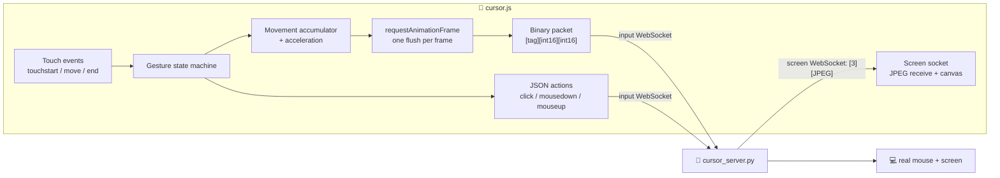
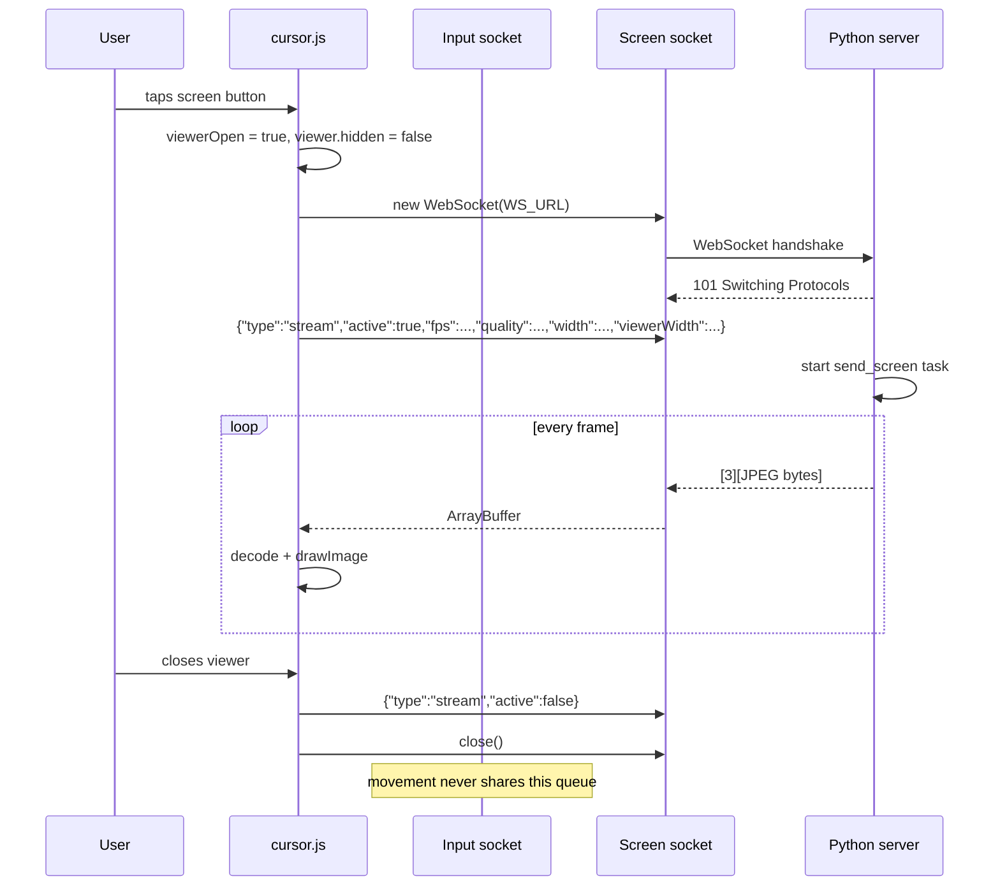
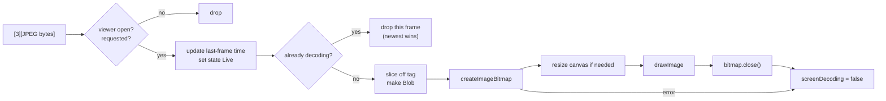
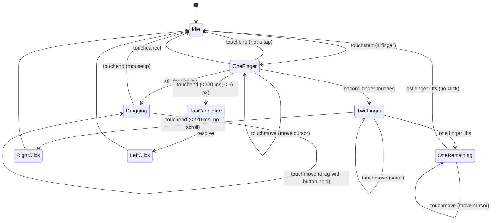
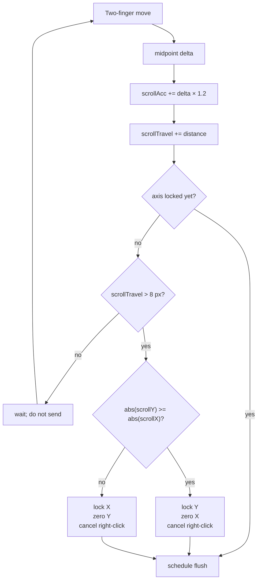
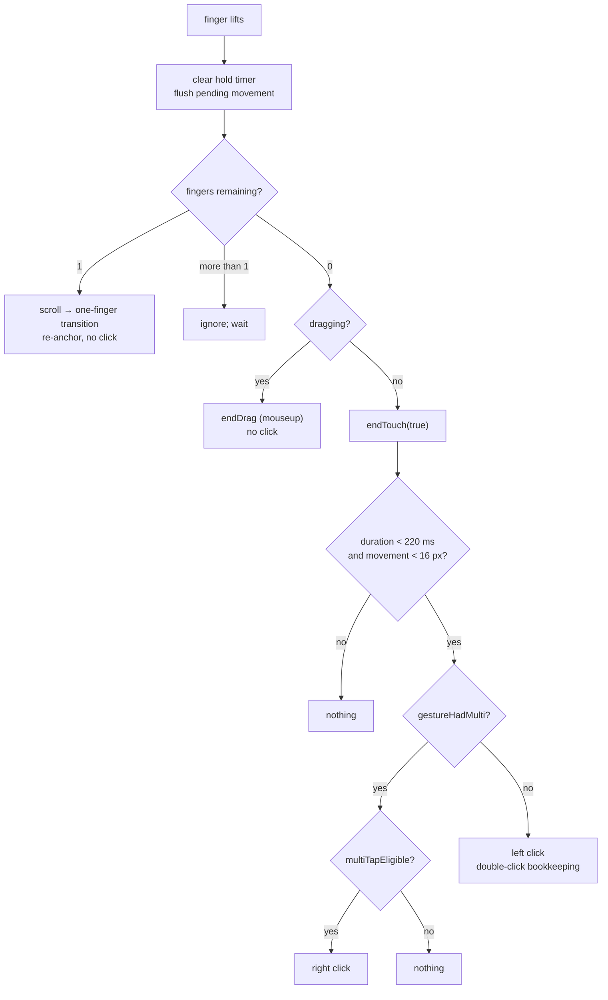

# The Phone's Brain, Explained From Zero
## A line-by-line guide to `cursor.js`

> **Who this is for:** someone who knows almost no JavaScript. Every concept is introduced
> before it is used.
>
> **What this file covers:** all 774 lines of `cursor.js`.
>
> **How to read it:** keep `cursor.js` open beside this guide. The line numbers match
> exactly. Each section starts with a plain-English purpose, then a line table, then the
> "what happens if…" cases.

---

## 0. The three-second summary

`cursor.js` is the **brain of the phone page**.

It does five jobs:

1. **Theme:** switch light/dark and remember the choice.
2. **Input socket:** open a WebSocket to the Python server and keep reconnecting if it
   drops.
3. **Movement:** turn finger movement into small binary packets, at most once per animation
   frame, with an acceleration curve.
4. **Gestures:** decide whether a touch was a move, tap, double-tap, hold-drag,
   two-finger scroll, or two-finger right-click.
5. **Screen viewer:** open a second WebSocket, receive JPEG frames, draw them on a canvas,
   and handle fullscreen/resize/stale-stream states.

The HTML is the body. The CSS is the look. This file is the nervous system.

---

## 1. The big picture



The single most important idea:

> **The phone sends *how far the finger moved*, not *where the cursor should be*.**
> The server adds that delta to the real cursor position. This is why the phone and laptop
> never need to know each other's screen resolution.

---

## 2. JavaScript in one page (only what this file uses)

| Concept | What it means here |
| --- | --- |
| **Variable** | A named box. `const` cannot be reassigned; `let` can. |
| **Function** | A reusable block. `function connect() { ... }` runs when called. |
| **Arrow function** | Shorter function syntax: `() => { ... }`. Used for event listeners. |
| **Object** | A bundle of named values: `{ type: "click", button: "left" }`. |
| **Array** | An ordered list, indexed from `0`. `event.touches[0]` is the first finger. |
| **DOM** | The browser's tree of HTML elements. `getElementById` searches it. |
| **Event listener** | "When X happens, run this function." `addEventListener("click", ...)`. |
| **Event object** | Information about what happened: which finger, coordinates, timestamp. |
| **WebSocket** | A two-way pipe to the server. `send()` writes; `message` event reads. |
| **Binary data** | Raw bytes in an `ArrayBuffer`; `DataView` reads/writes integers. |
| **`requestAnimationFrame`** | Run a function once before the next screen repaint (~60–120 Hz). |
| **Async / Promise** | Work that finishes later. `createImageBitmap(...).then(...)` is async. |
| **Canvas** | A pixel drawing surface. `drawImage` paints a decoded JPEG onto it. |

### 2.1 The whole file is one big wrapper

Line 1 is `(() => {` and line 774 is `})();`.

This is an **immediately invoked function expression (IIFE)**. It creates a private scope,
runs the code, and then closes. Nothing declared inside leaks into the global `window`
object. This avoids clashes with other scripts and keeps the browser console clean.

If you remove line 1 and line 774, the code still runs, but every function and variable
becomes global. In a one-script page that is harmless; in a real site it is a bug waiting
to happen. It also means you cannot pause the script halfway without a syntax error.

### 2.2 The full map of the file

| Lines | Section | Main job |
| --- | --- | --- |
| 1–16 | Wrapper + DOM lookups | Grab every element once |
| 17–56 | Theme | Apply/save light/dark |
| 58–67 | WebSocket URL | Decide `ws://` or `wss://` |
| 69–119 | Input socket | Connect, reconnect, send helpers |
| 121–146 | Page lifecycle | Cleanup + vibration |
| 148–412 | Screen viewer | Second socket, JPEG frames, fullscreen |
| 414–495 | Movement | Acceleration + animation-frame batching |
| 497–773 | Gestures | Touch state machine |
| 774 | End wrapper | Close the private scope |

---

## 3. Lines 1–16: the wrapper and the element lookup

```js
1:  (() => {
2:      "use strict";
3:
4:      const pad = document.getElementById("pad");
5:      const statusEl = document.getElementById("status");
6:      const statusText = document.getElementById("status-text");
7:      const glowEl = document.getElementById("glow");
8:      const viewer = document.getElementById("viewer");
9:      const screenCanvas = document.getElementById("screen");
10:     const screenCtx = screenCanvas.getContext("2d", { alpha: false });
11:     const screenToggle = document.getElementById("screen-toggle");
12:     const viewerStateText = document.getElementById("viewer-state-text");
13:     const fullscreenBtn = document.getElementById("viewer-fullscreen");
14:     const themeToggle = document.getElementById("theme-toggle");
15:     const themeColorMeta = document.getElementById("theme-color");
16:
```

| Line(s) | Code | Plain-English meaning | If missing or changed |
| --- | --- | --- | --- |
| 1 | `(() => {` | Start a private function and call it immediately. | Any `const` below becomes global if you also remove the closing wrapper. |
| 2 | `"use strict";` | Ask JavaScript to be stricter: undeclared variables become errors, silent mistakes become exceptions. | Typos may silently create global variables instead of failing. |
| 3 | blank | Readability. | Nothing. |
| 4 | `const pad = document.getElementById("pad");` | Find the touchpad element once, store it. | If the HTML ID is wrong, `pad` is `null`; line 574's `pad.addEventListener` throws and the whole script stops. |
| 5 | `const statusEl = ...("status")` | The connection pill. | Status styling cannot change; `statusEl.dataset` throws at line 73. |
| 6 | `const statusText = ...("status-text")` | The words inside the pill. | `statusText.textContent` throws when connecting. |
| 7 | `const glowEl = ...("glow")` | The finger-following glow circle. | First touch throws at `glowEl.style`; gestures break. |
| 8 | `const viewer = ...("viewer")` | The screen-preview section. | `viewer.hidden` throws when opening/closing the viewer. |
| 9 | `const screenCanvas = ...("screen")` | The canvas that displays JPEG frames. | `screenCanvas.getContext` throws on the next line. |
| 10 | `screenCanvas.getContext("2d", { alpha: false })` | Get a 2D drawing context. `alpha: false` means the canvas is opaque, which can be faster because the browser skips blending with the page behind it. | Without `alpha: false`: still works, slightly more compositing work. Without a canvas: TypeError. |
| 11 | `const screenToggle = ...("screen-toggle")` | The monitor button. | Its click listener never attaches; the viewer cannot open from the button. |
| 12 | `const viewerStateText = ...` | The "Connecting / Live / No signal" label. | `setViewerState` throws on every frame/state update. |
| 13 | `const fullscreenBtn = ...` | The fullscreen button. | Its listener throws; fullscreen button dead. |
| 14 | `const themeToggle = ...` | The moon/sun button. | The `if (themeToggle)` block is skipped, so the theme button does nothing (but no crash, because line 44 checks). |
| 15 | `const themeColorMeta = ...` | The `<meta name="theme-color">` tag. | `applyTheme` checks `if (themeColorMeta)`, so it skips safely; browser bar colour does not change. |
| 16 | blank | Spacing. | Nothing. |

**Why grab everything once?** `getElementById` is fast, but calling it inside a touch
handler that fires 120 times per second is wasteful. These `const` references are stable:
the elements never get replaced.

**A beginner trap:** `document.getElementById` returns `null` if the element is missing.
The error appears later, on the line that *uses* the variable, not on the lookup line. If
the console says "Cannot read properties of null (reading 'addEventListener')", check the
matching HTML ID first.

---

## 4. Lines 17–56: the theme system

### 4.1 Lines 17–19: the storage key

```js
17:     /* ---------- Theme ---------- */
18:
19:     const THEME_KEY = "touchpad-theme";
```

| Line | Meaning | If changed |
| --- | --- | --- |
| 17 | A section comment. | Nothing. |
| 18 | Blank. | Nothing. |
| 19 | The `localStorage` key. A single source of truth. | If you change it here but not in the HTML inline script, the pre-paint restore reads a different key; dark mode flashes. |

### 4.2 Lines 21–42: `applyTheme`

```js
21:     function applyTheme(theme, persist) {
22:         const dark = theme === "dark";
23:
24:         document.documentElement.dataset.theme = dark ? "dark" : "light";
25:         themeToggle.setAttribute("aria-pressed", dark ? "true" : "false");
26:
27:         const label = dark ? "Switch to light mode" : "Switch to dark mode";
28:         themeToggle.setAttribute("aria-label", label);
29:         themeToggle.title = label;
30:
31:         if (themeColorMeta) {
32:             themeColorMeta.content = dark ? "#20232a" : "#e9edf4";
33:         }
34:
35:         if (persist) {
36:             try {
37:                 localStorage.setItem(THEME_KEY, theme);
38:             } catch (error) {
39:                 // Storage can be blocked; the current session still switches.
40:             }
41:         }
42:     }
```

| Line(s) | Code | Meaning | If removed/changed |
| --- | --- | --- | --- |
| 21 | `function applyTheme(theme, persist)` | `theme` is `"light"` or `"dark"`; `persist` says whether to save it. | Without the function, the toggle has nothing to call. |
| 22 | `const dark = theme === "dark";` | Convert the string to a boolean. | If you compare `theme = "dark"` (one `=`), you assign and always get a truthy string; the theme becomes permanently dark. |
| 24 | `document.documentElement.dataset.theme = ...` | Writes `<html data-theme="dark">` or `"light"`. CSS chooses the palette from this. | No attribute means the light palette. Setting `"light"` explicitly is fine; CSS has no `[data-theme="light"]` block, so it uses the default variables. |
| 25 | `themeToggle.setAttribute("aria-pressed", ...)` | Tells screen readers the toggle's state. | Assistive tech says "button" but not whether dark mode is on. |
| 27 | `const label = dark ? ... : ...` | Pick the next action's name. | The button keeps saying "Switch to dark mode" even in dark mode. |
| 28 | `themeToggle.setAttribute("aria-label", label)` | Update the spoken label. | Screen-reader users get stale instructions. |
| 29 | `themeToggle.title = label` | Update the hover tooltip. | Sighted users see a stale tooltip. |
| 31 | `if (themeColorMeta)` | Guard, because the meta tag might be missing. | Without the guard, a missing meta tag throws and stops the rest of the function. |
| 32 | `themeColorMeta.content = ...` | Change the phone browser's bar colour. | The bar stays the old colour, which looks broken in dark mode. |
| 35 | `if (persist)` | On page load we apply the saved theme but do not need to save it again. | If you always save, you may overwrite the stored choice during startup; harmless but pointless. |
| 36–40 | `try { localStorage.setItem(...) } catch {}` | Save the choice. Storage can throw in private mode or when full. | Without `try`, a blocked storage throws and the click handler logs an error (the visual switch already happened, so the page still works). |
| 41 | `}` | End `if (persist)`. | Syntax error if removed. |
| 42 | `}` | End the function. | Syntax error if removed. |

**Why set `data-theme="light"` instead of removing the attribute?** Both work with this
CSS. Setting it explicitly makes the current state visible in DevTools and avoids ambiguity
if more theme-specific rules are added later. The HTML inline script only sets `"dark"`; if
it is absent, the CSS default is light.

### 4.3 Lines 44–56: startup and the click listener

```js
44:     if (themeToggle) {
45:         applyTheme(
46:             document.documentElement.dataset.theme === "dark" ? "dark" : "light",
47:             false
48:         );
49:
50:         themeToggle.addEventListener("click", () => {
51:             applyTheme(
52:                 document.documentElement.dataset.theme === "dark" ? "light" : "dark",
53:                 true
54:             );
55:         });
56:     }
```

| Line(s) | Code | Meaning | If missing/changed |
| --- | --- | --- | --- |
| 44 | `if (themeToggle) {` | Only wire the button if it exists. | Without it, a missing button causes a null error. |
| 45–48 | `applyTheme(existing, false)` | On startup, sync ARIA/tooltip/meta with the theme that the inline head script already applied. Do not re-save. | The page looks correct but the button may announce the wrong next action. |
| 46 | ternary check | Reads the attribute set by the inline script. | If the inline script failed, this defaults to light; the page stays light. |
| 50 | `addEventListener("click", () => {` | Run this function on every click/tap. | The theme button becomes decorative. |
| 51–54 | `applyTheme(flipped, true)` | Flip dark↔light and persist. | If `true` is changed to `false`, the theme changes but is forgotten on reload. |
| 55–56 | close listener/if | Syntax. | Missing brace breaks parsing. |

**Theme "each possibility":**

| Starting state | User action | `data-theme` becomes | Saved value | Visual result |
| --- | --- | --- | --- | --- |
| light | tap moon | dark | dark | Dark palette, sun icon |
| dark | tap sun | light | light | Light palette, moon icon |
| light | no tap, reload | light | unchanged | Light again |
| dark | no tap, reload | dark (set by head script) | dark | Dark again, no flash |
| any | storage blocked | changes for this tab | save fails silently | Works until reload |
| any | button missing | unchanged | unchanged | `if` skips, no crash |

---

## 5. Lines 58–67: choosing the WebSocket address

```js
58:     // Same-origin socket when the page is served by the Python server (also
59:     // through a tunnel). The LAN fallback keeps the old two-port setup working.
60:     const wsOverride = new URLSearchParams(window.location.search).get("ws");
61:     const WS_URL = wsOverride
62:         ? wsOverride
63:         : window.location.protocol === "https:"
64:             ? "wss://" + window.location.host
65:             : window.location.port === "8766"
66:                 ? "ws://" + window.location.host
67:                 : "ws://" + window.location.hostname + ":8766";
```

This nested ternary looks intimidating. Written as an `if` chain, it is:

```js
let WS_URL;
if (wsOverride) {
    WS_URL = wsOverride;
} else if (window.location.protocol === "https:") {
    WS_URL = "wss://" + window.location.host;
} else if (window.location.port === "8766") {
    WS_URL = "ws://" + window.location.host;
} else {
    WS_URL = "ws://" + window.location.hostname + ":8766";
}
```

| Line(s) | Meaning | If changed |
| --- | --- | --- |
| 58–59 | Comments explaining the same-origin design and LAN fallback. | Nothing. |
| 60 | Read `?ws=...` from the page URL. This is a manual override for testing/custom hosts. | Without it, you cannot point the page at a different socket host. |
| 61–62 | If an override exists, use it exactly. | An invalid override means the socket fails; the status stays amber. |
| 63–64 | On an `https` page, use `wss://` and the same host (including any port). | On a tunnel, using `ws://` would be blocked as mixed content. |
| 65–66 | On plain HTTP with port 8766, reuse the page's host and port. | If you hard-code port 8766 here, a custom port would fail. |
| 67 | Legacy fallback: same hostname, port 8766. | This supports an old setup where the page was served on another port (e.g., 8080) but the socket ran on 8766. |

**The cases table:**

| Page URL | WebSocket URL | Why |
| --- | --- | --- |
| `https://abc.trycloudflare.com/cursor.html` | `wss://abc.trycloudflare.com` | HTTPS requires secure WebSocket |
| `http://192.168.1.10:8766/cursor.html` | `ws://192.168.1.10:8766` | Same host/port |
| `http://192.168.1.10:8080/cursor.html` | `ws://192.168.1.10:8766` | Legacy two-port fallback |
| `...?ws=ws://127.0.0.1:9000` | `ws://127.0.0.1:9000` | Manual override |
| `file:///.../cursor.html` | `ws://:8766` (invalid) | There is no host; open via the server, not the file |

**What if the page is HTTPS but the WebSocket is `ws://`?** The browser blocks it as
"mixed content" because an insecure pipe would undermine the secure page. The status stays
on "Connecting"/"Reconnecting", and the console shows a security error.

---

## 6. Lines 69–119: the input WebSocket

### 6.1 Lines 69–76: state and `setStatus`

```js
69:     let socket = null;
70:     let reconnectTimer = null;
71:
72:     function setStatus(state, label) {
73:         statusEl.dataset.state = state;
74:         statusText.textContent = label;
75:         statusEl.title = label;
76:     }
```

| Line(s) | Code | Meaning | If changed |
| --- | --- | --- | --- |
| 69 | `let socket = null;` | The current input WebSocket, or `null` when there is none. | Without this, `connect` cannot store/close the socket, and `canSend` cannot inspect it. |
| 70 | `let reconnectTimer = null;` | Holds the timer that retries the connection. | Without it, multiple failed attempts could schedule multiple reconnects, causing a storm. |
| 72 | `setStatus(state, label)` | One place to update the pill. | Duplicated updates drift out of sync. |
| 73 | `statusEl.dataset.state = state` | Drives CSS: `connecting`, `connected`, `offline`. | The dot keeps its old colour. |
| 74 | `statusText.textContent = label` | Replace the words safely (no HTML injection). | The pill shows stale text. |
| 75 | `statusEl.title = label` | Hover/touch tooltip. | Minor: tooltip stale. |

`textContent` vs `innerHTML`: `textContent` treats the label as plain text. If you used
`innerHTML` and the label ever came from user input, an attacker could inject HTML/script.
Here the labels are hard-coded, but `textContent` is the safe habit.

### 6.2 Lines 78–100: `connect`

```js
78:     function connect() {
79:         clearTimeout(reconnectTimer);
80:         setStatus("connecting", "Connecting");
81:
82:         socket = new WebSocket(WS_URL);
83:         socket.binaryType = "arraybuffer";
84:
85:         socket.addEventListener("open", () => {
86:             setStatus("connected", "Connected");
87:         });
88:
89:         socket.addEventListener("error", () => {
90:             setStatus("offline", "Reconnecting");
91:         });
92:
93:         socket.addEventListener("close", () => {
94:             setStatus("offline", "Reconnecting");
95:             clearDragTimer();
96:             endDrag();
97:             resetMovement();
98:             reconnectTimer = setTimeout(connect, 1000);
99:         });
100:    }
```

| Line(s) | Code | Meaning | If changed |
| --- | --- | --- | --- |
| 79 | `clearTimeout(reconnectTimer)` | Cancel any pending retry before starting a new one. | Double retries and duplicate sockets. |
| 80 | `setStatus("connecting", "Connecting")` | Show progress immediately. | The pill may look idle for a moment. |
| 82 | `socket = new WebSocket(WS_URL)` | Start the handshake. This returns immediately; the socket is still `CONNECTING` (0). | Without assigning to the outer variable, helpers cannot send or close. |
| 83 | `socket.binaryType = "arraybuffer"` | Binary replies arrive as `ArrayBuffer`, not `Blob`. | Frame code expects `byteLength`; a `Blob` would break it. |
| 85–87 | `open` listener | Fires after the server accepts. Show green. | The pill stays "Connecting" even though input works. |
| 89–91 | `error` listener | Fires on handshake/network errors. | The pill does not turn amber before `close`; console still shows the error. |
| 93–99 | `close` listener | Fires when the connection ends for any reason. | Without cleanup: a drag can remain logically pressed; without retry, the remote never reconnects. |
| 95 | `clearDragTimer()` | Stop a pending hold-to-drag timer. | A timer could fire after disconnect and try to press a button over a dead socket. |
| 96 | `endDrag()` | If dragging, send `mouseup` (best effort) and clear the visual state. | The server may keep the left button held until its `finally` cleanup. |
| 97 | `resetMovement()` | Drop accumulated movement from the old session. | Stale movement could be sent on the next connection, causing a cursor jump. |
| 98 | `setTimeout(connect, 1000)` | Try again in one second. | The remote stays dead after a brief Wi-Fi hiccup. |

**Why retry forever?** A phone may switch Wi-Fi, lock the screen, or lose signal. The page
is still open, so it should recover without a reload. The retry uses a single timer, so it
does not spin the CPU.

### 6.3 Lines 102–117: the send helpers

```js
102:    function canSend(urgent) {
103:        if (!socket || socket.readyState !== WebSocket.OPEN) return false;
104:        return urgent || socket.bufferedAmount <= 2048;
105:    }
106:
107:    function send(payload, urgent = false) {
108:        if (!canSend(urgent)) return false;
109:        socket.send(JSON.stringify(payload));
110:        return true;
111:    }
112:
113:    function sendFrame(frame, urgent = false) {
114:        if (!canSend(urgent)) return false;
115:        socket.send(frame);
116:        return true;
117:    }
```

| Line(s) | Code | Meaning | If changed |
| --- | --- | --- | --- |
| 102 | `canSend(urgent)` | Central gate for every outgoing message. | Inconsistent guards lead to `InvalidStateError` on a closed socket. |
| 103 | `if (!socket || socket.readyState !== WebSocket.OPEN) return false;` | No socket, or still connecting/closing → do not send. `OPEN` is `1`. | Sending on a `CONNECTING` socket throws. |
| 104 | `return urgent || socket.bufferedAmount <= 2048;` | Clicks/drags bypass the queue check; normal movement is dropped when more than 2 KB are queued. | Without the limit, a slow tunnel builds a growing queue: the cursor lags seconds behind the finger. |
| 107 | `send(payload, urgent = false)` | Send JSON; return success. | Callers cannot tell whether it went out. |
| 108 | `if (!canSend(urgent)) return false;` | Bail out safely. | `socket.send` on `null` throws and breaks the gesture handler. |
| 109 | `socket.send(JSON.stringify(payload))` | Convert the object to text and send. | The server's JSON parser receives an object string; forgetting `stringify` sends `[object Object]`. |
| 110 | `return true` | Tells the caller it was queued. | If always `false`, `startDrag` thinks it failed and never sets `dragging`. |
| 113 | `sendFrame(frame, urgent = false)` | Send an `ArrayBuffer`/typed array without JSON. | JSON encoding adds bytes and CPU at 60 Hz. |
| 114 | `if (!canSend(urgent)) return false;` | Same backpressure rule. | Same as above. |
| 115 | `socket.send(frame)` | Send raw bytes. | The server sees text instead of binary if you pass a string. |
| 116 | `return true` | Success signal. | Movement accumulators would subtract unsent bytes. |

**Backpressure in plain English:** imagine a funnel. If you pour water faster than it drains,
water stacks up. `bufferedAmount` is how much water is waiting. The code refuses to add more
movement when the queue is over 2 KB, because old movement is useless: the next finger
position is always more important than a backlog. Clicks and drags are marked urgent because
losing a click is worse than a slightly late packet.

**The 2048 limit is bytes, not packets.** A move packet is 5 bytes, so 2048 bytes is about
400 queued movements — already far too much for a responsive pointer. The limit is a
tripwire, not a target.

### 6.4 Line 119: start immediately

```js
119:     connect();
```

| Line | Meaning | If missing |
| --- | --- | --- |
| 119 | Open the input socket as soon as the script runs. | The page loads but never connects until something else calls `connect()` (nothing in this file does on startup). The status stays "Connecting". |

---

## 7. Lines 121–146: page lifecycle and vibration

### 7.1 Lines 121–124: `pagehide`

```js
121:     window.addEventListener("pagehide", () => {
122:         clearDragTimer();
123:         endDrag();
124:     });
```

| Line(s) | Meaning | If missing |
| --- | --- | --- |
| 121 | The page is being hidden/navigated away/unloaded. | — |
| 122 | Cancel a pending hold timer. | A timer may fire while the page is gone. |
| 123 | Release a held mouse button. | The computer could be left with the left button stuck down until the socket closes and the server's `finally` cleanup runs. |

`pagehide` is more reliable than `beforeunload` on mobile, especially when the page goes
into the back/forward cache.

### 7.2 Lines 126–140: `visibilitychange`

```js
126:     document.addEventListener("visibilitychange", () => {
127:         if (document.hidden) {
128:             glowEl.style.opacity = "0";
129:             clearDragTimer();
130:             endDrag();
131:             if (viewerOpen) stopScreen();
132:             return;
133:         }
134:
135:         if (!socket || socket.readyState === WebSocket.CLOSED) {
136:             connect();
137:         }
138:
139:         if (viewerOpen) startScreen();
140:     });
```

| Line(s) | Meaning | If missing/changed |
| --- | --- | --- |
| 126 | Fires when the tab becomes hidden or visible (screen lock, app switch). | The app keeps streaming and may leave a drag active in the background. |
| 127 | Hidden branch. | — |
| 128 | Hide the glow immediately. | A glow may be frozen on screen when the user returns. |
| 129 | Cancel the hold timer. | A background timer might start a drag with no finger. |
| 130 | Release any drag. | Stuck mouse button. |
| 131 | Stop the screen stream if the viewer is open. | The phone keeps downloading JPEGs while the screen is off: wasted battery and bandwidth. |
| 132 | `return` — do not run the visible branch. | It would try to reconnect/restart while hidden. |
| 135–137 | If there is no socket or it is fully closed, reconnect. | After a long sleep, the phone may return with a dead socket; the UI would stay offline until the retry timer fires. `CLOSED` is `3`. |
| 139–140 | If the viewer was open, restart the stream. | The viewer would stay black/"No signal" after returning to the app. |

**What if the socket is `CLOSING` (2), not `CLOSED`?** The condition is false, so it does
not immediately connect; the pending close will schedule a retry. This avoids opening a
second socket before the old one finishes closing.

### 7.3 Lines 142–146: `haptic`

```js
142:     function haptic(ms) {
143:         if (navigator.vibrate) {
144:             navigator.vibrate(ms);
145:         }
146:     }
```

| Line(s) | Meaning | If missing/changed |
| --- | --- | --- |
| 142 | Small wrapper for vibration. | — |
| 143 | Feature-detect; desktop browsers often have no `vibrate`. | Calling it blindly throws on unsupported browsers. |
| 144 | Vibrate for `ms` milliseconds. | No physical feedback. |
| 146 | End function. | Syntax error if removed. |

Haptics used in this file: 14 ms on drag start, 12 ms on right-click, 8 ms on left-click.
Browsers may ignore vibration if the user has disabled it or if the page is not visible.

---

## 8. Lines 148–412: the live screen viewer

This is the second half of the app. It uses a **second WebSocket** so that large JPEG
frames can never sit in front of a tiny movement packet.



### 8.1 Lines 148–157: constants and stream profiles

```js
148:    /* ---------- Live screen ---------- */
149:
150:    // Screen frames use a dedicated socket, so a burst of large JPEGs can
151:    // never queue in front of touch input. The server only sends frames while
152:    // the viewer is open, and a tunnel gets a lighter stream by default.
153:    const IS_TUNNEL = window.location.protocol === "https:";
154:    const SCREEN_STALE_MS = 2500;
155:    const STREAM_SETTINGS = IS_TUNNEL
156:        ? { fps: 8, quality: 42, width: 760 }
157:        : { fps: 12, quality: 55, width: 960 };
```

| Line(s) | Code | Meaning | If changed |
| --- | --- | --- | --- |
| 148 | Section comment. | Nothing. |
| 150–152 | Comments explaining the separate socket and tunnel profile. | Nothing. |
| 153 | `IS_TUNNEL` is true for an `https:` page. Cloudflare tunnels serve HTTPS. | If you use a plain HTTP tunnel with a different port, it takes the LAN profile, which may be too heavy. |
| 154 | `SCREEN_STALE_MS = 2500` | If no frame arrives for 2.5 seconds, show "No signal". | Too low → false alarms on a slow tunnel; too high → the user stares at a frozen image. |
| 155–157 | Choose the profile. Tunnel: 8 fps, JPEG quality 42, 760 px wide. LAN: 12 fps, quality 55, 960 px wide. | Higher values look better but use more bandwidth; lower values are smoother over a slow link. |

**Why different profiles?** A Cloudflare Quick Tunnel adds latency and may have limited
bandwidth. A 960 px, quality-55 JPEG at 12 fps can be several hundred KB per second. The
tunnel profile cuts resolution, quality, and frame rate. On a LAN, the extra quality is
almost free.

### 8.2 Lines 159–165: viewer state variables

```js
159:    let screenSocket = null;
160:    let screenReconnectTimer = null;
161:    let viewerOpen = false;
162:    let viewerStateName = "";
163:    let screenRequested = false;
164:    let screenDecoding = false;
165:    let screenLastFrame = 0;
```

| Line | Variable | Meaning | If broken |
| --- | --- | --- | --- |
| 159 | `screenSocket` | The dedicated screen WebSocket. | Closing/restarting the stream would affect the wrong socket. |
| 160 | `screenReconnectTimer` | Retry timer for the screen socket. | Duplicate reconnects. |
| 161 | `viewerOpen` | Is the viewer visible? | Frames could be drawn while hidden, and closing might not stop the stream. |
| 162 | `viewerStateName` | Current state string (`"connecting"`, `"live"`, `"offline"`). | `handleScreenFrame` cannot avoid redundant state updates. |
| 163 | `screenRequested` | Did we successfully ask the server to stream? | The client might process frames it did not request, or fail to stop a stream. |
| 164 | `screenDecoding` | Is a JPEG decode currently in progress? | The client would queue every frame, and the canvas would fall further behind. |
| 165 | `screenLastFrame` | Timestamp (`performance.now()`) of the last frame. | Stale detection cannot work. |

**Why `performance.now()` instead of `Date.now()`?** `performance.now()` is a high-resolution
monotonic clock. It never jumps backward when the system clock changes, and it has
sub-millisecond precision. Perfect for measuring frame age and gesture duration.

### 8.3 Lines 167–171: `setViewerState`

```js
167:    function setViewerState(state, label) {
168:        viewerStateName = state;
169:        viewer.dataset.state = state;
170:        viewerStateText.textContent = label;
171:    }
```

| Line(s) | Code | Meaning | If changed |
| --- | --- | --- | --- |
| 167 | Function takes a machine state and a human label. | — |
| 168 | Remember the state so frame handling can compare. | Redundant updates cause DOM writes on every frame. |
| 169 | `data-state` drives the CSS dot colour and pulse. | The badge dot never changes. |
| 170 | Update the text. | Badge stays on "Connecting". |
| 171 | End function. | Syntax error. |

The three states used: `"connecting"` (amber pulse), `"live"` (green dot), `"offline"`
(amber pulse + "No signal").

### 8.4 Lines 173–176: `viewerWidthCss`

```js
173:    function viewerWidthCss() {
174:        const width = screenCanvas.getBoundingClientRect().width;
175:        return Math.max(120, Math.round(width || 360));
176:    }
```

| Line(s) | Meaning | If changed |
| --- | --- | --- |
| 173 | Function returns the displayed canvas width in CSS pixels. | — |
| 174 | Measure the actual rendered width. | If the viewer is hidden, the width may be `0`. |
| 175 | Fall back to 360 if width is `0`, and never send less than 120. | A zero width would make the server's cursor scale division meaningless. |
| 176 | End function. | Syntax error. |

The server uses this to keep the drawn cursor about 12 CSS px on the phone, regardless of
whether the viewer is small or fullscreen.

### 8.5 Lines 178–194: `sendStream`

```js
178:    function sendStream(active) {
179:        if (!screenSocket || screenSocket.readyState !== WebSocket.OPEN) {
180:            return false;
181:        }
182:
183:        screenSocket.send(
184:            JSON.stringify({
185:                type: "stream",
186:                active: active,
187:                fps: STREAM_SETTINGS.fps,
188:                quality: STREAM_SETTINGS.quality,
189:                width: STREAM_SETTINGS.width,
190:                viewerWidth: viewerWidthCss(),
191:            })
192:        );
193:        return true;
194:    }
```

| Line(s) | Meaning | If changed |
| --- | --- | --- |
| 178 | `active` is `true` to start/update, `false` to stop. | — |
| 179–181 | Refuse to send if the screen socket is not open. | Calling `send` on `null`/`CONNECTING` throws. |
| 183–192 | Send a JSON control message with the profile and rendered width. | If the server does not receive this, no stream starts. |
| 185 | `type: "stream"` | The server's dispatch checks this exact string. A typo means the message is ignored. |
| 186 | `active` | `false` stops the capture task. |
| 187–189 | fps/quality/width | Server clamps them to safe ranges. |
| 190 | `viewerWidth` | Controls the size of the drawn cursor. |
| 193 | Return `true` so the caller knows the request was sent. | `screenRequested` would be wrong. |

**Why send the profile every time?** It makes the message self-contained. The server does
not need to remember a previous negotiation; a resize can resend the same profile with a new
`viewerWidth`.

### 8.6 Lines 196–240: `connectScreen`

```js
196:    function connectScreen() {
197:        if (!viewerOpen) return;
198:
199:        if (
200:            screenSocket &&
201:            (screenSocket.readyState === WebSocket.OPEN ||
202:                screenSocket.readyState === WebSocket.CONNECTING)
203:        ) {
204:            return;
205:        }
206:
207:        clearTimeout(screenReconnectTimer);
208:
209:        const ws = new WebSocket(WS_URL);
210:        ws.binaryType = "arraybuffer";
211:        screenSocket = ws;
212:
213:        ws.addEventListener("message", (event) => {
214:            if (typeof event.data === "string") return;
215:            if (event.data.byteLength < 2) return;
216:            if (new Uint8Array(event.data, 0, 1)[0] !== 3) return;
217:            handleScreenFrame(event.data);
218:        });
219:
220:        ws.addEventListener("open", () => {
221:            if (screenSocket !== ws || !viewerOpen) return;
222:            screenLastFrame = performance.now();
223:            screenRequested = sendStream(true);
224:        });
225:
226:        ws.addEventListener("close", () => {
227:            if (screenSocket !== ws) return;
228:
229:            screenSocket = null;
230:            screenRequested = false;
231:            screenDecoding = false;
232:
233:            if (!viewerOpen) return;
234:
235:            setViewerState("connecting", "Reconnecting screen");
236:            screenReconnectTimer = setTimeout(connectScreen, 1200);
237:        });
238:
239:        ws.addEventListener("error", () => {});
240:    }
```

| Line(s) | Meaning | If changed |
| --- | --- | --- |
| 196 | Create/reuse the screen connection. | — |
| 197 | Do nothing if the viewer is closed. | Opening a socket in the background wastes battery. |
| 199–205 | If a socket is already `OPEN` or `CONNECTING`, do nothing. | Multiple sockets would each request a stream; the server would send duplicate frames. |
| 207 | Cancel a pending reconnect. | A manual start could race with a retry. |
| 209 | Create the socket. | — |
| 210 | Binary frames as `ArrayBuffer`. | The tag check would fail on a `Blob`. |
| 211 | Keep a reference for close/stop guards. | Close handlers could not tell whether they belong to the current socket. |
| 213–218 | `message` handler: ignore text, ignore tiny frames, require first byte `3`, then handle. | Without the tag check, a stray message would be decoded as JPEG and fail. Without the string check, JSON frames would hit `byteLength` undefined and be ignored anyway, but explicit is safer. |
| 214 | Text messages are control/error messages from the server; the screen protocol is binary. | If you remove it, `event.data.byteLength` on a string is `undefined`; the `< 2` check is false? Actually `undefined < 2` is false, then `new Uint8Array(string, ...)` throws. This guard prevents that. |
| 215 | A valid frame has at least the tag byte + one JPEG byte. | — |
| 216 | `new Uint8Array(event.data, 0, 1)[0]` reads the first byte without copying the whole buffer. `!== 3` rejects movement/scroll frames if they ever arrived here. | Without it, a `[1]` move packet would be treated as a JPEG and fail to decode. |
| 220–224 | On open: if this is still the current socket and the viewer is open, mark the time and request the stream. | If `viewerOpen` changed while connecting, do not start. If `screenSocket !== ws`, this is an old socket; ignore it. |
| 222 | Set `screenLastFrame` at open so stale detection starts from now. | The viewer could show "No signal" immediately before the first frame. |
| 223 | `screenRequested = sendStream(true)` records whether the request really went out. | If the socket closed between open and send, `sendStream` returns false; the client knows not to expect frames. |
| 226–237 | Close handler. | — |
| 227 | Ignore close events from an old socket. | An old socket could null out the new one and trigger a false reconnect. |
| 229–231 | Clear refs/flags. | State would claim a stream is active when it is not. |
| 233 | If the viewer is closed, do not reconnect. | A closed viewer would mysteriously reopen a socket. |
| 235 | Show "Reconnecting screen". | The user sees a frozen image with no explanation. |
| 236 | Retry after 1.2 s. | A brief server restart would permanently break the viewer. |
| 239 | Empty error listener. | Without any error listener, the browser may log an unhandled error; the close event still fires. |

**The socket identity guard (`screenSocket !== ws`) is important.** Imagine: user closes
the viewer; `stopScreen` sets `screenSocket = null` and closes socket A. Before A's close
event fires, the user reopens the viewer, creating socket B. A's close event then fires. If
there were no guard, it would set `screenSocket = null` (killing B's reference) and schedule
another reconnect. With the guard, A is ignored because `screenSocket` is now B.

### 8.7 Lines 242–253: `startScreen`

```js
242:    function startScreen() {
243:        if (!viewerOpen) return;
244:
245:        screenLastFrame = performance.now();
246:        setViewerState("connecting", "Connecting");
247:
248:        if (screenSocket && screenSocket.readyState === WebSocket.OPEN) {
249:            screenRequested = sendStream(true);
250:        } else {
251:            connectScreen();
252:        }
253:    }
```

| Line(s) | Meaning | If changed |
| --- | --- | --- |
| 242 | Start or resume the stream. | — |
| 243 | Only when the viewer is visible. | Starting while hidden is wasted work. |
| 245 | Reset the frame clock. | "No signal" could fire instantly from an old timestamp. |
| 246 | Show "Connecting". | No feedback while the socket opens. |
| 248–249 | If the socket is already open, just send a new `active: true` request (also used after returning from hidden). | Recreating the socket every time is slower. |
| 250–252 | Otherwise open a new socket. | The stream never starts. |

`startScreen` is called by `openViewer` and by the visibility handler when the page becomes
visible again. It is idempotent: calling it twice does not create two streams because
`sendStream(true)` just updates the config, and `connectScreen` guards against existing
sockets.

### 8.8 Lines 255–279: `stopScreen`

```js
255:    function stopScreen() {
256:        clearTimeout(screenReconnectTimer);
257:        clearTimeout(viewerSizeTimer);
258:        screenReconnectTimer = null;
259:        viewerSizeTimer = 0;
260:
261:        if (screenRequested) sendStream(false);
262:
263:        screenRequested = false;
264:        screenDecoding = false;
265:        screenLastFrame = 0;
266:
267:        const ws = screenSocket;
268:        screenSocket = null;
269:
270:        if (ws && ws.readyState <= WebSocket.OPEN) {
271:            try {
272:                ws.close();
273:            } catch (error) {
274:                // ignore
275:            }
276:        }
277:
278:        if (viewerOpen) setViewerState("connecting", "Connecting");
279:    }
```

| Line(s) | Meaning | If changed |
| --- | --- | --- |
| 256 | Cancel a pending screen reconnect. | The viewer could reopen itself after closing. |
| 257 | Cancel the resize debounce. | A queued resize could send a stream request after close. |
| 258–259 | Clear the timer IDs. | Stale IDs could confuse later guards. |
| 261 | Tell the server to stop capturing, but only if a request was successfully sent. | The server might keep a capture task running until the socket closes. |
| 263–265 | Clear all stream state. | A later frame could be processed with stale flags. |
| 267–268 | Detach the current socket before closing it. | The close handler's identity guard will see `screenSocket !== ws` and not schedule a reconnect. |
| 270 | `readyState <= OPEN` covers `CONNECTING` (0) and `OPEN` (1). | Trying to close an already-closed socket is harmless, but the guard avoids exceptions. |
| 271–275 | `close()` can throw in unusual states; ignore. | An exception would skip the state reset below. |
| 278 | Reset the badge while the viewer remains open. | The badge could stay "Live" after the stream stops. |

**Why send `active:false` before closing?** It is a polite stop. The server receives the
message and cancels its capture task immediately. Closing the socket alone also eventually
stops it (the server's `finally` cancels the task), but the explicit message is faster and
clearer.

### 8.9 Lines 281–296: resize handling

```js
281:    // Keep the drawn pointer a normal size when the viewer is resized or
282:    // rotated, by telling the server the rendered width.
283:    let viewerSizeTimer = 0;
284:
285:    function refreshViewerSize() {
286:        if (!viewerOpen || !screenRequested) return;
287:
288:        clearTimeout(viewerSizeTimer);
289:        viewerSizeTimer = setTimeout(() => {
290:            if (viewerOpen && screenRequested) sendStream(true);
291:        }, 250);
292:    }
293:
294:    if (typeof ResizeObserver !== "undefined") {
295:        new ResizeObserver(refreshViewerSize).observe(screenCanvas);
296:    }
```

| Line(s) | Meaning | If changed |
| --- | --- | --- |
| 281–282 | Comment. | Nothing. |
| 283 | Timer ID for debouncing. | Declared before `stopScreen` uses it (hoisting would also work, but explicit is clear). |
| 285 | Called whenever the canvas size changes. | — |
| 286 | Ignore if the viewer is closed or no stream is active. | Sending a resize for a closed viewer is wasted. |
| 288 | Cancel the previous debounce. | Many resize events could send a storm of stream messages. |
| 289–291 | After 250 ms of quiet, resend `active:true` with the new `viewerWidth`. | The server keeps drawing the cursor at the old scale after rotation. |
| 294–296 | Feature-detect `ResizeObserver` and observe the canvas. | Older browsers do not resize the cursor correctly; no crash. |

**Why debounce 250 ms?** Rotation triggers many intermediate sizes. Sending each one would
flood the server with config messages. Waiting for the size to settle sends one useful
message.

### 8.10 Lines 298–328: `handleScreenFrame`

```js
298:    function handleScreenFrame(buffer) {
299:        if (!viewerOpen || !screenRequested) return;
300:        if (buffer.byteLength < 2) return;
301:
302:        screenLastFrame = performance.now();
303:        if (viewerStateName !== "live") setViewerState("live", "Live");
304:
305:        // If decoding is still busy, drop this frame rather than queueing it.
306:        // The next frame is always fresher than a backlog.
307:        if (screenDecoding) return;
308:
309:        screenDecoding = true;
310:
311:        createImageBitmap(new Blob([buffer.slice(1)], { type: "image/jpeg" }))
312:            .then((bitmap) => {
313:                if (
314:                    screenCanvas.width !== bitmap.width ||
315:                    screenCanvas.height !== bitmap.height
316:                ) {
317:                    screenCanvas.width = bitmap.width;
318:                    screenCanvas.height = bitmap.height;
319:                }
320:
321:                screenCtx.drawImage(bitmap, 0, 0);
322:                bitmap.close();
323:            })
324:            .catch(() => {})
325:            .finally(() => {
326:                screenDecoding = false;
327:            });
328:    }
```

| Line(s) | Meaning | If changed |
| --- | --- | --- |
| 298 | Accept one complete `ArrayBuffer` that starts with tag `3`. | — |
| 299 | Ignore frames if the viewer closed or no stream was requested. | Late frames from an old socket could paint a closed viewer. |
| 300 | Need at least tag + one JPEG byte. | — |
| 302 | Record arrival time for stale detection. | The viewer could show "No signal" while frames are arriving. |
| 303 | If not already live, switch to green "Live". The check avoids touching the DOM on every frame. | The badge stays "Connecting" forever. |
| 307 | If a decode is still running, **drop** this frame. | Without this, each frame starts a decode; the browser accumulates a backlog and the preview lags seconds behind. Dropping is correct because the newest frame is always more useful. |
| 309 | Mark decode busy. | A second frame could start concurrently. |
| 311 | `buffer.slice(1)` copies the JPEG bytes without the tag; wrap in a `Blob` with MIME type; decode asynchronously. | Without `slice(1)`, the decoder sees a leading `0x03` and fails. Without the MIME type, some browsers still sniff it, but it is not guaranteed. |
| 312–322 | On success: resize the canvas if the bitmap dimensions changed, draw, close the bitmap. | Not resizing causes scaling/stretching. Not closing the bitmap leaks GPU memory over time. |
| 314–316 | Compare both dimensions. | A resize on every frame would clear and reallocate the canvas constantly. |
| 321 | `drawImage` paints the bitmap at the top-left. | The canvas stays blank. |
| 322 | `bitmap.close()` releases the image memory. | Memory grows with every frame; eventually the tab may crash. |
| 324 | Swallow decode errors. A corrupted/partial frame should not break the stream. | One bad frame could throw an unhandled rejection. |
| 325–327 | Always clear the busy flag, even on failure. | One failed decode would freeze the viewer forever. |

**The decode pipeline in one diagram:**



**Why `createImageBitmap` instead of an `` tag?** It decodes off the main thread in many
browsers and returns an object that `canvas.drawImage` accepts directly. It avoids creating
and garbage-collecting an `` element for every frame.

### 8.11 Lines 330–339: `openViewer`

```js
330:    function openViewer() {
331:        if (viewerOpen) return;
332:
333:        viewerOpen = true;
334:        viewer.hidden = false;
335:        document.body.classList.add("viewing");
336:        screenToggle.setAttribute("aria-pressed", "true");
337:        screenToggle.setAttribute("aria-label", "Hide laptop screen");
338:        startScreen();
339:    }
```

| Line(s) | Meaning | If changed |
| --- | --- | --- |
| 331 | Idempotent: opening twice does nothing. | A second click could create a second socket/stream. |
| 333 | Remember the state. | Visibility/close logic breaks. |
| 334 | Remove the `hidden` attribute; CSS shows the viewer. | The viewer stays invisible. |
| 335 | Add `body.viewing`; CSS hides the guide and enables the landscape two-column layout. | The viewer opens but the layout does not adapt. |
| 336–337 | Update the button's state and label. CSS shows the pressed style. | The button does not indicate that the viewer is open. |
| 338 | Connect/start the stream. | The viewer appears but stays black. |

### 8.12 Lines 341–355: `closeViewer`

```js
341:    function closeViewer() {
342:        if (!viewerOpen) return;
343:
344:        viewerOpen = false;
345:        stopScreen();
346:
347:        if (document.fullscreenElement === viewer && document.exitFullscreen) {
348:            document.exitFullscreen().catch(() => {});
349:        }
350:
351:        viewer.hidden = true;
352:        document.body.classList.remove("viewing");
353:        screenToggle.setAttribute("aria-pressed", "false");
354:        screenToggle.setAttribute("aria-label", "Show laptop screen");
355:    }
```

| Line(s) | Meaning | If changed |
| --- | --- | --- |
| 342 | Idempotent close. | Repeated close could close an unrelated socket. |
| 344 | State changes first, so any in-flight events see "closed". | A frame or close event could restart the stream. |
| 345 | Stop the stream and close the screen socket. | The phone keeps downloading frames in the background. |
| 347–349 | If the viewer is fullscreen, exit it. | The user is left in fullscreen with a hidden viewer. |
| 351 | Hide the viewer. | The black frame remains. |
| 352 | Remove `body.viewing`. | The guide stays hidden and landscape stays in two-column mode. |
| 353–354 | Reset the button. | The button still looks pressed and says "Hide". |

**Order matters:** `viewerOpen = false` comes before `stopScreen()`. `stopScreen` closes the
socket; the close handler checks `!viewerOpen` and therefore does **not** schedule a
reconnect. If the order were reversed, the close handler could see `viewerOpen === true`
and reconnect the screen socket after the viewer was closed.

### 8.13 Lines 357–375: fullscreen

```js
357:    async function toggleFullscreen() {
358:        if (document.fullscreenElement === viewer) {
359:            try {
360:                await document.exitFullscreen();
361:            } catch (error) {
362:                // ignore
363:            }
364:            return;
365:        }
366:
367:        try {
368:            await viewer.requestFullscreen();
369:            if (screen.orientation && screen.orientation.lock) {
370:                await screen.orientation.lock("landscape");
371:            }
372:        } catch (error) {
373:            // fullscreen or orientation lock is not available
374:        }
375:    }
```

| Line(s) | Meaning | If changed |
| --- | --- | --- |
| 357 | `async` because both APIs return promises. | `await` would be a syntax error. |
| 358–365 | If already fullscreen, exit and stop. | Tapping toggles into fullscreen again instead of leaving. |
| 360 | `exitFullscreen()` returns a promise; `await` waits, `catch` ignores failures. | An unhandled rejection in the console. |
| 367–371 | Try to enter fullscreen, then lock orientation to landscape. | A phone held in portrait shows a tiny landscape screen with huge black bars. |
| 369 | `screen.orientation` may be undefined on desktop Safari. | Calling `.lock` on undefined throws. |
| 370 | Orientation lock often requires fullscreen and may be rejected by the browser. | The `catch` lets the viewer stay fullscreen in portrait. |
| 372–374 | Ignore unsupported/failed fullscreen. | A rejected promise logs an error and the button appears broken. |

`document.fullscreenElement` is the element currently in fullscreen, or `null`. Comparing
it to `viewer` tells us whether *our* viewer is the one in fullscreen.

### 8.14 Lines 377–403: wiring the viewer controls

```js
377:    screenToggle.addEventListener("click", () => {
378:        if (viewerOpen) closeViewer();
379:        else openViewer();
380:    });
381:
382:    fullscreenBtn.addEventListener("click", (event) => {
383:        event.stopPropagation();
384:        toggleFullscreen();
385:    });
386:
387:    screenCanvas.addEventListener("click", toggleFullscreen);
388:
389:    document.addEventListener("fullscreenchange", () => {
390:        const full = document.fullscreenElement === viewer;
391:        fullscreenBtn.setAttribute(
392:            "aria-label",
393:            full ? "Exit fullscreen" : "Enter fullscreen"
394:        );
395:
396:        if (!full && screen.orientation && screen.orientation.unlock) {
397:            try {
398:                screen.orientation.unlock();
399:            } catch (error) {
400:                // ignore
401:            }
402:        }
403:    });
```

| Line(s) | Meaning | If changed |
| --- | --- | --- |
| 377–380 | The monitor button toggles the viewer. | The button does nothing or always opens. |
| 382–385 | The fullscreen button toggles fullscreen and stops the click from bubbling. | Without `stopPropagation`, the click bubbles to the canvas listener and toggles fullscreen twice (enter then immediately exit). |
| 387 | Clicking/tapping the screen image toggles fullscreen. | Tapping the preview would send a real click to the computer, which is dangerous/unexpected. |
| 389–394 | When fullscreen changes, update the button's accessible label. | The button says "Enter fullscreen" while it would actually exit. |
| 396–401 | When leaving fullscreen, unlock orientation. | The phone stays locked in landscape after closing the viewer. |

**Why tapping the canvas does not click the computer:** the canvas is part of the viewer, not
the pad. It has its own click handler for fullscreen. The remote-click path is only the pad's
touch handlers. This is a deliberate safety feature: a user tapping the preview wants a bigger
picture, not to click whatever is under the mouse on the laptop.

### 8.15 Lines 405–412: the stale-frame watchdog

```js
405:    setInterval(() => {
406:        if (!viewerOpen || !screenRequested) return;
407:        if (!screenSocket || screenSocket.readyState !== WebSocket.OPEN) return;
408:
409:        if (performance.now() - screenLastFrame > SCREEN_STALE_MS) {
410:            setViewerState("offline", "No signal");
411:        }
412:    }, 1000);
```

| Line(s) | Meaning | If changed |
| --- | --- | --- |
| 405 | Run once per second, forever. | A frozen stream looks live indefinitely. |
| 406 | Only when the viewer is open and a stream was requested. | The badge could show "No signal" for a closed viewer. |
| 407 | Only when the socket is open. If it is closed, the close handler already shows "Reconnecting screen". | Conflicting state messages. |
| 409 | If the last frame is older than 2.5 s, mark offline. | The user cannot tell a frozen image from a static desktop. |
| 410 | Label "No signal". | The badge stays green "Live" on a dead stream. |

**Why not rely on the socket close event alone?** The socket can stay open while the server's
capture task dies (for example, `mss` fails repeatedly). The server keeps the connection
alive but sends no frames. The watchdog catches that case. Conversely, a completely static
desktop still gets a heartbeat frame once per second (server-side frame skipping), so it
does not trigger a false "No signal".

---

## 9. Lines 414–495: movement and acceleration

This is the heart of the trackpad feel.

### 9.1 Lines 414–428: the constants and why they exist

```js
414:    /* ---------- Movement ---------- */
415:
416:    // Moves are accumulated and sent once per animation frame. That caps the
417:    // packet rate at ~60 Hz even on 120 Hz phones, and it gives the pointer a
418:    // stable acceleration curve. Fewer packets over a tunnel means less
419:    // queueing and a snappier cursor.
420:    //
421:    //   move:   [1][int16 dx][int16 dy]
422:    //   scroll: [2][int16 dy][int16 dx]
423:    const MOVE_MIN_GAIN = 1.15;
424:    const MOVE_MAX_GAIN = 2.9;
425:    const MOVE_ACCEL_SPEED = 14;       // CSS px per 16 ms
426:    const MAX_MOVE_STEP = 1200;
427:    const SCROLL_GAIN = 1.2;
428:    const SCROLL_LOCK_PX = 8;
```

| Line(s) | Constant | Value | Meaning |
| --- | --- | --- | --- |
| 414–422 | comments | — | Documents the packet layout and the batching idea. |
| 423 | `MOVE_MIN_GAIN` | 1.15 | At near-zero speed, 1 finger pixel becomes 1.15 cursor pixels. Fine control. |
| 424 | `MOVE_MAX_GAIN` | 2.9 | At high speed, 1 finger pixel can become up to 2.9 cursor pixels. Fast traversal. |
| 425 | `MOVE_ACCEL_SPEED` | 14 | The speed (CSS px per 16 ms) at which gain is already ~63% of the way from min to max. It controls how quickly acceleration kicks in. |
| 426 | `MAX_MOVE_STEP` | 1200 | A safety ceiling per flush. 1200 fits easily in a signed 16-bit integer and prevents a single huge jump if events were delayed. |
| 427 | `SCROLL_GAIN` | 1.2 | Two-finger scrolling is slightly faster than raw finger movement. |
| 428 | `SCROLL_LOCK_PX` | 8 | After 8 px of total scroll travel, lock to one axis. |

**Why not send every `touchmove`?** A 120 Hz phone can fire 120+ move events per second.
Sending each one creates 120 WebSocket messages, 120 JSON/binary conversions, and 120 TCP
packets. Batching one per animation frame caps the rate and keeps the latest total. The
cursor path stays smooth without flooding the network.

**Why int16?** A signed 16-bit integer holds −32768 to 32767. Each step is clamped to ±1200,
so 16 bits is plenty. Two int16s plus one tag byte = 5 bytes. A JSON move like
`{"type":"move","dx":21,"dy":8}` is 30+ bytes and requires parsing.

### 9.2 Lines 430–442: accumulators and reusable packet buffers

```js
430:    let moveAccX = 0;
431:    let moveAccY = 0;
432:    let scrollAccX = 0;
433:    let scrollAccY = 0;
434:    let inputScheduled = false;
435:
436:    const moveFrame = new ArrayBuffer(5);
437:    const moveView = new DataView(moveFrame);
438:    moveView.setUint8(0, 1);
439:
440:    const scrollFrame = new ArrayBuffer(5);
441:    const scrollView = new DataView(scrollFrame);
442:    scrollView.setUint8(0, 2);
```

| Line(s) | Code | Meaning | If changed |
| --- | --- | --- | --- |
| 430–433 | Accumulators | Pending movement/scroll that has not been sent yet. | Without accumulation, intermediate movement is lost or floods the socket. |
| 434 | `inputScheduled` | Is a `requestAnimationFrame` callback already queued? | Multiple callbacks per frame would send duplicates. |
| 436 | `new ArrayBuffer(5)` | Exactly 5 raw bytes. | A larger buffer sends extra bytes; a smaller one overflows. |
| 437 | `new DataView(moveFrame)` | A view that can write integers at byte offsets. | Without it, you would need manual bit-shifting. |
| 438 | `setUint8(0, 1)` | Byte 0 is the move tag. Written once, never changes. | The server would not recognise the packet. |
| 440–442 | Same for scroll, tag `2`. | Byte 0 = 2. | Server ignores or misreads scroll. |

**The packet layouts:**

```text
MOVE (5 bytes)
┌─────────┬──────────────┬──────────────┐
│ byte 0  │ bytes 1–2    │ bytes 3–4    │
│ 0x01    │ int16 LE dx  │ int16 LE dy  │
└─────────┴──────────────┴──────────────┘

SCROLL (5 bytes)
┌─────────┬──────────────┬──────────────┐
│ byte 0  │ bytes 1–2    │ bytes 3–4    │
│ 0x02    │ int16 LE dy  │ int16 LE dx  │
└─────────┴──────────────┴──────────────┘
```

Notice the order difference: move is `(dx, dy)`, scroll is `(dy, dx)`. The server matches
this exactly. Mixing them up makes vertical scrolling move horizontally.

**Little-endian example:** the value 21 is `0x0015`. Little-endian stores the least
significant byte first: `15 00`. The value 8 is `08 00`. A packet moving right 21 and down
8 is:

```text
01 15 00 08 00
```

The `true` third argument to `setInt16(offset, value, true)` means little-endian. If you
forget it, JavaScript defaults to **big-endian** on most platforms, and the server reads
`0x1500 = 5376` instead of 21. The cursor would fly to a corner.

### 9.3 Lines 444–446: `clamp`

```js
444:    function clamp(value, limit) {
445:        return Math.max(-limit, Math.min(limit, value));
446:    }
```

| Line(s) | Meaning | If changed |
| --- | --- | --- |
| 444–446 | Keep a number between `-limit` and `+limit`. | Without a clamp, a huge accumulated delta overflows int16 and wraps to the opposite direction, making the cursor jump wildly. |

How it works, step by step, for `value = 5000`, `limit = 1200`:

1. `Math.min(1200, 5000)` → `1200`
2. `Math.max(-1200, 1200)` → `1200`

For `value = -5000`: `Math.min(1200, -5000)` → `-5000`; `Math.max(-1200, -5000)` → `-1200`.

### 9.4 Lines 448–463: `flushMove`

```js
448:    function flushMove() {
449:        const dx = clamp(Math.round(moveAccX), MAX_MOVE_STEP);
450:        const dy = clamp(Math.round(moveAccY), MAX_MOVE_STEP);
451:
452:        if (dx === 0 && dy === 0) return;
453:
454:        moveView.setInt16(1, dx, true);
455:        moveView.setInt16(3, dy, true);
456:
457:        // Keep the unsent remainder while the socket is backed up. Dropping it
458:        // here is what makes a laggy link feel like the cursor is stuck.
459:        if (!sendFrame(moveFrame)) return;
460:
461:        moveAccX -= dx;
462:        moveAccY -= dy;
463:    }
```

| Line(s) | Meaning | If changed |
| --- | --- | --- |
| 448 | Send accumulated movement as one packet. | — |
| 449–450 | Round to integers and clamp to ±1200. The screen cannot move by a fraction of a pixel anyway. | `setInt16` with a non-integer truncates; explicit rounding is predictable. Without clamp, overflow. |
| 452 | If both are zero, there is nothing to send. | A zero packet wastes bandwidth and wakes the server for no reason. |
| 454 | Write `dx` at byte 1, little-endian. | Wrong offset writes over the tag or `dy`. |
| 455 | Write `dy` at byte 3. | Same. |
| 457–458 | Comment explaining backpressure. | — |
| 459 | Try to send. If the socket is closed or backed up, return **without clearing** the accumulator. | If you clear before send, a failed send loses movement forever; the cursor stops responding while the finger keeps moving. This is exactly the "stuck cursor" bug. |
| 461–462 | Subtract only what was sent. | If you subtract the full accumulator, unsent movement is lost. If you subtract nothing, the next frame resends old movement and the cursor overshoots. |

**Worked example (normal send):**

```text
moveAccX = 21.4  → round 21 → clamp 21 → write 21
moveAccY =  8.2  → round  8 → clamp  8 → write  8
send succeeds
moveAccX = 21.4 - 21 = 0.4
moveAccY =  8.2 -  8 = 0.2
```

The 0.4/0.2 remainder is tiny and is carried into the next frame, which preserves smoothness.

**Worked example (blocked send):**

```text
moveAccX = 60
sendFrame returns false (socket queue > 2 KB)
return
moveAccX is still 60
```

Next frame adds more movement, still tries to send. When the queue drains, it sends the
combined total (clamped to 1200). The cursor catches up in one jump instead of losing the
gesture.

### 9.5 Lines 465–478: `flushScroll`

```js
465:    function flushScroll() {
466:        const dy = clamp(Math.trunc(scrollAccY), MAX_MOVE_STEP);
467:        const dx = clamp(Math.trunc(scrollAccX), MAX_MOVE_STEP);
468:
469:        if (dy === 0 && dx === 0) return;
470:
471:        scrollView.setInt16(1, dy, true);
472:        scrollView.setInt16(3, dx, true);
473:
474:        if (!sendFrame(scrollFrame)) return;
475:
476:        scrollAccY -= dy;
477:        scrollAccX -= dx;
478:    }
```

| Line(s) | Meaning | If changed |
| --- | --- | --- |
| 466–467 | `Math.trunc` drops the fractional part toward zero (21.9 → 21, −21.9 → −21). Clamp to ±1200. | Rounding can make a tiny 0.6 scroll into 1 every frame, causing drift; truncation is stricter. |
| 469 | Nothing to send → return. | Wasted packets. |
| 471–472 | Scroll packet order is `(dy, dx)`, unlike move. | Server reads the wrong axis; vertical swipe scrolls sideways. |
| 474 | Send or keep the remainder. | Same backpressure logic as movement. |
| 476–477 | Subtract only the sent amount. | Lost or duplicated scroll. |

**The scroll sign:** the phone's drag down (`dy` positive) should scroll the content down,
which on Windows is a negative wheel delta. The server negates `dy` before sending the wheel
event. That is handled in Python, not here. The client simply reports finger direction.

### 9.6 Lines 480–488: `scheduleFlush`

```js
480:    function scheduleFlush() {
481:        if (inputScheduled) return;
482:        inputScheduled = true;
483:        requestAnimationFrame(() => {
484:            inputScheduled = false;
485:            flushMove();
486:            flushScroll();
487:        });
488:    }
```

| Line(s) | Meaning | If changed |
| --- | --- | --- |
| 481 | If a flush is already queued this frame, do nothing. | A fast finger would queue dozens of callbacks, negating the batching. |
| 482 | Mark scheduled. | — |
| 483 | Queue a callback before the next repaint. | Using `setTimeout(..., 0)` can run many times per frame and does not align with painting. |
| 484 | Clear the flag **inside** the callback, so a new move can schedule again. | If cleared before, re-entrancy is possible; if never cleared, scheduling stops forever. |
| 485–486 | Send movement and scroll together. | If you only flush one, the other waits until its own next event. |

**The timing graph:**

```text
touchmove events:   ● ● ● ● ● ● ● ● ● ● ● ● ● ● ● ●   (many per frame)
accumulators:       ↑ ↑ ↑ ↑ ↑ ↑ ↑ ↑ ↑ ↑ ↑ ↑ ↑ ↑ ↑ ↑
rAF boundary:       ────────────────┬───────────────┬────────────
flush:                              ●               ●
WebSocket packets:                  1               1
```

At 60 Hz, that is at most 60 packets per second. At 120 Hz, at most 120. Either way, far
fewer than raw touch events, and each packet carries the total movement since the last
flush.

### 9.7 Lines 490–495: `resetMovement`

```js
490:    function resetMovement() {
491:        moveAccX = 0;
492:        moveAccY = 0;
493:        scrollAccX = 0;
494:        scrollAccY = 0;
495:    }
```

| Line(s) | Meaning | If changed |
| --- | --- | --- |
| 490–495 | Throw away all unsent movement/scroll. | Called at gesture start, reconnect, cancel, and after lifting one finger from a scroll. Without it, leftover movement from the previous gesture would be applied to the new one, causing a jump. |

Why reset at gesture start? Suppose a frame was blocked and 40 px of movement remained
unsent. The user lifts and starts a new touch. If the accumulator were not cleared, the first
flush of the new gesture would include the old 40 px, making the cursor jump before the
finger moves.

---

## 10. Lines 497–773: the touch gesture state machine

This is the most complex part of the file. The idea is simple: keep a few numbers about the
current gesture, and decide at the end what it was.



### 10.1 Lines 497–522: thresholds and state variables

```js
497:    /* ---------- Touch state ---------- */
498:
499:    const TAP_MAX_MS = 220;
500:    const TAP_MAX_MOVE = 16;
501:    const DOUBLE_TAP_MS = 300;
502:    const HOLD_DRAG_MS = 320;
503:
504:    let lastX = 0;
505:    let lastY = 0;
506:    let lastTwoFingerX = 0;
507:    let lastTwoFingerY = 0;
508:    let lastTouchCount = 0;
509:    let lastTapTime = 0;
510:    let touchStartTime = 0;
511:    let gestureHadMulti = false;
512:    let multiTapEligible = false;
513:    let movedDistance = 0;
514:    let startX = 0;
515:    let startY = 0;
516:    let lastMoveSample = 0;
517:    let scrollAxis = null;
518:    let scrollTravel = 0;
519:    let dragTimer = 0;
520:    let dragging = false;
521:    let padRect = null;
522:    let padUsed = false;
```

| Line(s) | Name | Meaning | If changed |
| --- | --- | --- | --- |
| 499 | `TAP_MAX_MS` | A tap must be shorter than 220 ms. | Too low → normal taps become dead; too high → short holds count as clicks. |
| 500 | `TAP_MAX_MOVE` | A tap must move less than 16 px. | Too low → shaky fingers cannot click; too high → drags become clicks. |
| 501 | `DOUBLE_TAP_MS` | Two taps within 300 ms count as a double-click. | Too low → double-clicks are hard; too high → two separate clicks are merged. |
| 502 | `HOLD_DRAG_MS` | Hold still for 320 ms to start a drag. | Too low → accidental drags; too high → drag feels unresponsive. |
| 504–505 | `lastX`, `lastY` | The previous single-finger position. | The first delta would be measured from 0, causing a huge jump. |
| 506–507 | `lastTwoFingerX/Y` | The previous two-finger midpoint. | Scroll deltas would be wrong. |
| 508 | `lastTouchCount` | How many fingers were down at the last event. | The code cannot tell "first finger of a new gesture" from "second finger added". |
| 509 | `lastTapTime` | Timestamp of the previous tap for double-click detection. | Every tap is single; no double-click. |
| 510 | `touchStartTime` | When the current gesture began (or re-began after a second finger). | Tap duration and hold duration are wrong. |
| 511 | `gestureHadMulti` | Did this gesture ever have two or more fingers? | A two-finger scroll could end as a left click. |
| 512 | `multiTapEligible` | Is this still a valid two-finger tap (no movement/scroll)? | A scroll could trigger a right-click. |
| 513 | `movedDistance` | The maximum distance from the gesture start. | Tap detection cannot distinguish a shaky tap from a drag. |
| 514–515 | `startX`, `startY` | Where the gesture/midpoint began. | Distance-from-start is wrong. |
| 516 | `lastMoveSample` | Timestamp of the previous move sample for speed. | `dt` becomes huge/zero; acceleration gain is wrong. |
| 517 | `scrollAxis` | `null`, `"x"`, or `"y"`. | A diagonal swipe wobbles between axes. |
| 518 | `scrollTravel` | Total distance travelled while two fingers are down. | Axis lock cannot trigger after enough travel. |
| 519 | `dragTimer` | The 320 ms hold timer ID. | Cannot cancel a pending drag. |
| 520 | `dragging` | Is the left button currently held by this app? | `endDrag` might send a `mouseup` without a matching `mousedown`, or vice versa. |
| 521 | `padRect` | Cached bounding rectangle of the pad. | The glow position uses wrong offsets. |
| 522 | `padUsed` | Has the user touched the pad at least once? | The "Touch anywhere" hint never disappears. |

**Why cache `padRect`?** `getBoundingClientRect()` forces the browser to calculate layout.
Calling it on every `touchmove` (up to 120 times per second) can cause jank. It is read once
at `touchstart`, when the pad's size is stable during the gesture.

**Why `movedDistance` uses the maximum, not the final distance?** If the finger moves far
away and comes back to the start, the final distance is zero, but it was still a drag. Max
distance remembers that.

### 10.2 Lines 524–532: `setGlow`

```js
524:    function setGlow(x, y) {
525:        if (!padRect) return;
526:        glowEl.style.transform =
527:            "translate3d(" +
528:            (x - padRect.left) +
529:            "px, " +
530:            (y - padRect.top) +
531:            "px, 0) translate(-50%, -50%)";
532:    }
```

| Line(s) | Meaning | If changed |
| --- | --- | --- |
| 525 | Do nothing if `padRect` has not been measured (before the first touch). | Subtracting `undefined` gives `NaN`, and the glow jumps to an invalid position. |
| 526–531 | Convert viewport coordinates (`clientX/Y`) to pad-relative coordinates by subtracting the pad's left/top. Then translate the glow's centre to that point. | Without subtracting `padRect`, the glow appears offset by the pad's position. |
| 527 | `translate3d` is GPU-friendly; it does not trigger layout. | Animating `left/top` would force layout on every move and cause jank. |
| 531 | `translate(-50%, -50%)` centres the 300×300 glow on the finger. | The glow's top-left corner sits at the finger, so it looks off-centre. |

`setGlow` is called on touchstart and touchmove. It does **not** call `preventDefault` or
send anything; it is purely visual.

### 10.3 Lines 534–539: `clearDragTimer`

```js
534:    function clearDragTimer() {
535:        if (dragTimer) {
536:            clearTimeout(dragTimer);
537:            dragTimer = 0;
538:        }
539:    }
```

| Line(s) | Meaning | If changed |
| --- | --- | --- |
| 535 | Only clear if a timer exists. | `clearTimeout(null)` is harmless, but the check makes the state explicit. |
| 536 | Cancel the pending hold-to-drag. | The drag could start after the finger moved away. |
| 537 | Reset the ID to 0 so later code knows there is no timer. | A stale truthy ID could make the code think a timer is pending. |

### 10.4 Lines 541–549: `startDrag`

```js
541:    function startDrag() {
542:        dragTimer = 0;
543:        if (dragging || gestureHadMulti || lastTouchCount !== 1) return;
544:        if (!send({ type: "mousedown", button: "left" }, true)) return;
545:
546:        dragging = true;
547:        pad.classList.add("is-dragging");
548:        haptic(14);
549:    }
```

| Line(s) | Meaning | If changed |
| --- | --- | --- |
| 542 | The timer has fired; there is no longer a pending timer. | `clearDragTimer` might try to cancel a dead ID (harmless), but the state would be wrong. |
| 543 | Abort if already dragging, if the gesture ever had two fingers, or if it is not exactly one finger. | A second finger could start a drag instead of scrolling; a release could send an extra `mousedown`. |
| 544 | Send `mousedown` as **urgent** (bypasses the 2 KB queue limit). If it fails, do not enter drag state. | If `dragging` were set without a successful send, `endDrag` would send a `mouseup` with no matching press. |
| 546 | Remember that the left button is held. | The touchmove handler can continue moving with the button down. |
| 547 | Add the CSS class for the pressed pad and amber glow. | No visual feedback. |
| 548 | Vibrate 14 ms. | No tactile confirmation. |

**What the computer sees:** a normal left-button-down at the current cursor position. Any
subsequent relative movement drags whatever is under the cursor (file, text selection,
window). `touchend` sends the matching `mouseup`.

### 10.5 Lines 551–557: `endDrag`

```js
551:    function endDrag() {
552:        if (!dragging) return;
553:
554:        send({ type: "mouseup", button: "left" }, true);
555:        dragging = false;
556:        pad.classList.remove("is-dragging");
557:    }
```

| Line(s) | Meaning | If changed |
| --- | --- | --- |
| 552 | Only release if we actually pressed. | An unmatched `mouseup` could release a button the user pressed with a real mouse. |
| 554 | Send `mouseup`, urgent. | The computer stays in drag mode forever. |
| 555 | Clear the flag **even if the send failed**. | If the socket is dead, the server's `finally` cleanup releases the button; keeping `dragging` true would block future gestures. |
| 556 | Remove the pressed style. | The pad stays visually pressed. |

**Why clear `dragging` even when `send` fails?** The client must not get stuck in a state it
cannot leave. The server independently tracks the held button and releases it on disconnect.
This is defence in depth.

### 10.6 Lines 559–572: `beginGesture`

```js
559:    function beginGesture(x, y) {
560:        gestureHadMulti = false;
561:        multiTapEligible = false;
562:        movedDistance = 0;
563:        startX = x;
564:        startY = y;
565:        lastX = x;
566:        lastY = y;
567:        touchStartTime = performance.now();
568:        lastMoveSample = touchStartTime;
569:        scrollAxis = null;
570:        scrollTravel = 0;
571:        resetMovement();
572:    }
```

| Line(s) | Meaning | If changed |
| --- | --- | --- |
| 560 | This new gesture has not seen multiple fingers yet. | A previous two-finger gesture could mark the new one as multi. |
| 561 | No two-finger tap is possible until a second finger actually arrives. | A one-finger tap could be mistaken for a right-click. |
| 562 | Reset maximum travel. | A previous long drag would make the new tap fail the distance check. |
| 563–566 | Record the start and last point. | First delta/travel would be wrong. |
| 567–568 | Record the start time for tap/hold and the speed sample time. | Tap duration could be enormous or negative. |
| 569–570 | No scroll axis yet, zero scroll travel. | A previous axis lock would carry over. |
| 571 | Drop unsent movement from the previous gesture. | The new gesture could jump the cursor. |

This function is called only when the **first** finger of a gesture arrives (`count === 1 &&
lastTouchCount === 0`). A second finger uses the scroll branch instead.

### 10.7 Lines 574–623: `touchstart`

```js
574:    pad.addEventListener("touchstart", (event) => {
575:        event.preventDefault();
576:
577:        // One layout read per gesture, not per movement event.
578:        padRect = pad.getBoundingClientRect();
579:
580:        const count = event.touches.length;
581:
582:        if (count === 1 && lastTouchCount === 0) {
583:            beginGesture(event.touches[0].clientX, event.touches[0].clientY);
584:            clearDragTimer();
585:            dragTimer = setTimeout(startDrag, HOLD_DRAG_MS);
586:        } else if (count >= 2) {
587:            // Second finger: cancel any pending press-drag and start scrolling.
588:            clearDragTimer();
589:            endDrag();
590:
591:            const midX = (event.touches[0].clientX + event.touches[1].clientX) / 2;
592:            const midY = (event.touches[0].clientY + event.touches[1].clientY) / 2;
593:
594:            gestureHadMulti = true;
595:            multiTapEligible = true;
596:            movedDistance = 0;
597:            startX = midX;
598:            startY = midY;
599:            lastTwoFingerX = midX;
600:            lastTwoFingerY = midY;
601:            touchStartTime = performance.now();
602:            scrollAxis = null;
603:            scrollTravel = 0;
604:            resetMovement();
605:        }
606:
607:        if (count === 1) {
608:            lastX = event.touches[0].clientX;
609:            lastY = event.touches[0].clientY;
610:            setGlow(lastX, lastY);
611:        } else {
612:            setGlow(event.touches[0].clientX, event.touches[0].clientY);
613:        }
614:
615:        glowEl.style.opacity = "1";
616:
617:        if (!padUsed) {
618:            padUsed = true;
619:            pad.classList.add("is-used");
620:        }
621:
622:        lastTouchCount = count;
623:    }, { passive: false });
```

| Line(s) | Meaning | If changed |
| --- | --- | --- |
| 574 | Listen for a new finger touching the pad. | No gesture ever starts. |
| 575 | `preventDefault()` stops the browser's default touch behaviour: scrolling, zooming, text selection, callout. | The page may scroll while the user tries to move the cursor. |
| 578 | Cache the pad rectangle for the whole gesture. | Reading it per move is slower; not reading it makes glow coordinates wrong. |
| 580 | Count active touches. `event.touches` includes every finger currently on the surface. | — |
| 582 | First finger of a brand-new gesture. `lastTouchCount === 0` means nothing was down before. | If the condition were just `count === 1`, adding a finger after a two-finger gesture (one remains) would incorrectly begin a new gesture. |
| 583 | Initialize all single-finger state. | Stale values break tap/drag detection. |
| 584–585 | Cancel any old timer and start a 320 ms hold-to-drag timer. | The drag never starts, or an old timer fires during the new gesture. |
| 586 | Second or additional finger. | Missing this branch means adding a finger does nothing; the gesture stays a one-finger move. |
| 588–589 | Cancel the hold timer and release any active drag before switching to scroll. | The computer could stay in a dragging state while the user intends to scroll. |
| 591–592 | Use the midpoint of the first two fingers as the scroll anchor. | Scrolling from one finger's position feels lopsided and jumpy. |
| 594 | Mark the whole gesture as multi-touch forever. | A two-finger scroll could end as a left click. |
| 595 | A two-finger tap is still eligible until movement/axis lock proves otherwise. | Right-click would never work. |
| 596–600 | Reset distance/start and record the two-finger anchor. | Tap checks and scroll deltas use stale data. |
| 601 | Restart the duration clock at the moment the second finger arrives. | The two-finger tap duration would include the time before the second finger, so it could fail unfairly. |
| 602–604 | Reset axis/travel/accumulators. | Leftover single-finger movement would scroll immediately. |
| 607–610 | If exactly one finger, update `lastX/Y` and put the glow under it. | The first move delta would be huge. |
| 611–613 | If multiple fingers, put the glow under the first finger. | No glow during scroll. |
| 615 | Show the glow. | No visual feedback. |
| 617–620 | On the first-ever touch, add `is-used`; CSS fades the hint away. | The hint remains in the middle of the pad. |
| 622 | Remember the finger count for the next event. | The start condition and end logic cannot distinguish transitions. |
| 623 | `{ passive: false }` allows `preventDefault()` inside the handler. | Browsers treat touch listeners as passive by default in some contexts; `preventDefault` would be ignored and the page would scroll. |

**What if three fingers touch?** `count >= 2` runs the same scroll setup using the first two
fingers. The third finger is ignored by the math. `event.touches` still contains it, so
`touchend` transitions are handled. The gesture remains multi-touch, so it cannot become a
left click.

**What if the second finger arrives after a drag already started?** `endDrag()` sends
`mouseup` and clears the pressed state; the gesture becomes a scroll. This is important:
otherwise the computer would keep dragging while the phone thinks it is scrolling.

### 10.8 Lines 625–694: `touchmove`

This handler has two branches: one finger moves the cursor; two or more fingers scroll.

```js
625:    pad.addEventListener("touchmove", (event) => {
626:        event.preventDefault();
627:
628:        const now = performance.now();
629:
630:        if (event.touches.length === 1) {
631:            const x = event.touches[0].clientX;
632:            const y = event.touches[0].clientY;
633:            const dx = x - lastX;
634:            const dy = y - lastY;
635:
636:            if (gestureHadMulti) {
637:                // Lifted one finger after a scroll: let the remaining finger
638:                // keep moving the cursor, but never turn this into a click.
639:                if (Math.hypot(dx, dy) > 3) multiTapEligible = false;
640:            } else {
641:                const travel = Math.hypot(x - startX, y - startY);
642:                movedDistance = Math.max(movedDistance, travel);
643:
644:                // Any real movement means this is a pointer gesture, not a hold.
645:                if (travel > 8) clearDragTimer();
646:            }
647:
648:            const dt = Math.max(6, now - lastMoveSample);
649:            const speed = Math.hypot(dx, dy) * (16 / dt);
650:            const gain =
651:                MOVE_MIN_GAIN +
652:                (MOVE_MAX_GAIN - MOVE_MIN_GAIN) *
653:                    (1 - Math.exp(-speed / MOVE_ACCEL_SPEED));
654:
655:            moveAccX = clamp(moveAccX + dx * gain, MAX_MOVE_STEP);
656:            moveAccY = clamp(moveAccY + dy * gain, MAX_MOVE_STEP);
657:
658:            lastX = x;
659:            lastY = y;
660:            lastMoveSample = now;
661:            setGlow(x, y);
662:            scheduleFlush();
663:        } else if (event.touches.length >= 2) {
664:            const currentX = (event.touches[0].clientX + event.touches[1].clientX) / 2;
665:            const currentY = (event.touches[0].clientY + event.touches[1].clientY) / 2;
666:            const dx = currentX - lastTwoFingerX;
667:            const dy = currentY - lastTwoFingerY;
668:
669:            lastTwoFingerX = currentX;
670:            lastTwoFingerY = currentY;
671:
672:            scrollAccX += dx * SCROLL_GAIN;
673:            scrollAccY += dy * SCROLL_GAIN;
674:            scrollTravel += Math.hypot(dx, dy);
675:            movedDistance = Math.max(
676:                movedDistance,
677:                Math.hypot(currentX - startX, currentY - startY)
678:            );
679:
680:            // Lock to one axis so a slightly diagonal swipe does not wobble
681:            // between vertical and horizontal scrolling.
682:            if (!scrollAxis && scrollTravel > SCROLL_LOCK_PX) {
683:                scrollAxis =
684:                    Math.abs(scrollAccY) >= Math.abs(scrollAccX) ? "y" : "x";
685:                multiTapEligible = false;
686:
687:                if (scrollAxis === "y") scrollAccX = 0;
688:                else scrollAccY = 0;
689:            }
690:
691:            if (scrollAxis) scheduleFlush();
692:            setGlow(event.touches[0].clientX, event.touches[0].clientY);
693:        }
694:    }, { passive: false });
```

| Line(s) | Meaning | If changed |
| --- | --- | --- |
| 626 | Stop browser panning/zooming. | Page scrolls under the finger. |
| 628 | One timestamp for all calculations in this event. | Calling `performance.now()` multiple times gives slightly different values. |
| 630 | Single-finger branch. | Two-finger math would run with one finger and produce wrong deltas. |
| 631–634 | Current point and delta since the previous event. | This is the raw movement. |
| 636 | If this gesture ever had multiple fingers, we are now in "one finger remaining after a scroll" mode. | The remaining finger could be interpreted as a fresh tap/drag. |
| 639 | If the remaining finger moves more than 3 px, cancel any right-click eligibility. | Lifting one finger after a two-finger tap could still right-click even though the remaining finger dragged. |
| 641 | Distance from the gesture's start. | Tap detection. |
| 642 | Keep the maximum. | A finger that wanders and returns would look stationary. |
| 645 | More than 8 px from start cancels the hold-to-drag timer. | The user is moving the pointer, not holding to drag; the timer would otherwise press the button mid-move. |
| 648 | Time since the last sample, minimum 6 ms. | If two events arrive in the same millisecond, `dt = 0` would divide by zero → `Infinity` speed → max gain. The 6 ms floor prevents a spike. |
| 649 | Normalise speed to "pixels per 16 ms" (roughly one 60 Hz frame). `Math.hypot(dx, dy)` is the straight-line distance. | Without normalisation, the gain depends on the phone's event rate, so the same physical speed feels different on 60 Hz vs 120 Hz. |
| 650–653 | The acceleration curve: `min + (max-min) * (1 - e^(-speed/14))`. | A linear gain would feel either too slow at low speed or too wild at high speed. The exponential curve rises quickly then flattens. |
| 655–656 | Add `delta × gain` to the accumulator, clamped to ±1200. | Without gain, the cursor is too slow. Without clamp, overflow. |
| 658–660 | Update the previous point and sample time. | Next delta would be measured from an old point; speed would be wrong. |
| 661 | Move the glow. | No visual feedback. |
| 662 | Queue one flush for the next animation frame. | No packet is sent until the frame, so the cursor does not move. |
| 663 | Two or more fingers branch. | Scroll never works. |
| 664–665 | Midpoint of the first two fingers. | Using one finger makes the scroll pivot lopsided. |
| 666–667 | Delta of the midpoint since the last event. | Scroll speed/direction. |
| 669–670 | Update the anchor. | Next delta would be wrong. |
| 672–673 | Accumulate scroll with a 1.2 multiplier. | Too slow; the user has to swipe many times. |
| 674 | Add the straight-line distance to total scroll travel. | Axis lock cannot know when enough movement has happened. |
| 675–678 | Update maximum distance from the scroll start (for tap detection). | A two-finger tap that moved far could still right-click. |
| 682 | Once, after 8 px of travel, choose an axis. | A diagonal swipe would wobble between horizontal and vertical scrolling. |
| 683–684 | Pick the axis with the larger absolute accumulated movement. | If vertical wins, lock vertical; otherwise horizontal. |
| 685 | Any real scroll cancels the two-finger right-click. | A scroll would end with a right-click. |
| 687–688 | Zero the other axis. | A slightly diagonal swipe would still send small movements on the locked-out axis, causing the page to drift sideways. |
| 691 | Only schedule a flush after the axis is locked. | Before the lock, tiny diagonal movement could send a premature scroll in the wrong direction. |
| 692 | Glow follows the first finger (not the midpoint). | The glow would float between the fingers, which looks odd. |

**The acceleration curve, in numbers** (using `gain = 1.15 + 1.75 * (1 - e^(-speed/14))`):

| Finger speed (px per 16 ms) | Gain | What it feels like |
| --- | --- | --- |
| 0 | 1.15 | Very fine control |
| 2 | 1.38 | Slow precision |
| 5 | 1.68 | Normal small movements |
| 10 | 2.04 | Medium swipe |
| 14 | 2.26 | Fast swipe |
| 20 | 2.48 | Very fast |
| 30 | 2.70 | Flick |
| 50 | 2.85 | Nearly maximum |
| ∞ | 2.90 | Maximum |

```text
gain
2.9 |                         ●────────────
    |                   ●────
2.5 |             ●────
    |          ●──
2.0 |       ●──
    |     ●─
1.5 |  ●──
1.15|●─
    +─────┬─────┬─────┬─────┬─────┬────► speed
          5    10    15    20    25
```

**Worked example:** finger moves 10 px right and 4 px down in 16 ms.

```text
dx = 10, dy = 4
speed = hypot(10, 4) * (16/16) = 10.77
gain = 1.15 + 1.75 * (1 - e^(-10.77/14))
     = 1.15 + 1.75 * (1 - 0.463)
     = 2.09
moveAccX = 10 * 2.09 = 20.9  → round 21
moveAccY =  4 * 2.09 =  8.36 → round  8
packet: 01 15 00 08 00
```

The cursor moves 21 px right and 8 px down on the computer, even though the finger moved 10
and 4 on the phone. That 2.09× amplification is what makes a small phone screen able to
cross a large laptop screen.

**The scroll axis decision tree:**



**Why an axis lock?** Human fingers rarely move in a perfect straight line. A "vertical"
swipe often has 10–20% horizontal drift. Without a lock, the browser would receive a mix of
vertical and horizontal wheel events, and the page would jitter diagonally. The lock picks
the dominant direction after 8 px and ignores the other axis for the rest of the gesture.

**What if the user changes direction mid-scroll?** The axis stays locked for the whole
gesture. To scroll horizontally, the user lifts both fingers and starts a new gesture with a
horizontal swipe. This is a deliberate tradeoff: stable scrolling is more important than
mid-gesture axis changes.

### 10.9 Lines 696–725: `endTouch`

This function decides whether the gesture was a tap, a double-tap, or a two-finger
right-click.

```js
696:    function endTouch(allowTap) {
697:        glowEl.style.opacity = "0";
698:
699:        if (!allowTap) return;
700:
701:        const duration = performance.now() - touchStartTime;
702:        const isTap = duration < TAP_MAX_MS && movedDistance < TAP_MAX_MOVE;
703:
704:        if (!isTap) return;
705:
706:        if (gestureHadMulti) {
707:            if (multiTapEligible) {
708:                send({ type: "click", button: "right", clicks: 1 }, true);
709:                lastTapTime = 0;
710:                haptic(12);
711:            }
712:            return;
713:        }
714:
715:        if (lastTouchCount === 1) {
716:            const now = performance.now();
717:            const isDouble = now - lastTapTime < DOUBLE_TAP_MS;
718:
719:            // The first tap already clicked; this second one completes the
720:            // double-click without adding a third click.
721:            send({ type: "click", button: "left", clicks: 1 }, true);
722:            lastTapTime = isDouble ? 0 : now;
723:            haptic(8);
724:        }
725:    }
```

| Line(s) | Meaning | If changed |
| --- | --- | --- |
| 697 | Hide the glow on any end. | The glow stays visible after the finger lifts. |
| 699 | `allowTap` lets the caller suppress click detection (used only with `true` in this file, but keeps the function reusable). | Every end would be treated as a tap candidate. |
| 701 | How long the gesture lasted. | Tap detection impossible. |
| 702 | A tap must be **shorter than** 220 ms **and** move **less than** 16 px. Both conditions use `<`, so exactly 220 ms or exactly 16 px is **not** a tap. | Boundary behaviour changes; using `<=` lets slightly longer movements click. |
| 704 | If not a tap, stop. No click. | Drags/scrolls would click. |
| 706 | Multi-finger gesture. | A two-finger tap would send a left click. |
| 707 | Only if the gesture never scrolled/moved enough to cancel it. | Scrolling would right-click. |
| 708 | Send a right click, urgent. | No right-click. |
| 709 | Reset double-tap tracking. | A right-click could be followed by a left double-click using stale timing. |
| 710 | Vibrate 12 ms. | No feedback. |
| 712 | Return; do not fall through to left click. | A two-finger tap would also send a left click. |
| 715 | Only a one-finger gesture can be a left click. | A finger remaining after a scroll could click. |
| 716 | Current time. | — |
| 717 | Is this within 300 ms of the previous left tap? | Every tap becomes single; double-click never works. |
| 721 | Send a left click. Each tap sends one click. | No click. |
| 722 | If this was the second tap, reset to 0 so a third tap starts fresh; otherwise remember this tap time. | If not reset, a third tap would be treated as another double, potentially producing a triple-click. |
| 723 | Vibrate 8 ms. | No feedback. |

**How double-click works without a special "doubleclick" message:**

| Tap | Time since previous | Code action | What the OS sees |
| --- | --- | --- | --- |
| 1 | — | send left click; `lastTapTime = t1` | click |
| 2 | 180 ms | send left click; `lastTapTime = 0` | two clicks within 300 ms → double-click |
| 3 | 400 ms | send left click; `lastTapTime = t3` | a new single click |

The OS, not the app, decides that two clicks close enough in time and position are a
double-click. The app only sends clicks. This is simpler and matches how a real mouse works.

**The boundaries table:**

| Gesture | Duration | Movement | Result |
| --- | --- | --- | --- |
| Quick tap | 80 ms | 3 px | Left click |
| Boundary tap | 219 ms | 15 px | Left click |
| Too slow | 221 ms | 5 px | Nothing |
| Too shaky | 100 ms | 17 px | Nothing |
| Hold then release | 250 ms | 2 px | Nothing (tap expired, drag timer not yet fired) |
| Hold to drag | 400 ms | 0 px then move | `mousedown`, movement, `mouseup` |
| Two-finger tap | 100 ms | 4 px total | Right click |
| Two-finger scroll | 400 ms | 40 px | Scroll; no click |
| Two-finger scroll then lift one | 500 ms | 40 px | No click; remaining finger moves cursor |

The "250 ms hold with no movement" row surprises people: it is too slow to be a tap but too
short to start a drag. That is a deliberate gap in the thresholds; widening `TAP_MAX_MS` to
320 would make it a click, but would also make every 300 ms press click. Most users either
tap quickly or hold long enough to drag.

### 10.10 Lines 727–759: `touchend`

```js
727:    pad.addEventListener("touchend", (event) => {
728:        event.preventDefault();
729:
730:        clearDragTimer();
731:        flushMove();
732:        flushScroll();
733:
734:        if (event.touches.length === 1) {
735:            // One finger lifted from a scroll. Continue with the other finger,
736:            // but treat the gesture as multi-touch for tap purposes.
737:            gestureHadMulti = true;
738:            scrollAxis = null;
739:            resetMovement();
740:            lastX = event.touches[0].clientX;
741:            lastY = event.touches[0].clientY;
742:            lastMoveSample = performance.now();
743:            lastTouchCount = 1;
744:            return;
745:        }
746:
747:        if (event.touches.length > 0) return;
748:
749:        if (dragging) {
750:            endDrag();
751:            lastTapTime = 0;
752:            glowEl.style.opacity = "0";
753:            lastTouchCount = 0;
754:            return;
755:        }
756:
757:        endTouch(true);
758:        lastTouchCount = 0;
759:    }, { passive: false });
```

| Line(s) | Meaning | If changed |
| --- | --- | --- |
| 728 | Stop default browser behaviour on release. | A ghost click/scroll may occur. |
| 730 | A touch ended, so a pending hold timer must not fire. | A drag could start after the finger is gone. |
| 731–732 | Send any remaining accumulated movement/scroll immediately. | The last few pixels before lift are lost, making the cursor feel sticky. |
| 734 | Exactly one finger remains after this one lifted — this was a two-finger gesture losing one finger. | The remaining finger could be treated as a new single-finger gesture with a huge first delta. |
| 737 | Keep the gesture marked multi-touch. | The remaining finger could end as a left click. |
| 738 | Reset the scroll axis; a future two-finger gesture should choose again. | The remaining single finger might still use the old scroll axis. |
| 739 | Drop unsent scroll/move. | Old scroll could be applied after the transition. |
| 740–742 | Re-anchor the remaining finger as the new `last` point and time. | The first move of the remaining finger would jump the cursor by the distance between the two fingers. |
| 743 | Update the count. | `endTouch` cannot tell how many fingers were involved. |
| 744 | Return; do not run click detection on this partial release. | A two-finger scroll could click when the first finger lifts. |
| 747 | More than one finger remains → ignore; wait for more releases. | Premature click. |
| 749 | If a drag is active when the last finger lifts. | The button would stay held. |
| 750 | Release the left button. | Stuck drag. |
| 751 | Reset double-tap tracking. | A drag release could be counted as the first tap of a double-click. |
| 752 | Hide the glow. | Glow remains. |
| 753 | Reset the count. | Next gesture start condition fails. |
| 755 | Return; a drag is not a tap. | Drag end would also send a click. |
| 757 | Not dragging, all fingers are up → classify tap/right-click. | No clicks at all. |
| 758 | Reset count for the next gesture. | The next one-finger touch would not call `beginGesture`. |

**The `touchend` decision tree:**



**Why update `lastX/Y` when one finger remains?** Suppose two fingers are at x=100 and
x=300. The remaining finger is at x=300. Without re-anchoring, the next single-finger move
would compute `dx = 300 - lastX` (where `lastX` was the first finger's 100) = 200 px jump.
Re-anchoring makes the first delta zero, then normal movement.

### 10.11 Lines 761–769: `touchcancel`

```js
761:    pad.addEventListener("touchcancel", (event) => {
762:        event.preventDefault();
763:
764:        clearDragTimer();
765:        endDrag();
766:        glowEl.style.opacity = "0";
767:        resetMovement();
768:        lastTouchCount = 0;
769:    }, { passive: false });
```

| Line(s) | Meaning | If changed |
| --- | --- | --- |
| 761 | The browser cancelled the touch sequence (incoming call, system gesture, app switch). | The app can be left mid-drag. |
| 762 | Suppress default handling. | May allow a system scroll; minor. |
| 764 | Cancel the hold timer. | A drag could start with no finger. |
| 765 | Release the mouse button. | Stuck drag. |
| 766 | Hide the glow. | Glow remains frozen. |
| 767 | Drop unsent movement. | Movement could be applied to the next gesture. |
| 768 | Reset the count. | Next touch would not start a new gesture correctly. |

A cancel is not a tap and not a release: the gesture's outcome is unknown. The only safe
choice is to release everything and send no click.

### 10.12 Lines 771–774: suppress the context menu and close

```js
771:    pad.addEventListener("contextmenu", (event) => {
772:        event.preventDefault();
773:    });
774: })();
```

| Line(s) | Meaning | If changed |
| --- | --- | --- |
| 771–773 | Block the browser's long-press context menu on the pad. | Long-press would open "Save image / Inspect" instead of starting a drag. |
| 774 | Close and invoke the outer function. | Syntax error; the entire script fails to parse. |

The context menu is also suppressed globally by CSS (`-webkit-touch-callout: none`), but
this listener covers desktop right-click and browsers that ignore the CSS property.

---

## 11. Full gesture walk-throughs

### 11.1 One-finger move

```text
touchstart (1 finger)
  → padRect cached
  → beginGesture(x, y)
  → 320 ms timer starts
  → glow on, hint hidden

touchmove (finger moves 10 px right, 4 px down)
  → travel 10.77 px > 8 → timer cancelled
  → dt = 16 ms
  → speed 10.77, gain 2.09
  → accumulator (20.9, 8.4)
  → scheduleFlush()

requestAnimationFrame
  → flushMove: round (21, 8), clamp, write packet
  → sendFrame([01][15][00][08][00])
  → accumulator becomes (0, 0)

touchend
  → clear timer, flush any remainder
  → duration e.g. 600 ms → not a tap
  → no click
```

### 11.2 Tap

```text
touchstart
  → beginGesture, hold timer starts

touchend after 90 ms, 2 px
  → touchend clears the hold timer
  → endTouch(true)
  → duration 90 < 220, movement 2 < 16
  → gestureHadMulti false, lastTouchCount 1
  → send {"type":"click","button":"left","clicks":1}
  → haptic 8 ms
```

### 11.3 Double-tap

```text
tap 1 at t=0     → left click, lastTapTime = 0
tap 2 at t=180ms → isDouble = true
                 → left click (OS sees two clicks)
                 → lastTapTime = 0
tap 3 at t=700ms → isDouble = false
                 → left click
                 → lastTapTime = 700
```

### 11.4 Hold to drag

```text
touchstart
  → 320 ms timer

no movement for 320 ms
  → startDrag()
  → send mousedown (urgent)
  → dragging = true
  → .is-dragging class, haptic 14 ms

touchmove
  → cursor moves with the left button held

touchend
  → flush movement
  → dragging true → endDrag()
  → send mouseup (urgent)
  → no click
```

### 11.5 Two-finger scroll

```text
touchstart finger 1
  → beginGesture, timer starts

touchstart finger 2 (before 320 ms)
  → clear timer, endDrag (no-op)
  → midpoint anchor, gestureHadMulti = true, multiTapEligible = true

touchmove (midpoint moves 3 px)
  → scrollAcc += 3.6, travel 3
  → no axis yet, no flush

touchmove (total 10 px, mostly vertical)
  → travel > 8 → axis = Y, zero X
  → multiTapEligible = false
  → scheduleFlush
  → packet [02][dy][dx]

touchend (both up)
  → duration/movement fail tap test or gestureHadMulti
  → no click
```

### 11.6 Two-finger tap (right click)

```text
touchstart finger 1 → beginGesture
touchstart finger 2 → multi, midpoint, multiTapEligible = true
touchend both within 220 ms, total movement < 16 px, no axis lock
  → endTouch
  → isTap true
  → gestureHadMulti true, multiTapEligible true
  → send right click
```

### 11.7 Lifting one finger from a scroll

```text
two fingers scrolling
  → one finger lifts
  → gestureHadMulti stays true
  → scrollAxis reset
  → remaining finger re-anchored
  → no click

remaining finger moves
  → moves the cursor (gestureHadMulti branch)
  → if movement > 3 px, multiTapEligible = false

remaining finger lifts
  → endTouch
  → gestureHadMulti true
  → multiTapEligible false (if moved) → no click
  → if it never moved, it may still right-click
```

### 11.8 Opening the screen viewer

```text
tap screen button
  → openViewer()
  → viewerOpen = true, hidden removed, body.viewing
  → startScreen()
  → connectScreen() (new WebSocket)
  → on open: sendStream(true)
  → server starts capture
  → frames arrive as [3][JPEG]
  → handleScreenFrame → createImageBitmap → canvas

tap button again
  → closeViewer()
  → viewerOpen = false
  → stopScreen(): send active:false, close socket
  → hidden restored, body.viewing removed
```

### 11.9 Network drop

```text
input socket close
  → status "Reconnecting"
  → clear timer, end drag, reset movement
  → retry after 1 s

screen socket close (if viewer open)
  → "Reconnecting screen"
  → retry after 1.2 s
  → if viewer closed, no retry

page hidden
  → stop drag + stop screen
  → on visible: reconnect input if closed, restart screen if viewer open
```

---

## 12. The “what happens if…?” table for the whole script

### 12.1 Broken references / syntax

| Mistake | Immediate effect | User-visible effect |
| --- | --- | --- |
| Rename any HTML ID used at the top | `null` at line 4–15 | Error on the first use; gestures/viewer/status dead |
| Remove the closing `})();` | Syntax error | No script runs at all |
| Misspell `requestAnimationFrame` | ReferenceError in `scheduleFlush` | No movement packets |
| Use `const` but reassign `socket` | TypeError at runtime | Connection/reconnect breaks |
| Forget `JSON.stringify` | Sends `[object Object]` | Server JSON parse fails; clicks/drags/stream ignored |
| Forget `true` in `setInt16` | Big-endian bytes | Cursor jumps to huge values/wrong direction |
| Send `dx` where the server expects `dy` | Scroll axes swapped | Vertical swipe scrolls sideways |

### 12.2 Gesture edge cases

| User action | Detection | What happens |
| --- | --- | --- |
| Tap with a shaky finger (18 px) | `movedDistance >= 16` | No click; looks unresponsive |
| Press 250 ms and release | Too long for tap, too short for hold | Nothing |
| Press 400 ms and release without moving | Drag starts at 320 ms | `mousedown` then `mouseup`; no click |
| Drag then add a second finger | `touchstart count>=2` | Drag released; scroll starts |
| Scroll then lift one finger | `touchend` one remaining | Cursor continues; no click |
| Two-finger tap with 20 px of movement | `movedDistance >= 16` or axis lock | No right click |
| Three-finger swipe | Uses first two fingers | Scroll; third ignored |
| Palm touches edge while dragging | Extra finger → multi | Drag ends; scroll/transition |
| Incoming call / system gesture | `touchcancel` | Drag released; no click |
| Finger leaves the pad and returns | `touchend` then new `touchstart` | New gesture; no jump if re-anchored |
| Phone rotates mid-drag | Layout changes; `padRect` stale | Glow may be offset until next touch; movement still works |
| Screen locks mid-drag | `visibilitychange` / close | Drag released by client; server `finally` as backup |

### 12.3 Network edge cases

| Situation | Input socket | Screen socket | Result |
| --- | --- | --- | --- |
| Server stops | close → retry 1 s | close → retry 1.2 s | Status amber; viewer "Reconnecting screen" |
| Wi-Fi hiccup | close/reopen | close/reopen | Recovers without reload |
| Slow tunnel, 3 KB queued | movement dropped, clicks urgent | stream independent | Cursor stays responsive; screen may stutter |
| `bufferedAmount` always high | movement skipped until queue drains | — | Finger moves, cursor waits then catches up |
| Half-open TCP | `readyState` may stay OPEN | — | Frames queue; eventually ping timeout closes |
| HTTPS page → `ws://` | browser blocks | — | Status stays connecting; console mixed-content error |
| Server restarts while viewer open | input reconnects | screen reconnects | Preview returns after 1.2 s |
| Phone sleeps | page hidden | stream stopped | Battery saved; restarts on return |

### 12.4 Screen edge cases

| Situation | Behaviour |
| --- | --- |
| Stop capture libs missing (`mss`/Pillow) | Server prints a hint; no frames; viewer shows "No signal" after 2.5 s |
| Viewer closed while socket still connecting | `stopScreen` closes it; identity guard prevents reconnect |
| Old socket's close event arrives after a new socket opens | `screenSocket !== ws` guard ignores it |
| Decode slower than frame rate | Frames dropped while `screenDecoding`; newest frame wins |
| Corrupt JPEG | `.catch` ignores; busy flag cleared; next frame still processed |
| Canvas size changes | `ResizeObserver` debounces 250 ms and resends `viewerWidth` |
| Fullscreen rejected | `catch` ignores; viewer stays in-page |
| Orientation lock rejected | `catch` ignores; viewer stays in current orientation |
| Screen is static | Server sends heartbeat once per second; viewer stays "Live" |
| Server sends frames but no cursor overlay | Visual only; input still works |

---

## 13. Beginner pitfalls in this file

1. **`=`, `==`, and `===`.** `if (theme = "dark")` assigns and is always truthy. Use `===`.
2. **Ternary nesting.** Lines 61–67 are a chain of `? :`. Read them as `if/else if/else`.
3. **`event.touches` is live.** It is not a plain array snapshot; it reflects fingers
   currently down. Read `length` and coordinates at the moment you need them.
4. **`preventDefault` needs `{ passive: false }`.** Otherwise the browser may ignore it.
5. **`clientX/Y` are viewport coordinates**, not pad-relative. Subtract `padRect.left/top`.
6. **`Math.round` vs `Math.trunc`.** Movement rounds; scroll truncates. Both are deliberate.
7. **Binary endianness.** Client writes little-endian; server reads `<`. They must match.
8. **`setInt16` range.** Values outside −32768..32767 wrap. The clamp prevents that.
9. **`bufferedAmount` is bytes**, not messages. 2048 bytes ≈ 400 move packets.
10. **`WebSocket.readyState` values:** `CONNECTING=0`, `OPEN=1`, `CLOSING=2`, `CLOSED=3`.
11. **A close event can arrive after you replaced the socket.** Always compare identity.
12. **`createImageBitmap` is asynchronous.** Always clear the busy flag in `.finally`.
13. **`bitmap.close()` matters.** Without it, every frame leaks image memory.
14. **The viewer's click is not a remote click.** Only the pad sends mouse actions.
15. **Timers are global.** A timer from a previous gesture can fire during a new one if not
    cleared. The code clears aggressively for this reason.

---

## 14. Quick self-test

1. Why is the whole file wrapped in `(() => { ... })();`?
2. What does `socket.binaryType = "arraybuffer"` change?
3. Why does movement use 5 bytes instead of JSON?
4. What does `bufferedAmount <= 2048` protect against?
5. Why are clicks marked `urgent`?
6. What does the acceleration formula do at speed 0 and at very high speed?
7. Why is movement batched with `requestAnimationFrame`?
8. What is `MAX_MOVE_STEP` for?
9. Why does `flushMove` subtract only the sent amount?
10. How does the code distinguish a tap from a drag?
11. How does a double-click happen if the client only sends single clicks?
12. Why does a second finger cancel an active drag?
13. What does the scroll axis lock prevent?
14. Why is the screen on a second WebSocket?
15. What happens if decoding is slower than the stream?
16. Why does tapping the canvas toggle fullscreen instead of clicking the computer?
17. What does the stale watchdog detect that a socket close does not?
18. Why does the code reset movement when one finger remains after a scroll?

<details>
<summary>Answers</summary>

1. To create a private scope and avoid global variables.
2. Binary frames arrive as `ArrayBuffer` (not `Blob`), so `byteLength`/typed-array reads work.
3. No JSON stringify/parse, fewer bytes, less CPU at high frequency; tag + two int16.
4. A growing send queue on a slow link, which would make the cursor lag behind the finger.
5. Losing a click/drag is worse than dropping stale movement; urgent bypasses the queue gate.
6. At 0, gain is 1.15 (precision); at high speed it approaches 2.9 (fast traversal).
7. It caps packets at one per frame and sends the latest total, instead of flooding the socket.
8. A safety clamp so a delayed/large delta cannot overflow int16 or teleport the cursor.
9. To preserve unsent movement when a send fails or is clamped; dropping it makes the cursor feel stuck.
10. Duration < 220 ms and max movement < 16 px; otherwise it is a drag/scroll.
11. Two single clicks within 300 ms; the operating system interprets them as a double-click.
12. The user is switching from dragging to scrolling; the left button must be released.
13. Diagonal finger drift causing the page to wobble between vertical and horizontal scrolling.
14. Large JPEG frames would queue ahead of tiny movement packets and make the pointer lag.
15. New frames are dropped while `screenDecoding` is true; the newest frame is always preferred.
16. Tapping the preview means "make it bigger", not "click whatever is under the laptop cursor".
17. A live socket with a dead capture task: no frames, but the connection stays open.
18. The remaining finger is re-anchored so its first move does not include the distance from the other finger.

</details>

---

## 15. One-page recap

- One IIFE, no globals.
- Two sockets: input (small, urgent) and screen (large, droppable).
- Theme: one attribute, two palettes, saved in `localStorage`.
- Movement: raw delta → exponential gain → accumulator → one packet per animation frame.
- Packet: 5 bytes, little-endian int16, tag `1` move / `2` scroll.
- Backpressure: 2 KB queue limit; movement is disposable, clicks/drags are urgent.
- Gestures: thresholds decide tap, double-tap, hold-drag, scroll, right-click.
- Screen: second socket, JPEG tag `3`, `createImageBitmap`, drop frames while busy,
  fullscreen, resize, stale watchdog.
- Cleanup: every exit path releases drags and resets state, so the computer never gets a
  stuck mouse button.

**Next:** read `EXPLAIN_PYTHON.md` to see the server that receives these bytes and turns them
into real mouse movement.


