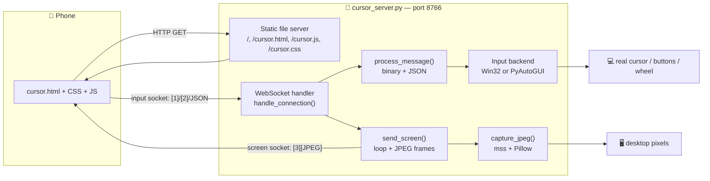
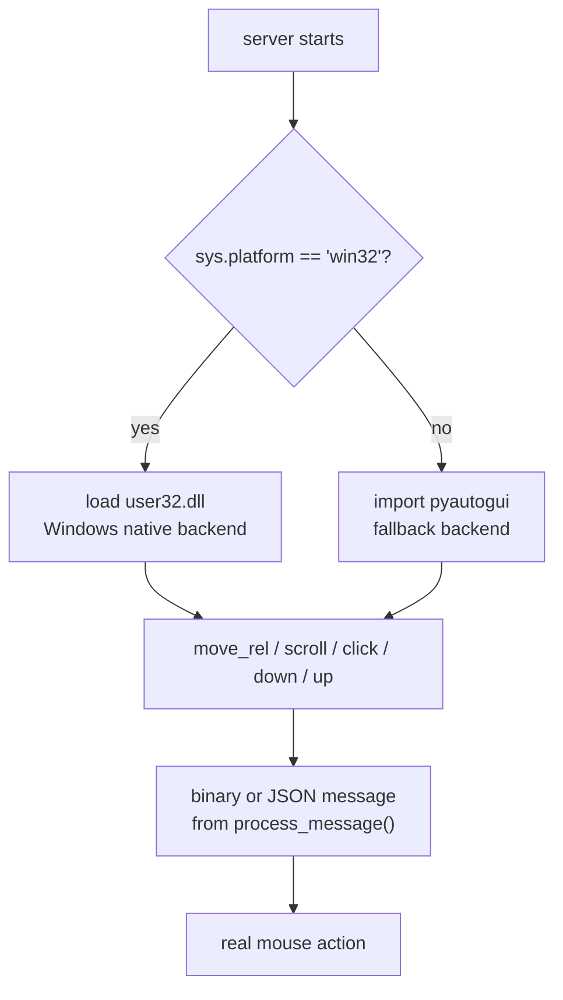
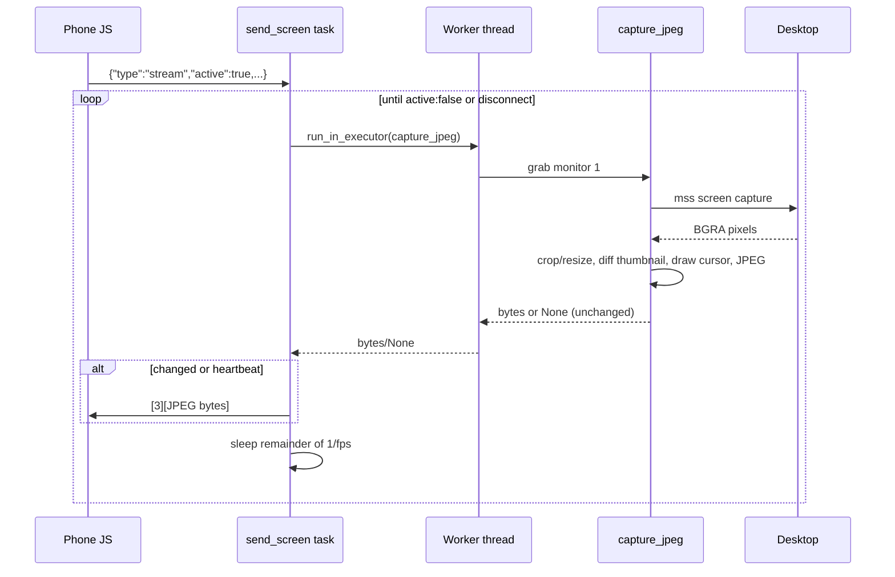
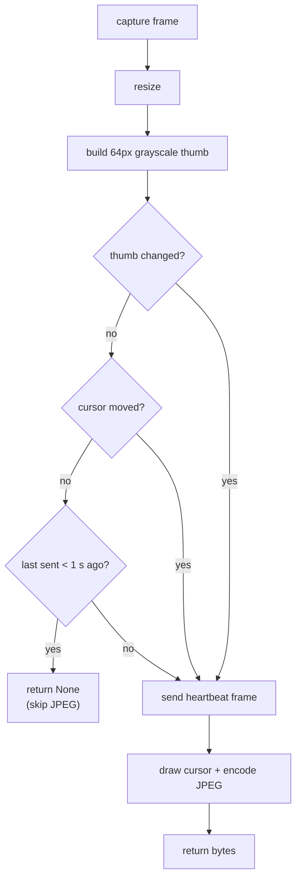
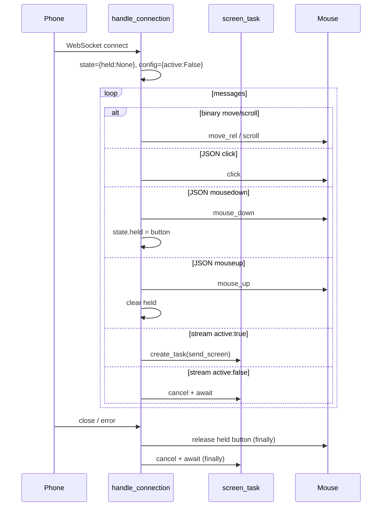
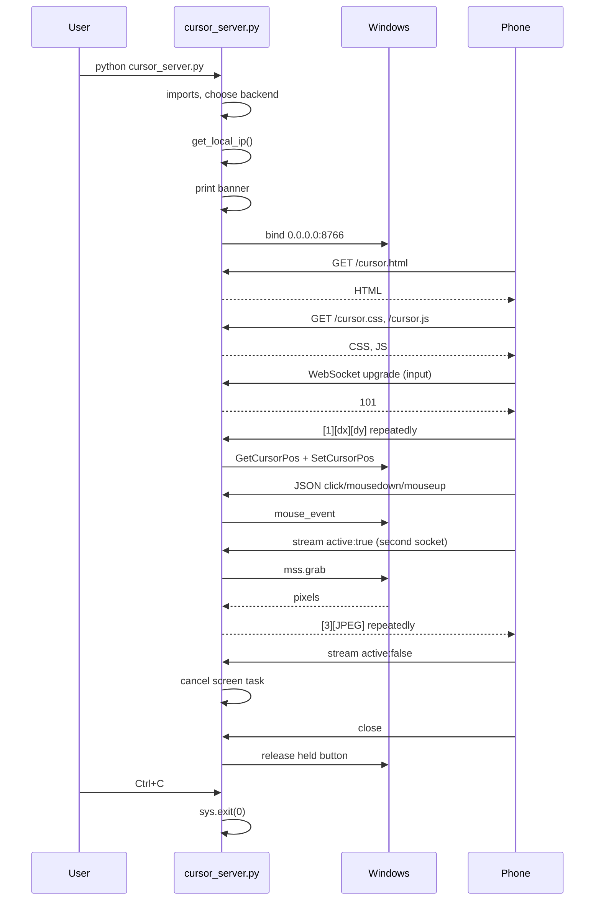

# The Hands of the Project, Explained From Zero
## A line-by-line guide to `cursor_server.py`

> **Who this is for:** someone who is new to Python, networking, and operating-system APIs.
>
> **What this file covers:** all 583 lines of `cursor_server.py`.
>
> **How to read it:** keep the file open beside this guide. Line numbers match exactly.
> Each section explains the purpose first, then every line range, then what breaks if the
> line is missing or changed.

---

## 0. The three-second summary

`cursor_server.py` is the program running on the **computer** (the laptop/desktop), not on
the phone.

It does four jobs:

1. **Serves the web page** (`cursor.html`, `cursor.css`, `cursor.js`) on port `8766`.
2. **Accepts WebSocket connections** from the phone.
3. **Turns tiny input messages into real mouse actions** using the Windows API (or
   PyAutoGUI on macOS/Linux).
4. **Captures the computer screen** on demand and streams JPEG frames back to the phone.

The phone is the remote control. This file is the hand that presses the computer's mouse
button and the camera that shows the computer's screen.

---

## 1. The big picture



### The four layers of the server

| Layer | Lines | Job |
| --- | --- | --- |
| Imports and optional screen libraries | 1–26 | Prepare tools |
| Input backend | 29–148 | Move/click/scroll the real mouse |
| Screen capture and stream | 150–352 | Grab, resize, draw cursor, encode JPEG, send |
| WebSocket server and routing | 354–583 | Serve the page, accept sockets, dispatch messages, clean up |

---

## 2. Python in one page (only what this file uses)

| Concept | Meaning here |
| --- | --- |
| **Module / import** | Load a library. `import asyncio` gives async tools. |
| **`try` / `except`** | Try code; if it fails with a specific error, run the fallback. |
| **Function** | A reusable block: `def move_rel(dx, dy): ...`. |
| **`if __name__ == "__main__":`** | Run the server only when the file is executed directly, not when imported. |
| **`async def` / `await`** | Asynchronous code: while waiting for network I/O, other work can run. |
| **`asyncio`** | Python's event loop for async tasks. |
| **`websockets`** | Third-party library that implements the WebSocket protocol. |
| **`ctypes`** | Call C functions inside Windows DLLs directly from Python. |
| **`struct`** | Convert bytes to/from Python integers. |
| **`threading` / `ThreadPoolExecutor`** | Run blocking work (screen capture) off the async event loop. |
| **Type hints** | Labels like `dx: int`; Python does not enforce them, but they document intent. |

### 2.1 Why async matters

Screen capture is slow (tens of milliseconds). Moving the mouse is fast (microseconds).
If the server captured the screen on its only thread, every capture would freeze input for
that moment. `asyncio` plus a worker thread keeps the pointer responsive while the screen
stream is running.

### 2.2 The full map

| Lines | Section |
| --- | --- |
| 1–18 | Standard-library and third-party imports |
| 20–26 | Optional screen libraries |
| 29–148 | Input backend (Win32 or PyAutoGUI) |
| 150–352 | Screen capture and streaming |
| 354–583 | WebSocket server, static files, lifecycle, startup |

---

## 3. Lines 1–26: imports and optional dependencies

```py
1:  import asyncio
2:  import contextlib
3:  import ctypes
4:  import io
5:  import json
6:  import socket
7:  import struct
8:  import sys
9:  import threading
10: import time
11: from concurrent.futures import ThreadPoolExecutor
12: from pathlib import Path
13: from urllib.parse import urlsplit
14:
15: import websockets
16: from websockets.asyncio.server import ServerConnection
17: from websockets.datastructures import Headers
18: from websockets.http11 import Response
19:
20: try:
21:     import mss
22:     from PIL import Image, ImageChops, ImageDraw
23:
24:     SCREEN_AVAILABLE = True
25: except ImportError:
26:     SCREEN_AVAILABLE = False
```

| Line(s) | Import | Why it is needed | If missing |
| --- | --- | --- | --- |
| 1 | `asyncio` | Event loop, tasks, sleeps, futures. | The server cannot run concurrently or await WebSocket messages. |
| 2 | `contextlib` | `suppress()` to ignore expected exceptions during cleanup. | Cleanup becomes noisy or needs manual `try/except`. |
| 3 | `ctypes` | Call Windows `user32.dll` functions. | No native Windows input backend. |
| 4 | `io` | In-memory byte buffer for JPEG encoding. | Must write temp files instead of holding the JPEG in memory. |
| 5 | `json` | Parse click/drag/stream messages. | Text messages cannot be decoded. |
| 6 | `socket` | Find the LAN IP; set `TCP_NODELAY`. | Startup banner loses the phone URL; Nagle stays on. |
| 7 | `struct` | Unpack little-endian int16 pairs. | Binary move/scroll cannot be decoded. |
| 8 | `sys` | Detect Windows (`sys.platform`) and exit. | Cannot choose the backend or exit cleanly. |
| 9 | `threading` | Thread-local `mss` instances. | Each capture call creates a new screenshot object; slower and thread-unsafe. |
| 10 | `time` | `perf_counter()` for FPS, heartbeat, error throttling. | Timing logic breaks. |
| 11 | `ThreadPoolExecutor` | One worker for screen capture. | Capture blocks the event loop. |
| 12 | `Path` | Build file paths relative to the script. | Static paths depend on the current working directory; server may 404. |
| 13 | `urlsplit` | Strip query strings from request paths. | `/cursor.css?v=13` would not match `/cursor.css`. |
| 15 | `websockets` | The WebSocket server and exceptions. | No networking at all. |
| 16 | `ServerConnection` | Subclass it to disable Nagle's algorithm. | No custom TCP option. |
| 17 | `Headers` | Build HTTP response headers. | Static responses cannot be constructed cleanly. |
| 18 | `Response` | Return a raw HTTP response from the request hook. | Static file serving is harder. |

**Why are `mss` and Pillow optional?** They are only needed for the screen preview. If a
user installs only `websockets`, the remote mouse still works; the screen button simply
produces no frames. This is a graceful degradation.

| Scenario | `SCREEN_AVAILABLE` | Behaviour |
| --- | --- | --- |
| `mss` and `Pillow` installed | `True` | Screen streaming works |
| One of them missing | `False` | Input works; server prints "Screen capture off"; viewer shows "No signal" |
| Installed but screen capture fails at runtime | Still `True` | `send_screen` catches the error, waits, retries; prints a throttled message |

**What if you remove the `try/except` and just import them?** Python raises `ImportError`
at startup, so the entire server refuses to run — even the parts that do not need screen
capture. The optional import keeps the core feature alive.

---

## 4. Lines 29–148: the input backend

This is where a Python function becomes a real mouse movement.



### 4.1 Lines 29–37: the section comment and platform check

```py
29: # ---------------------------------------------------------------------------
30: # Input backend
31: #
32: # Windows uses the native API directly: no PyAutoGUI wrapper, no extra Python
33: # work between the WebSocket frame and the cursor movement. PyAutoGUI remains
34: # the fallback on other platforms.
35: # ---------------------------------------------------------------------------
36:
37: IS_WINDOWS = sys.platform == "win32"
```

| Line(s) | Meaning | If changed |
| --- | --- | --- |
| 29–35 | Comments. | Nothing. |
| 37 | `sys.platform` is `"win32"` on Windows, `"darwin"` on macOS, `"linux"` on Linux. | If detected wrong, the server loads the wrong backend and crashes or uses the slow path. |

### 4.2 Lines 39–48: loading `user32.dll`, DPI awareness, the cursor point

```py
39: if IS_WINDOWS:
40:     from ctypes import wintypes
41:
42:     user32 = ctypes.WinDLL("user32", use_last_error=True)
43:
44:     # Match PyAutoGUI: keep cursor coordinates in physical screen pixels.
45:     try:
46:         user32.SetProcessDPIAware()
47:     except Exception:
48:         pass
```

| Line(s) | Meaning | If changed |
| --- | --- | --- |
| 39 | Only define the Windows backend on Windows. | On macOS/Linux, `WinDLL` does not exist and the file would crash at import. |
| 40 | `wintypes` provides Windows types: `POINT`, `DWORD`, `BOOL`, `c_int`. | `argtypes` declarations become harder and may pass wrong sizes. |
| 42 | Load `user32.dll`, the Windows library containing cursor/mouse functions. `use_last_error=True` lets ctypes capture the Windows error code. | `OSError` at startup; no input. |
| 45–48 | `SetProcessDPIAware()` tells Windows: "this process handles display scaling itself; give me physical pixels, not virtualised ones." | On a 125% or 150% scaled display, `GetCursorPos`/`SetCursorPos` may return logical coordinates; relative movement can be scaled or drift. |
| 46 | Wrapped in `try/except` because some Windows versions/security contexts reject it. | Without the `try`, a failure would stop the server. |

**DPI in beginner terms:** a 4K laptop may display Windows at 150% scaling. A "point" in
Python might mean 1.5 physical pixels. If the server mixes scaled and physical coordinates,
moving 10 units might move 15 physical pixels, and the cursor drifts away from the finger.
`SetProcessDPIAware` makes the process use physical pixels consistently.

### 4.3 Lines 50–63: the cursor holder and function signatures

```py
50:     _cursor = wintypes.POINT()
51:
52:     user32.GetCursorPos.argtypes = [ctypes.POINTER(wintypes.POINT)]
53:     user32.GetCursorPos.restype = wintypes.BOOL
54:     user32.SetCursorPos.argtypes = [ctypes.c_int, ctypes.c_int]
55:     user32.SetCursorPos.restype = wintypes.BOOL
56:     user32.mouse_event.argtypes = [
57:         wintypes.DWORD,
58:         wintypes.DWORD,
59:         wintypes.DWORD,
60:         wintypes.DWORD,
61:         ctypes.c_size_t,
62:     ]
63:     user32.mouse_event.restype = None
```

| Line(s) | Meaning | If changed |
| --- | --- | --- |
| 50 | A reusable `POINT` struct (two longs: x and y). Reusing it avoids allocating a new object for every movement. | New object per call; more garbage collection, slightly slower. |
| 52–53 | Tell ctypes that `GetCursorPos` takes a pointer to a `POINT` and returns a Windows `BOOL` (nonzero = success). | Without `argtypes`, ctypes may pass the pointer incorrectly on 64-bit Windows. Without `restype`, the return value may be truncated. |
| 54–55 | `SetCursorPos` takes two C ints (x, y) and returns a `BOOL`. | Wrong types can crash or silently fail. |
| 56–62 | `mouse_event` takes five arguments: flags, dx, dy, data, extra info. All are 32-bit `DWORD` except the last `c_size_t` (pointer-sized). | A wrong signature can corrupt the stack or pass garbage; button/wheel events fail. |
| 63 | `mouse_event` returns nothing. | Minor; the default `c_int` return is harmless but incorrect. |

**Why declare `argtypes` at all?** Python does not know C function signatures. If you call a
64-bit function with the wrong-sized integer, the upper bits may be garbage. On 64-bit
Windows, pointers and `size_t` are 8 bytes while `int` is 4. Being explicit prevents subtle,
hard-to-debug crashes. This is a good habit for any `ctypes` code.

### 4.4 Lines 65–78: mouse event constants and button mapping

```py
65:     MOUSEEVENTF_LEFTDOWN = 0x0002
66:     MOUSEEVENTF_LEFTUP = 0x0004
67:     MOUSEEVENTF_RIGHTDOWN = 0x0008
68:     MOUSEEVENTF_RIGHTUP = 0x0010
69:     MOUSEEVENTF_MIDDLEDOWN = 0x0020
70:     MOUSEEVENTF_MIDDLEUP = 0x0040
71:     MOUSEEVENTF_WHEEL = 0x0800
72:     MOUSEEVENTF_HWHEEL = 0x1000
73:
74:     BUTTON_FLAGS = {
75:         "left": (MOUSEEVENTF_LEFTDOWN, MOUSEEVENTF_LEFTUP),
76:         "right": (MOUSEEVENTF_RIGHTDOWN, MOUSEEVENTF_RIGHTUP),
77:         "middle": (MOUSEEVENTF_MIDDLEDOWN, MOUSEEVENTF_MIDDLEUP),
78:     }
```

| Lines | Constant | Meaning |
| --- | --- | --- |
| 65 | `LEFTDOWN` | Press the left button |
| 66 | `LEFTUP` | Release the left button |
| 67–68 | `RIGHTDOWN/UP` | Right button |
| 69–70 | `MIDDLEDOWN/UP` | Middle button |
| 71 | `WHEEL` | Vertical scroll wheel |
| 72 | `HWHEEL` | Horizontal scroll wheel |

`BUTTON_FLAGS` maps the JSON string (`"left"`, `"right"`, `"middle"`) to the pair of flags
needed to press and release it. If an unknown button arrives, `.get(button, ...)` falls
back to left, so the server never crashes on a typo.

**These hex numbers come from the Windows API.** You do not need to memorise them; they are
the documented bit flags for `mouse_event`. If you swap `LEFTDOWN` and `LEFTUP`, the server
would release a button before pressing it, producing no clicks.

### 4.5 Lines 80–86: `move_rel` (relative movement)

```py
80:     def move_rel(dx, dy):
81:         dx = int(dx)
82:         dy = int(dy)
83:         if dx == 0 and dy == 0:
84:             return
85:         if user32.GetCursorPos(ctypes.byref(_cursor)):
86:             user32.SetCursorPos(_cursor.x + dx, _cursor.y + dy)
```

| Line(s) | Meaning | If changed |
| --- | --- | --- |
| 80 | A function that moves the cursor by `dx`, `dy`, relative to its current position. | — |
| 81–82 | Coerce to Python `int`; JSON may send floats, and `SetCursorPos` expects integers. | Decimals are rejected or truncated unpredictably. |
| 83–84 | A zero move does nothing. | Wasted system calls; harmless but noisy. |
| 85 | Read the current position. `ctypes.byref(_cursor)` passes a pointer. `GetCursorPos` returns nonzero on success. | Without reading the current position, you cannot add a delta. `SetCursorPos(dx, dy)` would treat the delta as an absolute screen coordinate, teleporting the cursor to the top-left area. |
| 86 | Set the new absolute position = current + delta. | No movement. |

**This is the heart of "relative movement":** the phone sends `dx=21, dy=8`, not a screen
coordinate. The server asks Windows where the cursor is, adds the delta, and sets the new
position. This works on any monitor resolution and does not jump when the finger first
touches.

**What if `GetCursorPos` fails?** It returns 0, so the `if` body is skipped: no movement that
frame, no crash. This can happen on a secure desktop (UAC prompt), a locked screen, or a
disconnected session.

**Why not `SetCursorPos(dx, dy)` directly?** Because `dx, dy` are small relative values
(e.g., 21, 8). Treating them as absolute coordinates would put the cursor near the top-left
corner of the screen on every move.

### 4.6 Lines 88–99: `scroll`

```py
88:     def scroll(dy, dx=0):
89:         vertical = int(-dy * 4)
90:         if vertical:
91:             user32.mouse_event(
92:                 MOUSEEVENTF_WHEEL, 0, 0, ctypes.c_uint32(vertical).value, 0
93:             )
94:
95:         horizontal = int(dx * 4)
96:         if horizontal:
97:             user32.mouse_event(
98:                 MOUSEEVENTF_HWHEEL, 0, 0, ctypes.c_uint32(horizontal).value, 0
99:             )
```

| Line(s) | Meaning | If changed |
| --- | --- | --- |
| 88 | `dy` is finger vertical movement; `dx` is optional horizontal. | — |
| 89 | Negate `dy` (finger down should scroll content down, which is a negative wheel delta) and multiply by 4 to make scrolling responsive. | Sign flipped: natural scrolling feels inverted. Multiplier 1: very slow scrolling. |
| 90 | Skip if the rounded value is zero. | A zero wheel event is unnecessary. |
| 91–93 | Send a vertical wheel event. `mouse_event` expects the wheel amount in the `dwData` argument as an unsigned 32-bit value; `ctypes.c_uint32(vertical).value` converts a negative Python int into the correct two's-complement bits. | Passing a negative Python int directly may raise a ctypes error or send the wrong value. |
| 95 | Horizontal scroll is not negated; it maps directly. | Horizontal direction may feel reversed on some platforms, but it matches Windows' convention. |
| 96–99 | Send a horizontal wheel event if nonzero. | No horizontal scrolling. |

**The wheel unit:** Windows calls one wheel notch `WHEEL_DELTA = 120`. This code sends `dy*4`
as the delta, not 120. That means small finger movements produce small scrolls, which feels
analog rather than notchy. At 120, one notch would require a finger delta of 30 units. The
×4 is a feel choice.

**Two's complement in one sentence:** a 32-bit unsigned integer represents `-40` as
`4294967256`. Windows reads those bits as a signed value. `ctypes.c_uint32(-40).value`
performs that conversion safely.

### 4.7 Lines 101–118: clicks and button press/release

```py
101:     def click(button, clicks):
102:         down, up = BUTTON_FLAGS.get(button, BUTTON_FLAGS["left"])
103:         for _ in range(max(1, min(int(clicks), 5))):
104:             user32.mouse_event(down, 0, 0, 0, 0)
105:             user32.mouse_event(up, 0, 0, 0, 0)
106:
107:     def mouse_down(button="left"):
108:         down, _ = BUTTON_FLAGS.get(button, BUTTON_FLAGS["left"])
109:         user32.mouse_event(down, 0, 0, 0, 0)
110:
111:     def mouse_up(button="left"):
112:         _, up = BUTTON_FLAGS.get(button, BUTTON_FLAGS["left"])
113:         user32.mouse_event(up, 0, 0, 0, 0)
114:
115:     def cursor_position():
116:         if user32.GetCursorPos(ctypes.byref(_cursor)):
117:             return _cursor.x, _cursor.y
118:         return None
```

| Line(s) | Meaning | If changed |
| --- | --- | --- |
| 101 | Click a button a number of times. | — |
| 102 | Look up the down/up flags; unknown button → left. | A typo silently clicks the wrong button instead of crashing. |
| 103 | Clamp clicks to 1–5 and loop. `max(1, ...)` prevents zero/negative; `min(..., 5)` prevents a malicious client from requesting a million clicks. | A client could freeze the computer with a huge click count; zero clicks would do nothing. |
| 104–105 | Press then release. | No click, or a stuck button if only one half is sent. |
| 107–109 | Hold a button down (used for drag). | Hold-to-drag cannot work. |
| 111–113 | Release a button. | Stuck drag. |
| 115–118 | Read the current cursor position, returning `None` on failure. Used by the screen overlay to draw the pointer. | The screen stream cannot draw a cursor; no crash because the caller checks `None`. |

**Why click in a loop rather than `clicks=2`?** Windows has no "click twice" API; a
double-click is two down/up pairs close together in time. The loop sends them back-to-back.
Windows itself decides whether the timing qualifies as a double-click. The clamp protects
the machine from an accidental or malicious huge value.

### 4.8 Lines 120–148: the PyAutoGUI fallback

```py
120: else:
121:     import pyautogui
122:
123:     pyautogui.PAUSE = 0
124:     pyautogui.FAILSAFE = False
125:
126:     def move_rel(dx, dy):
127:         pyautogui.moveRel(dx, dy, _pause=False)
128:
129:     def scroll(dy, dx=0):
130:         if dy:
131:             pyautogui.scroll(int(-dy * 4), _pause=False)
132:         if dx:
133:             pyautogui.hscroll(int(dx * 4), _pause=False)
134:
135:     def click(button, clicks):
136:         pyautogui.click(
137:             button=button, clicks=clicks, interval=0.08, _pause=False
138:         )
139:
140:     def mouse_down(button="left"):
141:         pyautogui.mouseDown(button=button, _pause=False)
142:
143:     def mouse_up(button="left"):
144:         pyautogui.mouseUp(button=button, _pause=False)
145:
146:     def cursor_position():
147:         return None
148:
```

| Line(s) | Meaning | If changed |
| --- | --- | --- |
| 120 | Non-Windows branch. | — |
| 121 | Import PyAutoGUI. It is only installed on non-Windows via `requirements.txt` (`sys_platform != "win32"`). | If missing, the server crashes at startup on macOS/Linux. |
| 123 | Default PyAutoGUI delay after each call is 0.1 s. Set it to 0 for responsiveness. | Every movement waits 100 ms; the cursor is unusable. |
| 124 | `FAILSAFE` normally stops PyAutoGUI if the cursor hits a screen corner. Disable it so the remote does not randomly stop. | Moving to a corner raises `FailSafeException`; the connection handler may log errors. |
| 126–127 | Relative move. `_pause=False` overrides the global pause for this call. | Slow/blocky movement. |
| 129–133 | Vertical/horizontal scroll, same sign/multiplier as Windows. | Inverted or missing scroll. |
| 135–138 | Click with an 80 ms interval between multiple clicks — enough for the OS to see them as a sequence but not too slow. | Double-click may be interpreted as two singles. |
| 140–144 | Press/release for drag. | No hold-to-drag. |
| 146–147 | PyAutoGUI has no reliable cross-platform cursor read here, so the screen overlay skips the cursor. | If it returned a wrong value, the drawn cursor would be in the wrong place; `None` is safer. |

**Why not use PyAutoGUI on Windows too?** It works, but it adds Python wrapper overhead and
its own pause/failsafe logic between the WebSocket byte and the system call. The native
Win32 path is shorter and more predictable, which matters at 60+ packets per second. The
fallback keeps macOS/Linux usable without maintaining three separate backends.

---

## 5. Lines 150–352: screen capture and streaming

This is the optional camera. It only runs while the phone's viewer is open.



### 5.1 Lines 150–167: constants, clamps, and event tags

```py
150: # ---------------------------------------------------------------------------
151: # Screen capture (streamed on demand over the same WebSocket)
152: # ---------------------------------------------------------------------------
153:
154: DEFAULT_FPS = 12
155: DEFAULT_QUALITY = 55
156: DEFAULT_WIDTH = 960
157: CURSOR_CSS_PX = 12
158:
159: MIN_FPS, MAX_FPS = 1, 20
160: MIN_QUALITY, MAX_QUALITY = 30, 80
161: MIN_WIDTH, MAX_WIDTH = 480, 1280
162:
163: # Client -> server binary events.
164: EVENT_MOVE = 1
165: EVENT_SCROLL = 2
166: # Server -> client binary event: [3][JPEG bytes].
167: EVENT_SCREEN = 3
```

| Line(s) | Constant | Value | Meaning |
| --- | --- | --- | --- |
| 154 | `DEFAULT_FPS` | 12 | Frames per second if the client does not specify. |
| 155 | `DEFAULT_QUALITY` | 55 | JPEG quality 1–95; higher = sharper/larger. |
| 156 | `DEFAULT_WIDTH` | 960 | Resize width before encoding. |
| 157 | `CURSOR_CSS_PX` | 12 | The cursor should look ~12 CSS pixels wide on the phone. |
| 159 | FPS clamp | 1–20 | Prevents 0 fps (divide by zero) and absurd 240 fps (CPU/battery drain). |
| 160 | Quality clamp | 30–80 | Below 30 is blocky; above 80 is large and slow. |
| 161 | Width clamp | 480–1280 | Below 480 is unreadable; above 1280 wastes bandwidth. |
| 164 | `EVENT_MOVE = 1` | Byte tag for move packets. | Must match `cursor.js`. |
| 165 | `EVENT_SCROLL = 2` | Byte tag for scroll packets. | Must match. |
| 167 | `EVENT_SCREEN = 3` | Byte tag for JPEG frames. | Must match. |

**The protocol is a contract.** If the client sends tag `1` and the server expects `1`,
movement works. If either side changes a tag and the other does not, messages are silently
ignored (the server returns without action). There is no negotiation and no version number;
keep the numbers in sync.

### 5.2 Lines 169–191: thread-local `mss` and the arrow shape

```py
169: if SCREEN_AVAILABLE:
170:     _SCREEN_THREAD = threading.local()
171:     _SCREEN_EXECUTOR = ThreadPoolExecutor(max_workers=1)
172:
173:     # Mouse pointer shape, in output pixels at its natural size.
174:     _ARROW = (
175:         (0.0, 0.0),
176:         (0.0, 18.0),
177:         (4.6, 13.8),
178:         (7.8, 21.2),
179:         (11.0, 19.7),
180:         (7.8, 12.7),
181:         (13.8, 11.7),
182:     )
183:
184:     def _screen():
185:         sct = getattr(_SCREEN_THREAD, "sct", None)
186:         if sct is None:
187:             # mss 10 renamed the factory; support both spellings.
188:             factory = getattr(mss, "MSS", None) or mss.mss
189:             sct = factory()
190:             _SCREEN_THREAD.sct = sct
191:         return sct
```

| Line(s) | Meaning | If changed |
| --- | --- | --- |
| 169 | Only build screen tools if the libraries exist. | Importing/using missing `mss` would crash. |
| 170 | A thread-local storage object. Each thread gets its own attributes. | Sharing one `mss` object across threads can fail; some backends are not thread-safe. |
| 171 | One worker thread for all captures. | More workers could capture in parallel, competing for the screen/CPU; zero workers means blocking the event loop. |
| 174–182 | Seven (x, y) points of a mouse-arrow polygon. The natural height is 21.2 units. | The drawn cursor shape changes or disappears. |
| 184 | Get the capture object for the current thread. | — |
| 185 | `getattr(..., None)` returns `None` if not created yet. | — |
| 186 | First capture on this thread → create. | A new `mss` object on every frame is slower and may leak resources. |
| 188 | Support both `mss.MSS()` (new) and `mss.mss()` (old). | The server crashes on one of the two versions. |
| 189 | Create the capture object. | No screen capture. |
| 190 | Cache it on the thread. | Recreated every call. |
| 191 | Return it. | — |

**What is `mss`?** A small, fast, cross-platform screen-capture library. It returns raw
pixels from a monitor as a byte buffer. It is much faster than taking a screenshot through
a browser or a GUI framework.

**Why a single worker?** Screen capture is CPU-heavy. Parallel captures would produce frames
out of order and compete for the same monitor. One worker serialises them, and the executor
queue keeps the async loop free.

### 5.3 Lines 193–202: drawing the cursor arrow

```py
193:     def _draw_cursor(image, x, y, scale):
194:         draw = ImageDraw.Draw(image)
195:         points = [(x + px * scale, y + py * scale) for px, py in _ARROW]
196:         draw.polygon(points, fill=(255, 255, 255))
197:         draw.line(
198:             points + [points[0]],
199:             fill=(0, 0, 0),
200:             width=max(1, round(scale * 1.4)),
201:             joint="curve",
202:         )
203:
```

| Line(s) | Meaning | If changed |
| --- | --- | --- |
| 193 | Draw a white arrow with a black outline at `(x, y)`, scaled by `scale`. | — |
| 194 | Create a Pillow drawing object for the image. | No drawing. |
| 195 | Scale every point of the arrow and offset it to the cursor position. | The cursor is drawn at the wrong size/place. |
| 196 | Fill the polygon white. | A black shape on a dark screen is invisible. |
| 197–202 | Draw a black outline around the same points, closing back to the first point. `width` scales with the arrow, `joint="curve"` rounds the corners. | The white arrow disappears on light backgrounds. |
| 200 | `max(1, ...)` ensures the outline is at least 1 px; `round(scale*1.4)` keeps it proportional. | A hairline outline or a huge blob. |

**Why draw the cursor manually?** Operating-system screen capture often does **not** include
the mouse pointer. The phone would see the screen but not where the cursor is. Drawing it
server-side guarantees the pointer is visible and lets us scale it for the phone.

### 5.4 Lines 204–262: `capture_jpeg`

This is the screen-capture pipeline, step by step.

```py
204:     def capture_jpeg(width, quality, state=None, cursor_px=0.0):
205:         sct = _screen()
206:         monitor = sct.monitors[1]
207:         shot = sct.grab(monitor)
208:
209:         image = Image.frombytes("RGB", shot.size, shot.bgra, "raw", "BGRX")
210:
211:         if width < image.width:
212:             height = max(1, round(image.height * width / image.width))
213:             image = image.resize((width, height), Image.Resampling.BILINEAR)
214:
215:         position = cursor_position()
216:
217:         if state is not None:
218:             # While the screen is idle, skip JPEG encoding entirely...
219:             thumb = image.resize(
220:                 (64, max(1, round(image.height * 64 / image.width))),
221:                 Image.Resampling.BILINEAR,
222:             ).convert("L")
223:             now = time.perf_counter()
224:             previous = state.get("thumb")
225:             changed = (
226:                 previous is None
227:                 or previous.size != thumb.size
228:                 or ImageChops.difference(thumb, previous).getbbox() is not None
229:             )
230:             moved = position != state.get("cursor")
231:             state["thumb"] = thumb
232:             state["cursor"] = position
233:
234:             if not changed and not moved and now - state.get("sent", 0.0) < 1.0:
235:                 return None
236:
237:             state["sent"] = now
238:
239:         if position is not None:
240:             # The captured frame can be smaller than the physical monitor.
241:             scale_x = image.width / monitor["width"]
242:             scale_y = image.height / monitor["height"]
243:             x = (position[0] - monitor["left"]) * scale_x
244:             y = (position[1] - monitor["top"]) * scale_y
245:             if 0 <= x < image.width and 0 <= y < image.height:
246:                 if cursor_px <= 0:
247:                     cursor_px = width * 0.02
248:                 pointer_scale = max(0.3, min(3.0, cursor_px / 21.2))
249:                 _draw_cursor(image, x, y, pointer_scale)
250:
251:         buffer = io.BytesIO()
252:         image.save(
253:             buffer,
254:             "JPEG",
255:             quality=quality,
256:             optimize=False,
257:             progressive=False,
258:             subsampling=2,
259:         )
260:         return buffer.getvalue()
```

| Line(s) | Meaning | If changed |
| --- | --- | --- |
| 204 | Inputs: target width, JPEG quality, optional frame-skip state, cursor size in output pixels. | — |
| 205 | Get the thread-local capture object. | — |
| 206 | `monitors[1]` is the primary monitor. `monitors[0]` is the virtual bounding box of all monitors. | Capturing the wrong monitor (or a multi-monitor bounding box) shows the wrong area or a huge sparse image. |
| 207 | Grab the monitor as raw BGRA pixels. | No image. |
| 209 | Convert the raw buffer to a Pillow RGB image. Windows stores blue-green-red-alpha; `"BGRX"` says "ignore the fourth byte". | Colours come out blue/red swapped (channels misread). |
| 211 | Only downscale; never upscale. | Upscaling a small screen wastes bytes and looks blurry without adding detail. |
| 212 | Preserve aspect ratio: new height = old height × (new width / old width). `max(1, ...)` avoids a zero-height image. | Distorted or zero-height image. |
| 213 | Bilinear resize: fast and good enough for a preview. | Nearest-neighbour looks jagged; bicubic/Lanczos is slower. |
| 215 | Read the real cursor position. On Windows this works; on the fallback it returns `None`. | No cursor overlay. |
| 217 | If a `state` dict was passed, use the idle-skip logic. `send_screen` passes one; a one-off capture would pass `None`. | Every frame is JPEG-encoded even when nothing changed: wasted CPU. |
| 219–222 | Build a 64 px-wide grayscale thumbnail. | A large diff is slower; a tiny diff misses small changes. |
| 223 | Current time. | — |
| 224 | Previous thumbnail or `None`. | — |
| 225–229 | `changed` is true if there was no previous frame, the size changed, or any pixel differs. `ImageChops.difference(...).getbbox()` returns the bounding box of non-zero differences, or `None` if identical. | Missed changes or unnecessary encoding. |
| 230 | `moved` is true if the cursor position changed (including `None` transitions). | The cursor overlay would not update on a static screen. |
| 231–232 | Store the current thumbnail and cursor for next time. | The next comparison uses stale data. |
| 234–235 | If nothing changed, the cursor did not move, **and** less than 1 second has passed since the last sent frame, return `None` (skip). | Static screens burn CPU and bandwidth; without the 1 s heartbeat, the client's "No signal" watchdog would trigger. |
| 237 | Record when a frame was actually sent. | The heartbeat timing is wrong. |
| 239 | If the cursor position is known. | — |
| 241–242 | Map physical monitor coordinates to the resized image. `monitor["width"]/["height"]` are the original dimensions. | The cursor is drawn at the wrong scale/offset. |
| 243–244 | Subtract the monitor's origin, then scale. On a multi-monitor setup, the primary monitor may not start at `(0,0)`. | Cursor is offset by the monitor's position. |
| 245 | Only draw if the cursor is inside the captured image. | The arrow can be drawn outside the image or onto the wrong edge. |
| 246–247 | If no explicit cursor size, use 2% of the output width. | The pointer may be too small/large. |
| 248 | Scale factor relative to the arrow's natural 21.2-unit height, clamped to 0.3–3.0. | A huge viewer could draw a giant arrow; a tiny one could vanish. |
| 249 | Draw it. | No pointer in the preview. |
| 251 | In-memory buffer; no temp file. | Temp files would be slower and need cleanup. |
| 252–259 | Encode JPEG. `optimize=False` and `progressive=False` reduce CPU. `subsampling=2` uses 4:2:0 chroma subsampling: less colour detail, smaller files, fine for screen preview. | Slower encoding or larger files. `subsampling=0` keeps full colour but is much bigger. |
| 260 | Return the JPEG bytes. | `send_screen` has nothing to send. |

**What is 4:2:0 subsampling?** Human eyes are more sensitive to brightness than colour
detail. JPEG can store full brightness but quarter-resolution colour. Subsampling 2 does
that, cutting file size substantially. Text stays readable because its edges are mostly
brightness changes.

**The idle-skip logic, visualised:**



**What if `mss` returns a different monitor size after a resolution change?** The thumbnail
size check catches it (`previous.size != thumb.size`), so a frame is sent instead of being
skipped. The cursor scale uses the current monitor dimensions, so it stays consistent.

### 5.5 Lines 264–329: `send_screen`

```py
264:     async def send_screen(websocket, config):
265:         loop = asyncio.get_running_loop()
266:         frames = 0
267:         total_bytes = 0
268:         started = time.perf_counter()
269:         last_error = 0.0
270:         state = {}
271:
272:         try:
273:             while True:
274:                 frame_started = time.perf_counter()
275:                 fps = config["fps"]
276:                 quality = config["quality"]
277:                 width = config["width"]
278:
279:                 viewer_width = config.get("viewer_width", 0)
280:                 if viewer_width:
281:                     cursor_px = max(
282:                         8.0, min(48.0, CURSOR_CSS_PX * width / viewer_width)
283:                     )
284:                 else:
285:                     cursor_px = 0.0
286:
287:                 try:
288:                     jpeg = await loop.run_in_executor(
289:                         _SCREEN_EXECUTOR,
290:                         capture_jpeg,
291:                         width,
292:                         quality,
293:                         state,
294:                         cursor_px,
295:                     )
296:                 except Exception as exc:
297:                     now = time.perf_counter()
298:                     if now - last_error > 5:
299:                         print(f"Screen capture failed: {exc}", flush=True)
300:                         last_error = now
301:                     await asyncio.sleep(0.5)
302:                     continue
303:
304:                 if jpeg is not None:
305:                     frame = bytearray(len(jpeg) + 1)
306:                     frame[0] = EVENT_SCREEN
307:                     frame[1:] = jpeg
308:                     await websocket.send(frame)
309:
310:                     frames += 1
311:                     total_bytes += len(frame)
312:
313:                 delay = (1.0 / fps) - (time.perf_counter() - frame_started)
314:                 if delay > 0:
315:                     await asyncio.sleep(delay)
316:
317:                 if frames and frames % 120 == 0:
318:                     elapsed = time.perf_counter() - started
319:                     print(
320:                         f"Screen: {frames / elapsed:.1f} fps, "
321:                         f"{total_bytes / frames / 1024:.0f} KB/frame",
322:                         flush=True,
323:                     )
324:         except websockets.exceptions.ConnectionClosed:
325:             return
326:         except Exception as exc:
327:             print(f"Screen stream stopped: {exc}", flush=True)
328:
```

| Line(s) | Meaning | If changed |
| --- | --- | --- |
| 264 | An async task that sends frames on one screen socket. | — |
| 265 | Get the running event loop so blocking capture can be sent to an executor. | — |
| 266–270 | Counters for logging and idle state. `state = {}` is per stream, so a new viewer starts fresh. | Stats show wrong numbers; idle logic may carry between viewers. |
| 272 | Start error handling around the loop. | One failure kills the task silently. |
| 273 | Loop until cancelled (viewer closed/disconnect). | Only one frame is sent. |
| 274 | Frame start time for pacing. | FPS control is wrong. |
| 275–277 | Read the latest config each frame, so a resize/quality change takes effect immediately. | Changes require a stream restart. |
| 279 | Viewer width (CSS px) from the client. | Cursor scaling cannot adapt to the phone layout. |
| 280–283 | If known: target cursor size = 12 CSS px × (output width / viewer width), clamped to 8–48 output px. | A 12 px arrow on the phone stays 12 px after resizing/rotation; without this it grows/shrinks with the image. |
| 284–285 | Unknown width → `0.0`, and the capture function falls back to 2% of the output width. | Slightly less precise cursor size. |
| 287–295 | Run `capture_jpeg` in the single-worker executor and await it. The event loop stays free for input. | Capture blocks the loop: cursor freezes during each screenshot. |
| 296–302 | On capture error: print at most once every 5 seconds, sleep 0.5 s, continue. | A broken capture backend would spam the console thousands of times per second, or the task would die permanently. |
| 298 | `now - last_error > 5` throttle. | Log spam. |
| 299 | `flush=True` prints immediately even when stdout is redirected. | Logs may appear late/missing. |
| 301 | Back off half a second before retry. | Tight error loop burns CPU. |
| 304 | `None` means the frame was unchanged; skip sending. | The phone receives duplicate frames and wastes bandwidth. |
| 305 | Allocate `len(jpeg)+1` bytes for the tag. | — |
| 306 | First byte is `3`. | The client ignores the frame (tag check). |
| 307 | Copy JPEG bytes after the tag. | The client tries to decode the tag as JPEG and fails. |
| 308 | Send the binary frame. `await` applies backpressure: if the network is slow, this task waits instead of buffering endlessly. | Memory can grow if you fire-and-forget. |
| 310–311 | Update stats. | Logs wrong. |
| 313 | Delay = frame interval − time already spent. | Without pacing, the loop runs as fast as capture allows (exceeding the requested FPS, wasting CPU/bandwidth). |
| 314–315 | Sleep only if there is time left. If capture took longer than the interval, do not sleep; just continue. | Sleeping a negative number raises an error; adding a fixed sleep would make FPS too low. |
| 317 | Every 120 frames, log. | No performance visibility. |
| 318 | Elapsed time. | — |
| 319–322 | Print actual FPS and average KB/frame. | Harder to tune the stream. |
| 324–325 | Normal disconnect: return quietly. | A normal close logs an ugly error. |
| 326–327 | Any other error: log and stop the task. | Silent failure; viewer shows no signal with no clue. |

**The pacing formula in plain English:**

```text
target interval = 1 / fps
work time       = time spent capturing/encoding/sending
sleep time      = target interval - work time
```

At 12 fps, the target interval is 83.3 ms. If capture takes 30 ms, sleep 53.3 ms. If capture
takes 100 ms, the stream simply runs at 10 fps; no sleep and no error.

**Why `await websocket.send()` matters:** if the phone is on a slow tunnel, the send can block
until the network buffer drains. That is the correct backpressure signal. The capture task
waits, and the phone does not accumulate a huge backlog of stale frames. Combined with the
client dropping frames while decoding, the preview always trends toward the newest frame.

### 5.6 Lines 332–351: `update_stream_config`

```py
332: def update_stream_config(message, config):
333:     config["active"] = bool(message.get("active", config["active"]))
334:
335:     try:
336:         if "fps" in message:
337:             config["fps"] = max(MIN_FPS, min(MAX_FPS, int(message["fps"])))
338:         if "quality" in message:
339:             config["quality"] = max(
340:                 MIN_QUALITY, min(MAX_QUALITY, int(message["quality"]))
341:             )
342:         if "width" in message:
343:             config["width"] = max(
344:                 MIN_WIDTH, min(MAX_WIDTH, int(message["width"]))
345:             )
346:         if "viewerWidth" in message:
347:             config["viewer_width"] = max(
348:                 100, min(4000, int(message["viewerWidth"]))
349:             )
350:     except (TypeError, ValueError):
351:         pass
352:
```

| Line(s) | Meaning | If changed |
| --- | --- | --- |
| 332 | Update the mutable stream config from a client message. | — |
| 333 | `active` becomes a real boolean. If absent, keep the previous value. Note `bool("false")` is `True`, but the client sends real JSON booleans. | A string `"false"` would accidentally start the stream. |
| 335 | Start a guard for bad numeric input. | A malicious/buggy client could crash the connection handler with `int("abc")`. |
| 336–337 | Clamp FPS to 1–20. | 0 fps → division by zero; huge fps → CPU overload. |
| 338–341 | Clamp quality to 30–80. | Invalid JPEG quality; huge files or ugly images. |
| 342–345 | Clamp width to 480–1280. | Enormous captures or unreadable preview. |
| 346–349 | Clamp viewer width to 100–4000. | Division by zero or absurd cursor scaling. |
| 350–351 | Ignore `TypeError`/`ValueError` (e.g., missing value, non-numeric string). | One bad value kills the whole stream task. |

**The clamp pattern** `max(minimum, min(maximum, value))`:

- `value = 0`, fps: `min(20, 0)=0`, `max(1,0)=1` → 1.
- `value = 100`, fps: `min(20,100)=20`, `max(1,20)=20` → 20.
- `value = 12`, fps: stays 12.

**What happens when a field is absent?** The `if "fps" in message` check leaves the old value
untouched. This lets the client send a resize message with only `viewerWidth` and keep the
existing quality/FPS.

---

## 6. Lines 354–583: the WebSocket server

Now we connect everything: static files, sockets, message dispatch, cleanup, and startup.

### 6.1 Lines 354–369: `LowLatencyConnection` (disable Nagle)

```py
354: # ---------------------------------------------------------------------------
355: # WebSocket server
356: # ---------------------------------------------------------------------------
357:
358:
359: class LowLatencyConnection(ServerConnection):
360:     """Disable Nagle's algorithm on accepted connections."""
361:
362:     def connection_made(self, transport):
363:         try:
364:             sock = transport.get_extra_info("socket")
365:             if sock is not None:
366:                 sock.setsockopt(socket.IPPROTO_TCP, socket.TCP_NODELAY, 1)
367:         except OSError:
368:             pass
369:         super().connection_made(transport)
```

| Line(s) | Meaning | If changed |
| --- | --- | --- |
| 359 | A subclass of the server's connection class. | No hook to change TCP options. |
| 360 | Docstring. | Nothing. |
| 362 | Called when a new TCP connection is established. | — |
| 364 | Get the underlying socket object. | — |
| 365–366 | If it exists, set `TCP_NODELAY = 1`. | Small packets may wait for Nagle's algorithm (up to ~40 ms), adding lag to every movement. |
| 367–368 | Ignore an unsupported option. | A rare platform issue would crash the server. |
| 369 | Run the parent's setup. Critical. | The WebSocket connection is not initialised; connections fail. |

**Nagle's algorithm in beginner terms:** TCP normally tries to be efficient by collecting
small packets and sending them together. That is great for file downloads, terrible for a
mouse: a 5-byte move packet may sit in the buffer waiting for more data. `TCP_NODELAY` says
"send small packets immediately". The tradeoff is slightly more overhead, which is worth it
for latency.

### 6.2 Lines 372–380: `get_local_ip`

```py
372: def get_local_ip():
373:     try:
374:         s = socket.socket(socket.AF_INET, socket.SOCK_DGRAM)
375:         s.connect(("8.8.8.8", 80))
376:         ip = s.getsockname()[0]
377:         s.close()
378:         return ip
379:     except Exception:
380:         return "127.0.0.1"
```

| Line(s) | Meaning | If changed |
| --- | --- | --- |
| 372 | Find the computer's LAN IP to print the phone URL. | — |
| 374 | Create a UDP socket. UDP does not require a handshake. | — |
| 375 | "Connect" a UDP socket to a public address. **No data is sent**; this only asks the OS which local interface would be used. | Without it, you would have to parse network interfaces manually. |
| 376 | Read the local address chosen by the OS, e.g., `192.168.1.10`. | — |
| 377 | Close the socket. | Minor resource leak. |
| 378 | Return the IP string. | — |
| 379–380 | On failure (offline, firewall, no route), fall back to localhost. | The banner would crash; the phone URL would be missing. |

**Why `8.8.8.8`?** It is a public DNS server, almost always routable. Because this is UDP
"connect", no packet is actually sent and no internet access is required; the OS just picks
the interface. If the machine is offline, the call may still succeed with a local route, or
the fallback is used.

### 6.3 Lines 383–424: static file serving on the same port

```py
383: BASE_DIR = Path(__file__).resolve().parent
384:
385: STATIC_ROUTES = {
386:     "/": ("cursor.html", "text/html; charset=utf-8"),
387:     "/cursor.html": ("cursor.html", "text/html; charset=utf-8"),
388:     "/cursor.js": ("cursor.js", "text/javascript; charset=utf-8"),
389:     "/cursor.css": ("cursor.css", "text/css; charset=utf-8"),
390: }
391:
392:
393: def serve_static(connection, request):
394:     """Serve the remote's page on the same port as the WebSocket."""
395:
396:     path = urlsplit(request.path).path
397:
398:     # Let the WebSocket handshake through instead of serving a page for it.
399:     if request.headers.get("Upgrade", "").lower() == "websocket":
400:         return None
401:
402:     route = STATIC_ROUTES.get(path)
403:     if route is None:
404:         if path == "/favicon.ico":
405:             return connection.respond(204, "")
406:         return connection.respond(404, "Not found\n")
407:
408:     filename, content_type = route
409:     try:
410:         body = (BASE_DIR / filename).read_bytes()
411:     except OSError:
412:         return connection.respond(500, "Missing file\n")
413:
414:     headers = Headers(
415:         {
416:             "Content-Type": content_type,
417:             "Content-Length": str(len(body)),
418:             "Cache-Control": "no-store",
419:         }
420:     )
421:     return Response(200, "OK", headers, body)
```

| Line(s) | Meaning | If changed |
| --- | --- | --- |
| 383 | The folder containing this script, resolved to an absolute path. | If you use `Path.cwd()`, starting the server from another folder makes it 404. |
| 385–390 | An allow-list mapping URL paths to files and MIME types. | — |
| 386 | `/` → `cursor.html`. | Visiting the bare IP shows 404 instead of the app. |
| 387 | `/cursor.html` explicit. | — |
| 388 | `/cursor.js` → JavaScript MIME. | Some browsers refuse modules/scripts with the wrong MIME; the page breaks. |
| 389 | `/cursor.css` → CSS MIME. | The stylesheet may be ignored. |
| 393 | Hook called for every HTTP request before the WebSocket upgrade. Returning `None` means "continue to the WebSocket handshake"; returning a `Response` means "answer this HTTP request here". | — |
| 394 | Docstring explaining the one-port design. | Nothing. |
| 396 | Strip the query string. `/cursor.css?v=13` becomes `/cursor.css`. | Cache-busting URLs return 404. |
| 399–400 | If the request asks to upgrade to WebSocket, return `None` and let the library handle it. | The handshake gets a 404, so no socket ever connects. |
| 402 | Look up the path in the allow-list. | — |
| 403–406 | Unknown path: favicon gets `204 No Content`; everything else gets `404`. | Browsers log a missing favicon error; unknown paths might accidentally expose files. |
| 408 | Unpack the route tuple. | — |
| 409–410 | Read the file from disk. | — |
| 411–412 | If the file is missing/unreadable, return `500`. | The exception would propagate and disconnect the request. |
| 414–420 | Build headers: content type, exact byte length, no caching. | Without `Content-Length`, some clients wait for close. Without `no-store`, the phone may keep an old JS/CSS. |
| 421 | Return `200 OK` with the bytes. | — |

**Why one port?** A Cloudflare Quick Tunnel gives you **one** public URL. If the page were on
one port and the WebSocket on another, the tunnel would need two tunnels or a path-based
proxy. Serving both from `8766` means one URL covers the page and both sockets.

**Why an allow-list instead of reading any path?** If the server did
`(BASE_DIR / path).read_bytes()`, an attacker could request `/../cursor_server.py` and read
source code (and possibly other files outside the folder). The fixed dictionary only serves
four known files. This is a simple and effective security measure.

**`Cache-Control: no-store`** is a development choice. Every reload fetches fresh files,
which is why the `?v=13` cache buster matters less here. For production you could allow
caching with long max-age and use hashed filenames.

### 6.4 Lines 427–469: `process_message`

```py
427: def process_message(message, state=None):
428:     """Decode and dispatch one input packet."""
429:
430:     if isinstance(message, (bytes, bytearray, memoryview)):
431:         if len(message) >= 5 and message[0] == EVENT_MOVE:
432:             dx, dy = struct.unpack_from("<hh", message, 1)
433:             move_rel(dx, dy)
434:         elif len(message) >= 5 and message[0] == EVENT_SCROLL:
435:             dy, dx = struct.unpack_from("<hh", message, 1)
436:             scroll(dy, dx)
437:         elif len(message) >= 3 and message[0] == EVENT_SCROLL:
438:             (dy,) = struct.unpack_from("<h", message, 1)
439:             scroll(dy)
440:         return
441:
442:     data = json.loads(message)
443:     if not isinstance(data, dict):
444:         return
445:
446:     msg_type = data.get("type")
447:
448:     if msg_type == "move":                     # legacy text fallback
449:         move_rel(data.get("dx", 0), data.get("dy", 0))
450:     elif msg_type == "scroll":                 # legacy text fallback
451:         scroll(data.get("dy", 0), data.get("dx", 0))
452:     elif msg_type == "mousedown":
453:         button = data.get("button", "left")
454:         mouse_down(button)
455:         if state is not None:
456:             state["held"] = button
457:     elif msg_type == "mouseup":
458:         button = data.get("button", "left")
459:         mouse_up(button)
460:         if state is not None and state.get("held") == button:
461:             state["held"] = None
462:     elif msg_type == "click":
463:         click(
464:             data.get("button", "left"),
465:             data.get("clicks", 1),
466:         )
467:
```

| Line(s) | Meaning | If changed |
| --- | --- | --- |
| 427 | Handle one message from the client. `state` is per-connection (tracks held button). | — |
| 430 | If the message is binary, use the compact protocol. | Binary treated as text throws a decode error. |
| 431–433 | Move: require at least 5 bytes and tag `1`; unpack two **signed 16-bit little-endian** values from offset 1; move relative. | Wrong tag/offset/endianness → ignored or garbage movement. |
| 432 | `<hh`: `<` little-endian, `h` signed short, `hh` two of them. | Big-endian reads huge values; cursor jumps. |
| 434–436 | Scroll: tag `2`, unpack **dy first, then dx**. | Swapped axes. |
| 437–439 | Old 3-byte scroll packet: tag + one int16 dy. Kept for compatibility. | Older clients' scrolling stops working; current client unaffected (it sends 5 bytes, so the earlier branch wins). |
| 440 | Return after any binary packet. | Binary would fall through to JSON parsing and crash. |
| 442 | Parse text as JSON. | — |
| 443–444 | Only objects are accepted. A JSON array/string/number is ignored. | A malicious payload could reach `data.get` and raise. |
| 446 | Read the `type` field. | — |
| 448–449 | Legacy JSON movement: `dx`, `dy` with defaults 0. | Old clients cannot move. |
| 450–451 | Legacy JSON scroll: `dy`, `dx`. | Old clients cannot scroll. |
| 452–456 | `mousedown`: default left, press, remember which button is held. | Hold-to-drag fails; the server cannot release it on disconnect. |
| 457–461 | `mouseup`: release; clear the held state **only if it matches** the button being released. | Releasing the left button could clear a right-button hold, leaving the right button stuck. |
| 462–466 | `click`: default left, default 1 click. | Taps do nothing. |

**Why are clicks JSON but movement binary?** Clicks are rare (a few per second at most) and
have named fields (`button`, `clicks`). JSON is readable and flexible. Movement happens
60–120 times per second; binary is smaller and cheaper. This hybrid is deliberate.

**Malformed input handling:** `process_message` itself does not catch `json.JSONDecodeError`
or `struct.error`; the caller wraps it in `try/except` with a list of expected errors. If
you call `process_message` directly without a guard, a malformed message crashes the call.

**The `state["held"]` contract:** the server remembers the last button pressed so it can
release it in the `finally` block if the phone disappears. Without it, a disconnect during a
drag would leave the left button logically down until the user clicks the real mouse.

### 6.5 Lines 472–549: `handle_connection`

This is the per-phone coroutine. Each WebSocket connection gets its own instance, its own
state, and its own optional screen task.

```py
472: async def handle_connection(websocket):
473:     print("Phone connected", flush=True)
474:
475:     stream_config = {
476:         "active": False,
477:         "fps": DEFAULT_FPS,
478:         "quality": DEFAULT_QUALITY,
479:         "width": DEFAULT_WIDTH,
480:         "viewer_width": 0,
481:     }
482:     screen_task = None
483:     state = {"held": None}
484:
485:     async def stop_screen():
486:         nonlocal screen_task
487:         if screen_task is not None:
488:             screen_task.cancel()
489:             with contextlib.suppress(asyncio.CancelledError, Exception):
490:                 await screen_task
491:             screen_task = None
492:             print("Screen stream stopped", flush=True)
493:
494:     try:
495:         async for message in websocket:
496:             if isinstance(message, (bytes, bytearray, memoryview)):
497:                 try:
498:                     process_message(message, state)
499:                 except (AttributeError, TypeError, ValueError, KeyError, OverflowError):
500:                     continue
501:                 continue
502:
503:             try:
504:                 data = json.loads(message)
505:             except (TypeError, ValueError):
506:                 continue
507:
508:             if not isinstance(data, dict):
509:                 continue
510:
511:             if data.get("type") == "stream":
512:                 update_stream_config(data, stream_config)
513:
514:                 if stream_config["active"]:
515:                     if not SCREEN_AVAILABLE:
516:                         print(
517:                             "Screen capture unavailable: pip install mss pillow",
518:                             flush=True,
519:                         )
520:                         continue
521:
522:                     if screen_task is None or screen_task.done():
523:                         screen_task = asyncio.create_task(
524:                             send_screen(websocket, stream_config)
525:                         )
526:                         print("Screen stream started", flush=True)
527:                 else:
528:                     await stop_screen()
529:                 continue
530:
531:             try:
532:                 process_message(message, state)
533:             except (AttributeError, TypeError, ValueError, KeyError, OverflowError):
534:                 continue
535:     except websockets.exceptions.ConnectionClosed:
536:         pass
537:     except Exception as exc:
538:         print(f"Connection event: {exc}", flush=True)
539:     finally:
540:         if state["held"] is not None:
541:             with contextlib.suppress(Exception):
542:                 mouse_up(state["held"])
543:             state["held"] = None
544:
545:         if screen_task is not None:
546:             screen_task.cancel()
547:             with contextlib.suppress(asyncio.CancelledError, Exception):
548:                 await screen_task
549:         print("Phone disconnected", flush=True)
```

| Line(s) | Meaning | If changed |
| --- | --- | --- |
| 472 | One coroutine per connection. | — |
| 473 | Log connection. | No visibility when testing. |
| 475–481 | Per-connection stream config. Defaults are safe. | Shared global config would let one phone's settings affect another. |
| 482 | The optional screen task. | Cannot start/stop/cancel streaming. |
| 483 | Per-connection held-button state. | A disconnect during a drag leaves the button stuck. |
| 485–492 | Stop helper. | — |
| 486 | `nonlocal` lets the inner function reassign `screen_task` from the outer scope. | Assigning without `nonlocal` creates a local variable; the outer task is never cleared/cancelled. |
| 487 | Only if a task exists. | `None.cancel()` error. |
| 488 | Request cancellation. | A stream could continue after the viewer closes. |
| 489–490 | Await the cancelled task to let it clean up, suppressing expected errors. | The task lingers; "Task was destroyed but it is pending" warnings. |
| 491 | Clear the reference. | A later start sees a done task and may not restart correctly. |
| 492 | Log. | Less visibility. |
| 494 | Start the main loop guard. | One exception would skip cleanup. |
| 495 | `async for` yields each complete message (text or binary) as it arrives. | The server would have to manage framing manually. |
| 496 | Binary branch. | Binary would be treated as JSON text. |
| 497–500 | Try to process; ignore expected malformed-input errors and keep the connection alive. | One bad packet kills the phone's session. |
| 501 | Continue to the next message. | Binary would fall through to JSON. |
| 503–506 | Parse text; invalid JSON is ignored. | A malformed message crashes the handler. |
| 508–509 | Only JSON objects. | `data.get` on a list/string raises. |
| 511 | Is this a screen-stream control message? | Screen requests would be passed to `process_message` and ignored; no preview. |
| 512 | Update config (with clamps). | The stream keeps old settings. |
| 514 | If the client wants streaming active. | — |
| 515–520 | If `mss`/Pillow are missing, print a hint and skip. | The client gets no frames and no explanation; or the server crashes trying to use missing modules. |
| 522 | Start a task only if none is running or the old one finished. | Two streams on one socket double the CPU and interleave frames. |
| 523–525 | Create the `send_screen` background task. | The message loop would block forever inside the stream; no clicks/drags during preview. |
| 526 | Log. | — |
| 527–528 | If `active` is false, stop the task. | The stream keeps running after the viewer closes. |
| 529 | Continue; a stream message is not an input action. | It would be passed to `process_message` and ignored anyway, but this is clearer. |
| 531–534 | All other text messages: clicks, drags, legacy move/scroll. Same malformed-input guard. | A bad click crashes the connection. |
| 535–536 | Normal close: no error logging. | A normal phone disconnect looks like a crash in the console. |
| 537–538 | Unexpected error: log it. | Silent failures are hard to diagnose. |
| 539 | `finally` always runs: normal close, error, or cancellation. | Cleanup would be skipped on exceptions. |
| 540 | If a button is still held. | — |
| 541–542 | Release it, ignoring any error. | The computer can be left with a button pressed after the phone disconnects. |
| 543 | Clear the state. | A reused state object would report a stale held button. |
| 545–548 | Cancel the screen task and await its cleanup. | The capture task can outlive the socket and keep using CPU. |
| 549 | Log disconnect. | No visibility. |

**The per-connection lifecycle:**



**Why use `asyncio.create_task` instead of `await send_screen(...)`?** `send_screen` contains
an infinite loop. Awaiting it would block the message loop, so the server could not process a
click or a stop request. Creating a task lets the stream run concurrently while the main loop
keeps handling input.

**Why is stream config per connection?** Two phones could connect at once. Each has its own
FPS/quality/width and its own screen task. A global config would make them fight over the
settings and the single capture worker.

### 6.6 Lines 552–583: `main`

```py
552: async def main():
553:     ip = get_local_ip()
554:     port = 8766
555:
556:     print("===================================================")
557:     print(" Touchpad + Screen Server Live")
558:     print(f" Phone:     http://{ip}:{port}/cursor.html")
559:     print(f" WebSocket: ws://{ip}:{port}")
560:     print(" Tunnel:    cloudflared tunnel --url http://localhost:8766")
561:     print(" Screen:    on demand over a separate connection")
562:     if not SCREEN_AVAILABLE:
563:         print(" Screen capture off: pip install mss pillow")
564:     print("===================================================", flush=True)
565:
566:     async with websockets.serve(
567:         handle_connection,
568:         "0.0.0.0",
569:         port,
570:         compression=None,          # tiny input frames don't need deflate
571:         create_connection=LowLatencyConnection,
572:         process_request=serve_static,
573:         ping_interval=20,
574:         ping_timeout=20,
575:     ):
576:         await asyncio.Future()
577:
578:
579: if __name__ == "__main__":
580:     try:
581:         asyncio.run(main())
582:     except KeyboardInterrupt:
583:         sys.exit(0)
```

| Line(s) | Meaning | If changed |
| --- | --- | --- |
| 552 | Async main. | — |
| 553 | Find the LAN IP for the banner. | — |
| 554 | Port 8766. `start_all.bat` and the client URL selection expect this. | If you change it, update the CSS/JS URL fallback, launcher, and firewall rule. |
| 556–564 | Print human-readable instructions. `flush=True` makes them appear immediately. | The user does not know which URL to open. |
| 558 | Phone URL includes `/cursor.html`. | Opening the bare IP also works because `/` maps to the same file, but the explicit URL is clearer. |
| 560 | Tunnel command. | — |
| 562–563 | Warn if screen libraries are missing. | The user wonders why the preview is black. |
| 566–575 | Start the WebSocket server. | — |
| 567 | Handler for each connection. | No connections accepted. |
| 568 | Bind all interfaces. | Binding `127.0.0.1` only allows the local machine; the phone cannot connect. |
| 569 | Port. | — |
| 570 | Disable permessage-deflate. Input frames are 5 bytes; compressing them costs CPU and saves nothing. Screen JPEGs are already compressed. | Slightly more CPU, no benefit. |
| 571 | Use the `LowLatencyConnection` subclass. | Nagle remains on; small input packets may be delayed. |
| 572 | Serve static files through the same HTTP server. | The page cannot load from the LAN URL. |
| 573 | Send a WebSocket ping every 20 s. | Dead connections may stay "open" for minutes; the server keeps buffers/state. |
| 574 | Consider the connection dead if no pong within 20 s. | A half-open connection lingers indefinitely. |
| 576 | Await a never-completing future, keeping `main` alive. | The `async with` block exits immediately and the server shuts down. |
| 579 | Only run when executed as a script. | Importing the file (e.g., for tests) would start the server unexpectedly. |
| 580–583 | Run the event loop; exit cleanly on Ctrl+C. | A traceback on normal shutdown. |

**What if port 8766 is already in use?** `websockets.serve` raises `OSError: [WinError 10048]`
and the program exits. `start_all.bat` checks the port first, but a manual run will show the
error. Stop the old server or change the port in both the server and the client/launcher.

**What if the firewall blocks it?** The server starts and prints the URL, but the phone
cannot connect. Windows Firewall must allow Python on **private networks**. The page may work
through a tunnel even when LAN access is blocked, because the tunnel connection is outbound
from the computer.

---

## 7. The protocol, end to end

### 7.1 Client → server

| Message | Format | Example bytes | Server action |
| --- | --- | --- | --- |
| Move | `[1][int16 LE dx][int16 LE dy]` | `01 15 00 08 00` | `SetCursorPos(current + (21, 8))` |
| Scroll | `[2][int16 LE dy][int16 LE dx]` | `02 0A 00 00 00` | wheel down by 10 × 4 units |
| Mousedown | JSON | `{"type":"mousedown","button":"left"}` | press left |
| Mouseup | JSON | `{"type":"mouseup","button":"left"}` | release left |
| Click | JSON | `{"type":"click","button":"right","clicks":1}` | right click |
| Stream | JSON | `{"type":"stream","active":true,"fps":12,"quality":55,"width":960,"viewerWidth":360}` | start/configure capture |

### 7.2 Server → client

| Message | Format | Meaning |
| --- | --- | --- |
| Screen frame | `[3][JPEG bytes]` | One preview frame |
| WebSocket ping/pong | Protocol control | Keepalive every 20 s |

### 7.3 Binary layout

```text
MOVE
byte 0   1
byte 1   dx low byte
byte 2   dx high byte
byte 3   dy low byte
byte 4   dy high byte

SCROLL
byte 0   2
byte 1   dy low byte
byte 2   dy high byte
byte 3   dx low byte
byte 4   dx high byte

SCREEN
byte 0   3
bytes 1..N   complete JPEG file
```

**A worked decode:** `01 15 00 08 00`

```python
struct.unpack_from("<hh", message, 1)
# offset 1: 15 00 → 0x0015 = 21
# offset 3: 08 00 → 0x0008 = 8
# returns (21, 8)
```

**A negative value:** `-21` in 16-bit two's complement is `0xFFEB`, stored little-endian as
`EB FF`. `struct.unpack_from("<h", ...)` returns `-21`.

---

## 8. Every failure path, in one place

### 8.1 Startup failures

| Problem | Error / symptom | Fix |
| --- | --- | --- |
| `websockets` not installed | `ModuleNotFoundError: websockets` | `pip install -r requirements.txt` |
| `mss`/Pillow missing | Server runs, prints "Screen capture off" | Install them, or ignore screen preview |
| PyAutoGUI missing on macOS/Linux | `ModuleNotFoundError: pyautogui` | `pip install pyautogui` |
| Port 8766 busy | `OSError: [WinError 10048]` | Stop the old server or change the port |
| Script started from another folder | Files 404 | Run from the project folder; `BASE_DIR` already helps, but the venv/Python must be correct |
| Windows Firewall blocks | Page does not load on phone | Allow Python on private networks |
| No network route | Banner IP `127.0.0.1` | Connect Wi-Fi/Ethernet; use LAN IP |
| `SetProcessDPIAware` fails | Cursor may scale/drift on high-DPI displays | Usually harmless; check display scaling |

### 8.2 Input failures

| Problem | What happens | Defence |
| --- | --- | --- |
| Malformed binary | `struct.error` caught in `handle_connection`; message ignored | `try/except` around `process_message` |
| Wrong tag | No branch matches; ignored | Tag checks |
| Unknown button | Falls back to left | `.get(..., left)` |
| Huge click count | Clamped to 5 | `min(int(clicks), 5)` |
| Violent movement | Clamped client-side to ±1200 per packet | `MAX_MOVE_STEP` |
| Phone disconnects mid-drag | `finally` releases held button | `state["held"]` |
| Secure desktop / UAC | `GetCursorPos` may fail; no movement | Silently skipped |
| Locked screen | Similar; input may not reach the desktop | Expected OS limitation |
| Double release | `mouseup` without a held state still sends an up event | Harmless; no stuck state |

### 8.3 Screen failures

| Problem | What happens | Defence |
| --- | --- | --- |
| No `mss`/Pillow | Hint printed; no frames | `SCREEN_AVAILABLE` check |
| Capture throws | Throttled error log; retries every 0.5 s | `try/except` in `send_screen` |
| Client disconnects | `ConnectionClosed` caught; task ends | Task cancellation in `finally` |
| Viewer closes | `active:false` → task cancelled | `stop_screen` |
| Static screen | Frames skipped; heartbeat once/s | Thumbnail diff + `sent` timestamp |
| Slow encode | FPS drops naturally; no negative sleep | `delay > 0` check |
| Slow network | `await send` waits; client drops stale frames | Backpressure + decode flag |
| Multi-monitor | Captures primary monitor only | `monitors[1]` |
| Resolution change | Thumb size differs → frame sent; scale recomputed | `previous.size != thumb.size` |
| Cursor outside capture | Arrow not drawn | Bounds check |

### 8.4 Security realities

| Issue | Reality | Mitigation |
| --- | --- | --- |
| No authentication | Anyone with the URL can control the mouse and view the screen | Use only on trusted LAN or a private tunnel; stop when done |
| Plain HTTP on LAN | Traffic can be observed/modified by other devices | Use a tunnel for TLS, or a trusted network |
| Tunnel URL is public | Cloudflare Quick Tunnel has no login by default | Do not share; add Cloudflare Access for real use |
| Static allow-list | Only four files are exposed | Do not replace it with arbitrary path reads |
| Input from any client | Multiple phones can connect and fight for the mouse | Stop the server when not in use; add auth for production |

---

## 9. Full startup-to-shutdown story



---

## 10. Beginner glossary

| Term | Meaning here |
| --- | --- |
| **Bind** | Ask the OS to listen on an address/port. `0.0.0.0` means all network interfaces. |
| **Port** | A numbered door on the computer. This project uses `8766`. |
| **WebSocket** | A persistent two-way connection that starts as HTTP and then upgrades. |
| **Handshake** | The HTTP request/response that switches to WebSocket. |
| **Coroutine** | An `async def` function that can pause at `await`. |
| **Event loop** | The scheduler that runs coroutines and I/O callbacks. |
| **Task** | A coroutine scheduled to run concurrently (`asyncio.create_task`). |
| **Executor** | A pool of threads for blocking work (`run_in_executor`). |
| **Thread-local** | Storage where each thread has its own value (`threading.local`). |
| **`ctypes`** | Python's foreign-function interface for calling C libraries such as `user32.dll`. |
| **`DLL`** | A Windows shared library. `user32.dll` contains mouse/keyboard/window functions. |
| **`POINT`** | A C struct with `x` and `y` integers. |
| **DPI awareness** | Telling Windows to use physical pixels instead of scaled coordinates. |
| **`TCP_NODELAY`** | Disable Nagle's algorithm; send small packets immediately. |
| **Nagle's algorithm** | TCP's attempt to batch small packets, which adds latency. |
| **`struct`** | Convert between Python values and packed bytes. |
| **Little-endian** | Least-significant byte first. The client and server must agree. |
| **JPEG** | A lossy image format; small files, good for screen preview. |
| **Subsampling** | Reducing colour detail to shrink a JPEG. |
| **`mss`** | Fast screen-capture library. |
| **Pillow / PIL** | Python image library: resize, draw, encode. |
| **Thumbnail diff** | Compare a tiny grayscale copy to detect screen changes cheaply. |
| **Heartbeat** | A periodic frame even when nothing changes, so the client knows the stream is alive. |
| **Backpressure** | A slow receiver makes the sender wait instead of buffering forever. |
| **`finally`** | A block that always runs, used for cleanup. |
| **MIME type** | A label for file content, such as `text/css`. |
| **Cache-Control** | HTTP header telling the browser whether to cache a file. |
| **Quick Tunnel** | A temporary public Cloudflare URL that forwards to localhost. |

---

## 11. Quick self-test

1. Why does the server check `sys.platform`?
2. What does `SetProcessDPIAware()` prevent?
3. Why does `move_rel` read the cursor position before setting it?
4. Why is `GetCursorPos`'s return value checked?
5. What does `struct.unpack_from("<hh", message, 1)` mean?
6. Why does the move packet clamp to ±1200?
7. Why are clicks JSON but movement binary?
8. What does `TCP_NODELAY` do?
9. Why does the server serve static files and WebSockets on the same port?
10. Why is the static route map an allow-list?
11. Why is `active` converted with `bool(...)`?
12. Why are fps/quality/width clamped?
13. Why does `send_screen` run in a task instead of being awaited directly?
14. Why does capture run in a thread pool?
15. Why does `capture_jpeg` return `None` sometimes?
16. What is the purpose of the 1-second heartbeat?
17. Why is `mss` stored in `threading.local()`?
18. What does the `finally` block do if the phone disconnects mid-drag?
19. Why does the server disable compression?
20. What happens if two phones connect at once?

<details>
<summary>Answers</summary>

1. To choose the native Win32 backend on Windows and the PyAutoGUI fallback elsewhere.
2. Cursor coordinates being scaled by Windows display scaling, which would cause drift/mismatch.
3. Relative movement needs the current absolute position; the delta is added to it.
4. A failed read (locked/secure desktop) must not move the cursor to a garbage position.
5. `<` little-endian, `h` signed 16-bit, `hh` two values, starting at byte offset 1.
6. To keep the value inside int16 and prevent a single huge jump/overflow.
7. Clicks are rare and have named fields; movement is high-frequency and benefits from 5-byte binary.
8. It disables Nagle's algorithm so small packets are sent immediately, reducing latency.
9. One port means one tunnel URL covers the page and both sockets; no CORS issues.
10. To prevent path traversal and serving arbitrary files; only four known files are exposed.
11. To turn JSON `true`/`false` into a real Python bool; the default keeps the previous value.
12. To protect the CPU, bandwidth, and the client from invalid or malicious values.
13. `send_screen` loops forever; awaiting it would block input handling.
14. Screen capture is blocking/slow; the executor keeps the asyncio event loop responsive.
15. When the screen and cursor have not changed and less than 1 s has passed, skipping JPEG saves CPU.
16. It keeps the client's "Live" state alive and prevents the stale watchdog from firing on a static screen.
17. Some capture backends are not thread-safe; each thread gets its own `mss` instance.
18. It releases the held mouse button, so the computer does not stay in drag mode.
19. Input frames are tiny (compression costs more than it saves) and JPEGs are already compressed.
20. Each gets its own `handle_connection`, config, held state, and screen task; they share the one capture worker and the mouse.

</details>

---

## 12. One-page recap

- The server runs on the computer, serves the phone page, and accepts two kinds of WebSocket
  traffic: small input frames and large screen frames.
- Windows input uses `ctypes` → `user32.dll` → `GetCursorPos`/`SetCursorPos`/`mouse_event`.
- Relative deltas are added to the real cursor position; clicks/drags/wheel are discrete
  events.
- Screen capture uses `mss` in a single worker thread, Pillow for resize/draw/JPEG, and a
  64 px thumbnail diff to skip unchanged frames.
- The client and server share a strict binary protocol: tags `1`, `2`, `3`; little-endian
  int16 values; JSON for clicks and stream control.
- One port (`8766`) serves HTTP and WebSockets; `TCP_NODELAY` and no compression keep latency
  low.
- Per-connection state and a `finally` cleanup guarantee that a disconnected phone never
  leaves a mouse button held.
- There is no authentication. Use it on a trusted network or a private tunnel, and stop it
  when finished.

**That is the whole system:** HTML/CSS make the remote, JavaScript turns touches into
messages, and Python turns messages into real mouse actions and screen frames.


